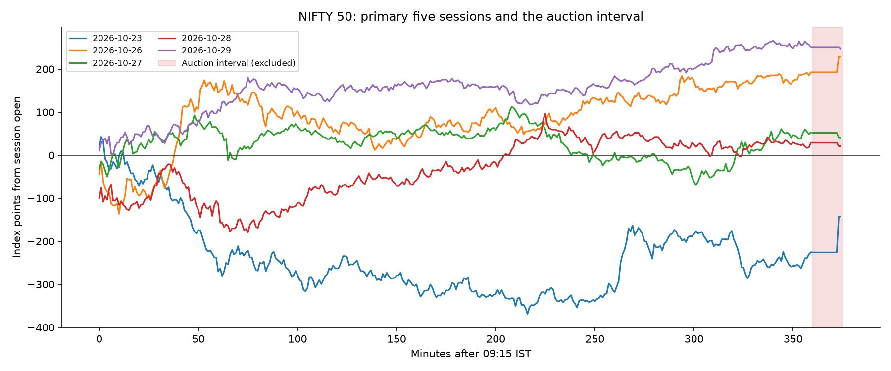
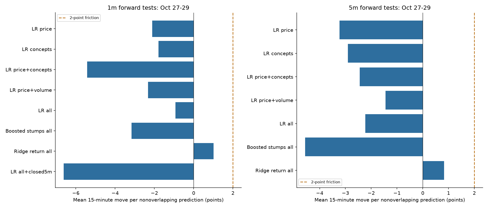

# NIFTY 50: all 47 concepts on 1-minute and 5-minute charts

## Scope and main conclusion

Research date: **29 October 2026, America/Los_Angeles**. Frozen decision cutoff: **30 October 2026, 05:16:12 UTC / 10:46:12 IST**. Instrument: `NSE_INDEX|Nifty 50`, the default instrument of this workspace’s 47-concept study.

The main window is **23–29 October 2026 inclusive**, seven completed calendar dates, containing **five trading sessions: 23, 26, 27, 28 and 29 October**. The seven-session sensitivity window adds 21 and 22 October. The ongoing 30 October session is excluded: it is incomplete, in a different market date, and not a comparable full-day test. This definition avoids silently calling five sessions seven trading days.

**Interpretation:** Results below test forward movement after a signal is observable. High event counts and a good fit to these few days do not establish a stable predictive edge. The strongest useful candidate must beat directional drift, survive later-day testing and still have positive movement after a stated cost assumption. All rules/model families are reported, including failures.

## Findings that matter

**No robust predictor was established.** None of the eligible directional concepts reaches BH-adjusted q<0.05 on either chart. The strongest gross mean among the tested ML models is 1.01 points on 1m (Ridge return all) and 0.83 on 5m (Ridge return all). All are negative under the illustrative 2-point friction. More labels and more model complexity did not establish a dependable advantage on this small history.

| Candidate / diagnostic | N15 | Win % | Mean pts | Matched excess pts | 7-session mean pts | q |
| --- | --- | --- | --- | --- | --- | --- |
| 1m #19 Trendline break | 54 | 68.5 | 7.80 | 7.23 | 6.86 | 0.453 |
| 1m #20 CHoCH | 37 | 59.5 | 12.52 | 2.72 | 9.56 | 0.408 |
| 1m #42 BOS | 53 | 58.5 | 10.09 | -4.37 | 10.99 | 0.734 |
| 1m #13 Breakout + retest | 31 | 51.6 | 9.40 | 4.24 | 2.36 | 0.697 |
| 5m #47 Mitigation / retest | 43 | 60.5 | 8.95 | 6.04 | 5.19 | 0.929 |
| 5m #33 Pullback to resistance | 7 | 85.7 | 10.79 | 15.38 | 11.42 | 0.929 |
| 5m #39 Opening range breakout | 6 | 66.7 | 34.75 | -10.55 | 22.11 | 0.756 |
| 5m #46 Displacement | 11 | 18.2 | -17.03 | -20.53 | -12.95 | 0.944 |

**1. The clearest 1m candidate is a confirmed trendline break (#19), with CHoCH (#20) a second research candidate.** #19 has 54 nonoverlapping observations, 68.5% directional wins, +7.80 points at 15 minutes and +7.23 versus the matched directional/time baseline. All five daily means are positive, and the seven-session mean remains +6.86. Its 5-minute future mean is only +1.59 points; its final-day mean is +4.38, which does not cover the 5-point cost assumption. These are research positives with q=0.453, not a validated edge.

#20 CHoCH has +12.52 points at 15 minutes and +17.42 at 30 minutes, versus −2.52 points in the separately resampled 5-minute panel. Those panels use different events. **On the same 37-event cohort**, its forward means are **+0.92 at 5 minutes, +12.52 at 15, and +22.44 at 30**.ln move. All five daily gross means are positive, but the final day is only +2.43 points and its matched excess is negative that day. Calling it an early entry without allowing adverse movement would overstate the evidence. CHoCH does not transfer to 5m here: that chart’s 15-minute result is −4.32 points from seven observations.

**2. A positive raw return often describes the prevailing market drift.** On 1m, BOS (#42) averages +10.09 points and is positive on all five days, yet its matched excess is **−4.37 points**. The simple retest+EMA rule averages +8.10 points but has −3.99 matched excess. A label can be associated with a rising/falling market without selecting better moments within that market.

**3. On 5m, zone mitigation/retest (#47) is worth further study, but its apparent edge is fragile.** It has 43 independent observations, 60.5% wins, +8.95 points and +6.04 matched excess; its seven-session mean falls to +5.19. The primary daily means are +33.48, −0.41, −11.99, +1.06 and +16.99 points. October 23 contributes more than the entire pooled gain, so the leave-one-day-out result matters. Pullback to resistance (#33) has an eye-catching 85.7% win rate, but only seven observations. That is too little to rank confidently above the larger samples.

**4. Avoid automatically chasing displacement or counting FVG as continuation confirmation.** 1m displacement (#46) averages −1.68 points after confirmation; 5m displacement averages **−17.03** (11 observations), with a positive daily mean on only one day. Fading that 5m displacement reverses the full-sample result to +17.03, but the single final-day fade loses 7 points. This is a small-sample exhaustion hypothesis, not evidence for an automatic countertrend strategy. Standalone FVG is approximately flat on 1m (+0.30 points), and its 5m +3.95 points is −9.41 versus matched drift.

**5. Extra volume confirmation did not improve direction.** On 1m, structure/setup+EMA averages +7.30 points; requiring ETF RVOL≥1.5 reduces that to +7.15, and also requiring signed ETF volume reduces it to +5.79. On 5m the same sequence is −2.07, −4.72 and −15.30 points. The logistic ablation also fails to show a reliable directional improvement from volume. RVOL may still help describe activity/movement size: 5m high-RVOL observations have a 44.4% chance of a terminal move ≥1 chart ATR versus 38.3% for the baseline and 25.3% for low RVOL. See the time-matched table for the excess after controlling session and half-hour. This is an exploratory magnitude observation, not a direction signal.

**6. Generic multi-timeframe agreement did not improve this sample’s simple setup rule.** The 1m setup+both-EMA-trends rule averages −0.96 points, versus +7.30 for setup+1m EMA alone. Adding closed-5m features changes the full logistic model’s mean forward movement from -0.93 to -6.61 points. A slower confirming chart can arrive after much of the opportunity; do not assume agreement must improve an early indicator.

**7. Opening-range breakout looks impressive because of very few opportunities and a large day.** Its 15-minute means are +32.93 points on 1m (seven independent observations) and +34.75 on 5m (six). The 5m result includes a +132.80-point observation on October 26. Its matched excess is negative, and the final-day result is −2.20 points. There is no basis here for treating that high average as a stable opening edge.

**8. ML did not establish a dependable forward improvement.** On October 27–29, always predicting up achieves 57.7% bar accuracy on 1m and 54.1% on 5m, with 4.81/4.64 gross points per nonoverlapping 15-minute interval. The best observed ML accuracy is 49.5% on 1m and 50.2% on 5m. The seven-session sensitivity and a training-only expanding-prior probability baseline are also reported. AUC improvements without positive net movement do not establish a usable rule. Always-up itself is a hindsight benchmark for these dates, not a recommended strategy.

**9. The most interesting narrow combination is 1m trendline break + same-side EMA9/21 alignment.** In the additional post-selection check, it produces 24 nonoverlapping observations, 70.8% wins and +11.26 gross points over 15 minutes, compared with +7.80 for the unfiltered concept. Matched excess is +3.52 points. The development mean is +12.64 (N=16), and October 29 is +8.51 (N=8). It is positive on only three of five days; its matched excess is lower than the unfiltered concept. This is a concrete candidate for a later frozen test, not proof the filter improves generalization. Requiring recent CHoCH as a second vote instead performs poorly. On 5m, zone revisit + EMA alignment increases the raw mean to +10.20 points (N=32), with +6.76 matched excess, but is likewise positive on only three days and heavily influenced by October 23. These extra rules are not covered by the concept q-values.

**Practical answer:** prioritize testing 1m #19, including the narrow EMA-alignment variant, and track #20 separately as a slower-reversal candidate. Treat 5m #47 as a more fragile conditional zone reaction. Use candle-close confirmation and known levels, measure the subsequent 15–30 minute path, and record volume as context. This sample supports rejecting an all-47 composite or mandatory volume/5m-agreement filter more strongly than it supports a deployable entry system.

## Data audit

| Session IST | 1m bars | 5m derived / native | Open | 15:15 value | Final value | Continuous change | Auction change |
| --- | --- | --- | --- | --- | --- | --- | --- |
| 2026-10-21 | 375 | 75 / 75 | 23016.00 | 22739.20 | 22811.35 | -276.80 | 72.15 |
| 2026-10-22 | 375 | 75 / 75 | 22687.75 | 22667.25 | 22687.65 | -20.50 | 20.40 |
| 2026-10-23 | 375 | 75 / 75 | 22742.20 | 22517.00 | 22600.00 | -225.20 | 83.00 |
| 2026-10-26 | 375 | 75 / 75 | 22524.40 | 22717.05 | 22753.20 | 192.65 | 36.15 |
| 2026-10-27 | 375 | 75 / 75 | 22708.80 | 22762.00 | 22749.75 | 53.20 | -12.25 |
| 2026-10-28 | 375 | 75 / 0 | 22678.00 | 22707.20 | 22698.85 | 29.20 | -8.35 |
| 2026-10-29 | 375 | 75 / 75 | 22690.65 | 22940.75 | 22936.75 | 250.10 | -4.00 |

The source has 375 one-minute bars per full session (09:15–15:29), including the final auction-related interval. Main analysis uses **09:15–15:15**, and each forward holding period must finish by 15:15. The full 09:15–15:30 window is a sensitivity check. NSE’s schedule places CAS for eligible cash stocks from 15:15, with order matching following random order-entry closure. Index levels in that interval therefore need different interpretation from continuous price discovery. [NSE CAS schedule](https://www.nseindia.com/static/products-services/closing-auction-session).

Five-minute candles are rebuilt from exactly five consecutive one-minute bars, aligned at 09:15. This gives the same underlying observations for both timeframes and does not treat them as independent datasets. Native five-minute candles were also retrieved and compared:

| Field | Compared bars | Differences >0.011 points | Maximum difference |
| --- | --- | --- | --- |
| open | 525 | 0 | 0.0000 |
| high | 525 | 0 | 0.0000 |
| low | 525 | 0 | 0.0000 |
| close | 525 | 0 | 0.0000 |

| Session | Daily reference used by production study | Most recent prior intraday session | Reference stale? |
| --- | --- | --- | --- |
| 2026-10-21 | 2026-10-19 | 2026-10-19 | False |
| 2026-10-22 | 2026-10-21 | 2026-10-21 | False |
| 2026-10-23 | 2026-10-22 | 2026-10-22 | False |
| 2026-10-26 | 2026-10-23 | 2026-10-23 | False |
| 2026-10-27 | 2026-10-26 | 2026-10-26 | False |
| 2026-10-28 | 2026-10-27 | 2026-10-27 | False |
| 2026-10-29 | 2026-10-28 | 2026-10-28 | False |

The production study’s daily references are retained as supplied. No same-day/future daily high or low enters features. If a daily reference is older than the preceding intraday session, PDH/PDL-dependent results inherit that limitation. An alternate prior-session-extrema run below checks the effect; those extrema are research references, not a replacement for an official missing daily bar.

### Volume availability

NIFTY index candles have **0 positive volume readings** in the fetched sample. Index zero volume is unavailable traded volume, not evidence that buying or selling stopped. Index VWAP/OBV/volume breakout claims would be invalid here.

| Traded proxy | Main-window bars | Positive volume | Zero volume | Missing volume |
| --- | --- | --- | --- | --- |
| NIFTYBEES | 1875 | 1875 | 0 | 0 |
| RELIANCE | 1875 | 1805 | 70 | 0 |
| HDFCBANK | 1875 | 1805 | 70 | 0 |
| ICICIBANK | 1875 | 1805 | 70 | 0 |

Volume inputs are **NIFTYBEES ETF volume**, plus separate RELIANCE, HDFCBANK and ICICIBANK volume/returns. The three-stock basket is an equal average of each stock’s normalized volume, not index volume or a complete breadth measure. NIFTYBEES identity is verified by its ISIN `INF204KB14I2`. [NSE instrument page](https://www.nseindia.com/get-quote/equity/NIFTYBEES/Nippon-India-ETF-Nifty-50-BeES).

RVOL = current bar volume / median of the preceding 20 minutes’ bars (at least three previous bars). It is not time-of-day-normalized historical relative volume. Signed volume uses candle direction; it is not aggressor-side order flow. Proxy VWAP uses that proxy’s own typical price and volume. All proxies align by timestamp and become available only at their candle close.

## Experimental design

1. Recompute the existing `price_action.analyze` engine separately for every session and timeframe: default ORB 15 minutes, round-number step 100. Use events’ `known_at`, not a pivot’s original timestamp. Study parameters are unchanged.
2. Enter at the **next candle open**, then measure its closing price after **5, 15 or 30 elapsed minutes**. No overnight labels; all main labels end by 15:15. Current trigger-candle movement is excluded from future return.
3. Main table uses 15 minutes as a common horizon across timeframes. Directional accuracy is signed return >0; zero return is not a win. Return is index points, with a separate ATR normalization.
4. Keep one observation per holding window per strategy/concept/session. Raw event counts are also shown. Signals sharing a candle are not independent trades; opposite directions on one candle cancel.
5. Compare to same-side, same-session, same-half-hour mean forward movement, and to always-up/down and simple momentum/fade baselines. The matched baseline is retrospective diagnostic context, never a live feature.
6. Fit models on prior sessions only. The first two primary sessions train the first fold; 27, 28 and 29 October are forward tests. Whole-session boundaries prevent training labels from overlapping a later test day. Imputation, means and scales come only from training data.
7. Feature families: price/ATR, EMA9/21, RSI, compression, known level distances and time of day; recent bullish/bearish/neutral concept channels; traded-proxy volume, returns and VWAP; and, for 1m, the latest **fully closed** 5m context. Event memory is five minutes (five 1m bars or one 5m bar), not five bars on both charts.
8. Fixed model settings: L2 logistic regression (mean-loss penalty 0.20); 60 boosted decision stumps, learning rate 0.08, minimum leaf max(15,5% training rows), leaf curvature penalty 5; ridge forward-return regression (penalty 0.50) with sigmoid-scaled score. No hyperparameter search. Ridge scores are ranking scores rather than calibrated probabilities.
9. Subtract **2 and 5 index points per completed observation** as illustrative round-trip friction. These are sensitivity assumptions, not a broker fee model or an executable index fill. Futures/ETF basis and option Greeks are not modeled.
10. Directional concept significance uses 499 within-session circular shifts of the return sequence; BH correction covers concepts with ≥5 independent 15m observations within each timeframe. Other horizons, rule variants and model comparisons are exploratory and are not covered by that correction.

**Causality verification:** 48/48 real-session prefix checks passed: adding later candles did not change earlier confirmed events. Production timing fixtures were also run separately. Technical ATR reference uses the preceding 14 continuous-session true ranges, with first-session bars warmed from earlier sessions, overnight gaps excluded from true range, and auction bars excluded from the warm-up. Production event ATR remains session-local and therefore has its own warm-up. Historical candles are assumed observable at their close; provider publication latency, revisions and live fill availability were not measured.

**Uncertainty:** Independent observations within a session are still correlated. Wilson intervals below describe binomial sampling only and likely understate regime uncertainty. Five primary days cannot support a reliable long-run confidence interval, nor a strong claim about significance from hundreds of inspected alternatives.

## 1-minute results

### Complete 47-concept inventory

`Events` counts all detected directions and neutral annotations; `N15` removes conflicting directions, late/invalid labels and overlapping holding windows. Continuous references have no standalone directional event. Their distances are present in price features. A zero means no usable evidence under the current rule, not proof that the market concept does not exist.

| # | Concept | Events ↑/↓/0 | N15 | Win % | 95% Wilson % | Mean pts | Matched excess pts | Mean 5m / 30m pts | q15 |
| --- | --- | --- | --- | --- | --- | --- | --- | --- | --- |
| 1 | HH / HL | 211/0/0 | 76 | 53.9 | 42.8–64.7 | 2.57 | -1.72 | 0.88 / 7.11 | 0.810 |
| 2 | LH / LL | 0/180/0 | 68 | 47.1 | 35.7–58.8 | 0.46 | -2.06 | 1.75 / 1.25 | 0.810 |
| 3 | Sideways range | 0/0/509 | 0 | — | — | — | — | — / — | — |
| 4 | Support | 40/0/0 | 28 | 46.4 | 29.5–64.2 | -0.20 | -4.04 | 0.88 / 2.91 | 0.890 |
| 5 | Resistance | 0/42/0 | 27 | 44.4 | 27.6–62.7 | -3.09 | -2.06 | -1.45 / 1.14 | 0.810 |
| 6 | Support / resistance flip | 61/50/0 | 53 | 56.6 | 43.3–69.0 | 6.95 | -1.85 | 2.73 / 7.06 | 0.805 |
| 7 | Previous day high | 0/0/0 | 0 | — | — | — | — | — / — | — |
| 8 | Previous day low | 0/0/0 | 0 | — | — | — | — | — / — | — |
| 9 | Day high / low | 0/0/0 | 0 | — | — | — | — | — / — | — |
| 10 | Equal highs / lows | 40/42/0 | 39 | 35.9 | 22.7–51.6 | -3.99 | -4.96 | -2.94 / 4.28 | 0.836 |
| 11 | Liquidity sweep | 21/20/0 | 31 | 38.7 | 23.7–56.2 | -8.02 | -2.64 | -4.18 / -13.40 | 0.862 |
| 12 | Psychological levels | 0/0/0 | 0 | — | — | — | — | — / — | — |
| 13 | Breakout + retest | 61/0/0 | 31 | 51.6 | 34.8–68.0 | 9.40 | 4.24 | 2.23 / 6.52 | 0.697 |
| 14 | Breakdown + retest | 0/50/0 | 33 | 63.6 | 46.6–77.8 | 3.66 | -4.82 | 1.57 / 6.33 | 0.810 |
| 15 | False breakout / breakdown | 18/19/0 | 30 | 43.3 | 27.4–60.8 | -2.82 | 1.79 | 2.41 / 1.17 | 0.836 |
| 16 | Double top / bottom | 9/8/0 | 13 | 53.8 | 29.1–76.8 | -1.65 | -8.36 | 0.97 / 6.42 | 0.821 |
| 17 | Head and shoulders | 0/5/0 | 4 | 50.0 | 15.0–85.0 | -1.79 | -0.61 | 6.38 / -17.61 | — |
| 18 | Inverse head and shoulders | 7/0/0 | 7 | 42.9 | 15.8–75.0 | 8.25 | -5.95 | 10.75 / 22.22 | 0.810 |
| 19 | Trendline break | 45/41/0 | 54 | 68.5 | 55.3–79.3 | 7.80 | 7.23 | 1.59 / 2.96 | 0.453 |
| 20 | CHoCH | 25/29/0 | 37 | 59.5 | 43.5–73.7 | 12.52 | 2.72 | -2.52 / 17.42 | 0.408 |
| 21 | Bullish engulfing | 14/0/0 | 11 | 54.5 | 28.0–78.7 | 6.37 | -2.81 | 11.67 / 36.78 | 0.810 |
| 22 | Bearish engulfing | 0/139/0 | 69 | 49.3 | 37.8–60.8 | -1.96 | 0.84 | -0.26 / -2.47 | 0.810 |
| 23 | Hammer | 78/0/0 | 46 | 63.0 | 48.6–75.5 | 4.40 | 3.68 | -0.36 / 6.94 | 0.810 |
| 24 | Shooting star | 0/46/0 | 32 | 46.9 | 30.9–63.6 | 0.57 | 10.78 | -1.47 / -8.62 | 0.810 |
| 25 | Doji | 0/0/149 | 0 | — | — | — | — | — / — | — |
| 26 | Inside bar | 0/0/191 | 0 | — | — | — | — | — / — | — |
| 27 | Outside bar | 81/98/1 | 77 | 51.9 | 41.0–62.7 | 0.65 | -1.43 | -0.15 / 2.84 | 0.810 |
| 28 | Marubozu | 26/150/0 | 69 | 49.3 | 37.8–60.8 | 2.48 | 1.31 | -0.02 / -1.01 | 0.810 |
| 29 | Morning star | 22/0/0 | 16 | 43.8 | 23.1–66.8 | -2.75 | 0.09 | -6.70 / -2.36 | 0.821 |
| 30 | Evening star | 0/11/0 | 11 | 45.5 | 21.3–72.0 | -26.98 | -9.14 | -13.22 / -44.02 | 0.994 |
| 31 | Pin bar / rejection | 85/48/0 | 63 | 52.4 | 40.3–64.2 | -0.07 | 2.60 | -0.35 / 15.98 | 0.810 |
| 32 | Pullback to support | 46/0/0 | 28 | 53.6 | 35.8–70.5 | -1.60 | -2.80 | -0.62 / -2.27 | 0.921 |
| 33 | Pullback to resistance | 0/37/0 | 24 | 41.7 | 24.5–61.2 | 0.39 | 0.62 | -0.10 / -10.77 | 0.810 |
| 34 | Bull flag | 0/0/0 | 0 | — | — | — | — | — / — | — |
| 35 | Bear flag | 0/0/0 | 0 | — | — | — | — | — / — | — |
| 36 | Ascending triangle | 3/0/0 | 3 | 33.3 | 6.1–79.2 | -1.12 | -15.29 | -15.75 / 8.43 | — |
| 37 | Descending triangle | 0/1/0 | 1 | 100.0 | 20.7–100.0 | 11.10 | 5.43 | 19.60 / -6.95 | — |
| 38 | Symmetrical triangle | 0/0/0 | 0 | — | — | — | — | — / — | — |
| 39 | Opening range breakout | 4/3/0 | 7 | 57.1 | 25.0–84.2 | 32.93 | -4.54 | 4.16 / 39.51 | 0.408 |
| 40 | Momentum breakout | 13/20/0 | 25 | 40.0 | 23.4–59.3 | 1.65 | -7.36 | 3.02 / 3.27 | 0.810 |
| 41 | Compression / expansion | 22/33/179 | 36 | 50.0 | 34.5–65.5 | 1.87 | -4.05 | 4.07 / -8.33 | 0.810 |
| 42 | BOS | 40/34/0 | 53 | 58.5 | 45.1–70.7 | 10.09 | -4.37 | 3.55 / 17.37 | 0.734 |
| 43 | Order block candidate | 11/17/0 | 22 | 40.9 | 23.3–61.3 | 4.03 | -5.30 | 1.88 / 1.87 | 0.810 |
| 44 | Fair value gap | 261/226/0 | 96 | 41.7 | 32.3–51.7 | 0.30 | -3.94 | 0.82 / 3.81 | 0.810 |
| 45 | Supply / demand candidate | 39/61/0 | 58 | 44.8 | 32.7–57.5 | -1.99 | -3.33 | -1.19 / -10.91 | 0.821 |
| 46 | Displacement | 43/69/0 | 59 | 45.8 | 33.7–58.3 | -1.68 | -5.72 | 0.01 / -7.16 | 0.821 |
| 47 | Mitigation / retest | 259/256/0 | 100 | 46.0 | 36.6–55.7 | 3.68 | 1.69 | 1.98 / -9.38 | 0.810 |

### Candidate concepts with at least eight independent observations

| Concept | N15 / days | Win % | Mean / net2 / net5 pts | Matched excess | Positive days | TP-first / SL-first % |
| --- | --- | --- | --- | --- | --- | --- |
| 24. Shooting star | 32 / 5 | 46.9 | 0.57 / -1.43 / -4.43 | 10.78 | 3/5 | 40.6 / 59.4 |
| 19. Trendline break | 54 / 5 | 68.5 | 7.80 / 5.80 / 2.80 | 7.23 | 5/5 | 59.3 / 40.7 |
| 13. Breakout + retest | 31 / 5 | 51.6 | 9.40 / 7.40 / 4.40 | 4.24 | 4/5 | 48.4 / 48.4 |
| 23. Hammer | 46 / 5 | 63.0 | 4.40 / 2.40 / -0.60 | 3.68 | 3/5 | 56.5 / 43.5 |
| 20. CHoCH | 37 / 5 | 59.5 | 12.52 / 10.52 / 7.52 | 2.72 | 5/5 | 64.9 / 35.1 |
| 31. Pin bar / rejection | 63 / 5 | 52.4 | -0.07 / -2.07 / -5.07 | 2.60 | 3/5 | 50.8 / 49.2 |
| 15. False breakout / breakdown | 30 / 5 | 43.3 | -2.82 / -4.82 / -7.82 | 1.79 | 2/5 | 70.0 / 30.0 |
| 47. Mitigation / retest | 100 / 5 | 46.0 | 3.68 / 1.68 / -1.32 | 1.69 | 3/5 | 48.0 / 51.0 |
| 28. Marubozu | 69 / 5 | 49.3 | 2.48 / 0.48 / -2.52 | 1.31 | 1/5 | 60.9 / 39.1 |
| 22. Bearish engulfing | 69 / 5 | 49.3 | -1.96 / -3.96 / -6.96 | 0.84 | 2/5 | 65.2 / 33.3 |

TP/SL diagnostic: ±1 ATR from next-bar open, first hit within 15 minutes; an ambiguous candle hitting both is counted as an adverse hit. Neither-hit observations remain in the denominator. This is a path diagnostic, not a full stop/target P&L backtest.

### Fixed signal combinations and later-day check

Rules use recent five-minute signals and the current EMA sign. `Dev` is 23–28 October; 29 October is a separately shown final-day check. Rule results and rankings were inspected after the full experiment, so the final-day column is a temporal diagnostic, not an untouched lockbox for the entire research process.

| Rule | All N / win % | All mean / excess pts | Dev N / mean | 29 Oct N / mean | 7-session mean |
| --- | --- | --- | --- | --- | --- |
| EMA9/21 trend | 115 / 53.0 | 4.28 / -2.80 | 92 / 3.41 | 23 / 7.79 | 5.23 |
| 3-bar continuation | 115 / 50.4 | 0.87 / -1.56 | 92 / 0.75 | 23 / 1.33 | -0.66 |
| 3-bar fade | 115 / 49.6 | -0.87 / 1.56 | 92 / -0.75 | 23 / -1.33 | 0.66 |
| Retest + EMA alignment | 54 / 55.6 | 8.10 / -3.99 | 46 / 8.29 | 8 / 7.00 | 5.61 |
| Retest against EMA | 22 / 54.5 | 2.59 / 4.16 | 20 / 1.53 | 2 / 13.17 | 3.40 |
| Sweep/failed break/CHoCH + EMA alignment | 46 / 47.8 | 2.82 / -5.81 | 43 / 2.33 | 3 / 9.83 | 0.81 |
| Displacement family + EMA alignment | 50 / 50.0 | 4.20 / -7.27 | 42 / 2.85 | 8 / 11.28 | -0.33 |
| Displacement family fade | 65 / 53.8 | 0.15 / 4.74 | 54 / -0.75 | 11 / 4.55 | 3.59 |
| FVG + EMA alignment | 96 / 56.2 | 7.04 / -2.63 | 78 / 6.30 | 18 / 10.26 | 6.81 |
| Structure/setup + EMA alignment | 102 / 57.8 | 7.30 / -2.13 | 81 / 6.96 | 21 / 8.63 | 8.15 |
| Structure/setup + EMA + ETF RVOL>=1.5 | 79 / 59.5 | 7.15 / -5.06 | 62 / 7.00 | 17 / 7.69 | 6.10 |
| Structure/setup + EMA + signed ETF volume | 68 / 61.8 | 5.79 / -6.10 | 51 / 4.37 | 17 / 10.08 | 5.93 |
| EMA + signed ETF RVOL>=1.5 | 82 / 59.8 | 5.25 / -5.43 | 64 / 4.97 | 18 / 6.26 | 6.56 |
| Compression break direction | 36 / 47.2 | -0.10 / -5.25 | 31 / -1.07 | 5 / 5.92 | -3.42 |
| 1m setup + both EMA trends | 78 / 51.3 | -0.96 / -8.57 | 61 / -3.37 | 17 / 7.71 | 1.12 |
| Both EMA trends + signed ETF RVOL>=1.5 | 58 / 55.2 | 1.83 / -9.05 | 45 / 0.89 | 13 / 5.08 | 1.48 |

### Predicting movement size, separately from direction

| Condition | N15 nonoverlap | P(abs net move ≥1 ATR) % | Mean abs pts | Mean abs ATR |
| --- | --- | --- | --- | --- |
| All eligible bars | 115 | 71.3 | 27.61 | 2.24 |
| Prior 5-bar compression <=2 ATR | 93 | 68.8 | 28.17 | 2.21 |
| Current range >=1.5 ATR | 72 | 73.6 | 26.34 | 2.45 |
| ETF RVOL >=1.5 | 94 | 63.8 | 24.36 | 1.91 |
| ETF RVOL <1 | 107 | 64.5 | 27.10 | 2.13 |
| EMA separation >=0.5 ATR | 91 | 62.6 | 24.16 | 1.94 |
| Concept 3: Sideways range | 79 | 65.8 | 28.03 | 2.20 |
| Concept 25: Doji | 66 | 63.6 | 25.89 | 1.94 |
| Concept 26: Inside bar | 81 | 65.4 | 28.15 | 2.24 |
| Concept 41: Compression / expansion | 82 | 68.3 | 28.00 | 2.27 |

A large-move condition is not itself a bullish or bearish prediction. The target is the absolute terminal 15-minute move, not merely a wick that touched a barrier.

### Forward model comparisons

All model rows below use forward test days **2026-10-27, 2026-10-28, 2026-10-29**. Directional metrics use every eligible nonzero-return bar and therefore have overlapping labels; point results use one position at a time. AUC measures ranking, Brier measures squared probability error (lower is better). Different models share the same observations.

| Model / baseline | Bar N | Accuracy % | Balanced % | AUC | Brier | Independent N | Mean / net2 / net5 pts |
| --- | --- | --- | --- | --- | --- | --- | --- |
| Always up | 1035 | 57.7 | 50.0 | 0.500 | 0.422 | 69 | 4.81 / 2.81 / — |
| Always down | 1035 | 42.3 | 50.0 | 0.500 | 0.576 | 69 | -4.81 / -6.81 / — |
| EMA direction | 1035 | 54.3 | 52.0 | 0.520 | 0.273 | 69 | 2.57 / 0.57 / — |
| 3-bar continuation | 1035 | 49.1 | 48.6 | 0.486 | 0.294 | 69 | -3.62 / -5.62 / — |
| 3-bar fade | 1035 | 50.9 | 51.4 | 0.514 | 0.286 | 69 | 3.62 / 1.62 / — |
| Expanding prior up rate | 1035 | 52.3 | 54.9 | 0.566 | 0.251 | 69 | 1.00 / -1.00 / -4.00 |
| Logistic price | 1035 | 44.9 | 46.6 | 0.481 | 0.280 | 69 | -2.11 / -4.11 / -7.11 |
| Logistic concepts | 1035 | 49.5 | 51.5 | 0.526 | 0.260 | 69 | -1.79 / -3.79 / -6.79 |
| Logistic price+concepts | 1035 | 47.1 | 49.9 | 0.496 | 0.284 | 69 | -5.42 / -7.42 / -10.42 |
| Logistic price+volume | 1035 | 44.3 | 48.0 | 0.496 | 0.284 | 69 | -2.32 / -4.32 / -7.32 |
| Logistic all | 1035 | 46.0 | 49.4 | 0.509 | 0.287 | 69 | -0.93 / -2.93 / -5.93 |
| Boosted stumps all | 1035 | 42.7 | 46.5 | 0.483 | 0.281 | 69 | -3.16 / -5.16 / -8.16 |
| Ridge return all | 1035 | 49.3 | 53.8 | 0.554 | 0.341 | 69 | 1.01 / -0.99 / -3.99 |
| Logistic all+closed5m | 1035 | 44.4 | 47.5 | 0.502 | 0.289 | 69 | -6.61 / -8.61 / -11.61 |

| Model | Final 29 Oct accuracy % / AUC | Positive P&L days | Confidence ≥60% N / mean pts | Seven-session forward accuracy % / mean pts |
| --- | --- | --- | --- | --- |
| Logistic price | 35.1 / 0.664 | 1/3 | 44 / -4.75 | 44.4 / -2.77 |
| Logistic concepts | 43.2 / 0.439 | 0/3 | 52 / 2.01 | 48.8 / -3.50 |
| Logistic price+concepts | 37.1 / 0.534 | 0/3 | 59 / -4.54 | 48.2 / -4.21 |
| Logistic price+volume | 35.1 / 0.616 | 1/3 | 51 / -4.47 | 43.7 / -3.87 |
| Logistic all | 37.4 / 0.525 | 1/3 | 63 / -0.02 | 47.3 / -4.26 |
| Boosted stumps all | 35.1 / 0.574 | 1/3 | 42 / -4.78 | 46.2 / -3.20 |
| Ridge return all | 35.1 / 0.529 | 2/3 | 69 / 3.39 | 49.4 / -3.36 |
| Logistic all+closed5m | 36.5 / 0.543 | 0/3 | 62 / -1.54 | 47.7 / -3.99 |

Confidence ≥60% is a fixed score filter; calibration is not established on five days. It is especially not a calibrated probability for ridge. Seven-session model comparisons test additional folds as well as supplying additional training data, so they are not an identical test sample.

### What changes with auction inclusion and reference choice

| Concept | Main N / mean | Through 15:30 N / mean | Prior-intraday-reference N / mean |
| --- | --- | --- | --- |
| 6. Support / resistance flip | 53 / 6.95 | 57 / 5.68 | 53 / 6.95 |
| 11. Liquidity sweep | 31 / -8.02 | 31 / -8.02 | 31 / -8.02 |
| 13. Breakout + retest | 31 / 9.40 | 34 / 8.98 | 31 / 9.40 |
| 14. Breakdown + retest | 33 / 3.66 | 37 / 1.81 | 33 / 3.66 |
| 15. False breakout / breakdown | 30 / -2.82 | 31 / -3.40 | 30 / -2.82 |
| 20. CHoCH | 37 / 12.52 | 41 / 10.42 | 37 / 12.52 |
| 39. Opening range breakout | 7 / 32.93 | 7 / 32.93 | 7 / 32.93 |
| 42. BOS | 53 / 10.09 | 53 / 10.09 | 53 / 10.09 |
| 44. Fair value gap | 96 / 0.30 | 99 / 0.10 | 96 / 0.30 |
| 46. Displacement | 59 / -1.68 | 63 / -2.13 | 59 / -1.68 |
| 47. Mitigation / retest | 100 / 3.68 | 103 / 3.23 | 100 / 3.68 |

Auction-inclusive figures are a contamination check, not the preferred estimate. Alternate-reference run uses the previous completed intraday session’s extrema and last value. All other settings are unchanged.

## 5-minute results

### Complete 47-concept inventory

`Events` counts all detected directions and neutral annotations; `N15` removes conflicting directions, late/invalid labels and overlapping holding windows. Continuous references have no standalone directional event. Their distances are present in price features. A zero means no usable evidence under the current rule, not proof that the market concept does not exist.

| # | Concept | Events ↑/↓/0 | N15 | Win % | 95% Wilson % | Mean pts | Matched excess pts | Mean 5m / 30m pts | q15 |
| --- | --- | --- | --- | --- | --- | --- | --- | --- | --- |
| 1 | HH / HL | 48/0/0 | 32 | 50.0 | 33.6–66.4 | 4.68 | -2.07 | 0.27 / 16.50 | 0.929 |
| 2 | LH / LL | 0/30/0 | 24 | 45.8 | 27.9–64.9 | -5.51 | -8.63 | 2.59 / -7.68 | 0.929 |
| 3 | Sideways range | 0/0/93 | 0 | — | — | — | — | — / — | — |
| 4 | Support | 2/0/0 | 2 | 50.0 | 9.5–90.5 | -11.23 | -12.00 | -17.90 / -8.65 | — |
| 5 | Resistance | 0/6/0 | 3 | 33.3 | 6.1–79.2 | -5.72 | 3.76 | -6.79 / -36.72 | — |
| 6 | Support / resistance flip | 18/10/0 | 21 | 47.6 | 28.3–67.6 | 5.71 | -4.58 | -2.79 / 11.39 | 0.929 |
| 7 | Previous day high | 0/0/0 | 0 | — | — | — | — | — / — | — |
| 8 | Previous day low | 0/0/0 | 0 | — | — | — | — | — / — | — |
| 9 | Day high / low | 0/0/0 | 0 | — | — | — | — | — / — | — |
| 10 | Equal highs / lows | 2/6/0 | 5 | 40.0 | 11.8–76.9 | -7.92 | -2.55 | -10.49 / -25.49 | 0.929 |
| 11 | Liquidity sweep | 13/13/0 | 24 | 58.3 | 38.8–75.5 | -7.01 | 2.66 | -10.56 / -19.06 | 0.929 |
| 12 | Psychological levels | 0/0/0 | 0 | — | — | — | — | — / — | — |
| 13 | Breakout + retest | 18/0/0 | 13 | 53.8 | 29.1–76.8 | 10.03 | 1.37 | -0.41 / 15.93 | 0.929 |
| 14 | Breakdown + retest | 0/10/0 | 9 | 44.4 | 18.9–73.3 | 4.02 | -9.57 | -6.83 / 0.86 | 0.929 |
| 15 | False breakout / breakdown | 5/6/0 | 11 | 54.5 | 28.0–78.7 | 0.27 | 2.56 | 6.37 / 1.06 | 0.929 |
| 16 | Double top / bottom | 0/0/0 | 0 | — | — | — | — | — / — | — |
| 17 | Head and shoulders | 0/0/0 | 0 | — | — | — | — | — / — | — |
| 18 | Inverse head and shoulders | 0/0/0 | 0 | — | — | — | — | — / — | — |
| 19 | Trendline break | 10/9/0 | 17 | 41.2 | 21.6–64.0 | -9.66 | -13.45 | -10.42 / -9.31 | 0.929 |
| 20 | CHoCH | 5/2/0 | 7 | 42.9 | 15.8–75.0 | -4.32 | -9.79 | -3.99 / -4.10 | 0.929 |
| 21 | Bullish engulfing | 3/0/0 | 1 | 100.0 | 20.7–100.0 | 17.55 | 16.67 | 20.95 / 33.10 | — |
| 22 | Bearish engulfing | 0/26/0 | 25 | 60.0 | 40.7–76.6 | 4.59 | 0.18 | 4.90 / 1.88 | 0.929 |
| 23 | Hammer | 16/0/0 | 12 | 41.7 | 19.3–68.0 | -7.65 | -2.80 | 0.38 / -5.34 | 0.929 |
| 24 | Shooting star | 0/9/0 | 8 | 37.5 | 13.7–69.4 | -10.60 | -0.66 | -5.49 / -16.50 | 0.929 |
| 25 | Doji | 0/0/28 | 0 | — | — | — | — | — / — | — |
| 26 | Inside bar | 0/0/44 | 0 | — | — | — | — | — / — | — |
| 27 | Outside bar | 18/17/0 | 26 | 42.3 | 25.5–61.1 | 1.95 | -4.26 | -1.03 / 6.98 | 0.929 |
| 28 | Marubozu | 12/18/0 | 22 | 31.8 | 16.4–52.7 | -5.81 | -14.86 | 1.84 / 0.31 | 0.929 |
| 29 | Morning star | 2/0/0 | 2 | 100.0 | 34.2–100.0 | 19.10 | 19.59 | 9.62 / 11.67 | — |
| 30 | Evening star | 0/1/0 | 1 | 0.0 | 0.0–79.3 | -16.35 | -15.47 | 1.30 / -29.65 | — |
| 31 | Pin bar / rejection | 16/12/0 | 20 | 50.0 | 29.9–70.1 | 5.00 | -1.48 | 4.68 / 4.38 | 0.929 |
| 32 | Pullback to support | 6/0/0 | 5 | 60.0 | 23.1–88.2 | 3.37 | 10.32 | 2.51 / -12.90 | 0.929 |
| 33 | Pullback to resistance | 0/7/0 | 7 | 85.7 | 48.7–97.4 | 10.79 | 15.38 | 1.62 / 7.00 | 0.929 |
| 34 | Bull flag | 0/0/0 | 0 | — | — | — | — | — / — | — |
| 35 | Bear flag | 0/0/0 | 0 | — | — | — | — | — / — | — |
| 36 | Ascending triangle | 1/0/0 | 0 | — | — | — | — | — / — | — |
| 37 | Descending triangle | 0/0/0 | 0 | — | — | — | — | — / — | — |
| 38 | Symmetrical triangle | 0/0/0 | 0 | — | — | — | — | — / — | — |
| 39 | Opening range breakout | 4/2/0 | 6 | 66.7 | 30.0–90.3 | 34.75 | -10.55 | 11.15 / 48.31 | 0.756 |
| 40 | Momentum breakout | 6/2/0 | 6 | 16.7 | 3.0–56.4 | -12.37 | -12.07 | 3.12 / -16.36 | 0.929 |
| 41 | Compression / expansion | 6/6/35 | 9 | 55.6 | 26.7–81.1 | 10.84 | 8.75 | 6.58 / 7.79 | 0.929 |
| 42 | BOS | 10/4/0 | 12 | 33.3 | 13.8–60.9 | -8.14 | -18.13 | 6.71 / 3.04 | 0.944 |
| 43 | Order block candidate | 6/2/0 | 6 | 16.7 | 3.0–56.4 | -12.37 | -12.07 | 3.12 / -16.36 | 0.929 |
| 44 | Fair value gap | 44/30/0 | 47 | 48.9 | 35.3–62.8 | 3.95 | -9.41 | -0.12 / 7.60 | 0.929 |
| 45 | Supply / demand candidate | 10/4/0 | 10 | 20.0 | 5.7–51.0 | -15.82 | -17.13 | -5.37 / -11.85 | 0.944 |
| 46 | Displacement | 11/4/0 | 11 | 18.2 | 5.1–47.7 | -17.03 | -20.53 | -7.02 / -13.63 | 0.944 |
| 47 | Mitigation / retest | 33/30/0 | 43 | 60.5 | 45.6–73.6 | 8.95 | 6.04 | 0.91 / 12.27 | 0.929 |

### Candidate concepts with at least eight independent observations

| Concept | N15 / days | Win % | Mean / net2 / net5 pts | Matched excess | Positive days | TP-first / SL-first % |
| --- | --- | --- | --- | --- | --- | --- |
| 41. Compression / expansion | 9 / 5 | 55.6 | 10.84 / 8.84 / 5.84 | 8.75 | 3/5 | 33.3 / 33.3 |
| 47. Mitigation / retest | 43 / 5 | 60.5 | 8.95 / 6.95 / 3.95 | 6.04 | 3/5 | 41.9 / 20.9 |
| 11. Liquidity sweep | 24 / 5 | 58.3 | -7.01 / -9.01 / -12.01 | 2.66 | 2/5 | 29.2 / 37.5 |
| 15. False breakout / breakdown | 11 / 5 | 54.5 | 0.27 / -1.73 / -4.73 | 2.56 | 3/5 | 27.3 / 45.5 |
| 13. Breakout + retest | 13 / 4 | 53.8 | 10.03 / 8.03 / 5.03 | 1.37 | 4/4 | 38.5 / 30.8 |
| 22. Bearish engulfing | 25 / 5 | 60.0 | 4.59 / 2.59 / -0.41 | 0.18 | 3/5 | 28.0 / 24.0 |
| 24. Shooting star | 8 / 3 | 37.5 | -10.60 / -12.60 / -15.60 | -0.66 | 1/3 | 0.0 / 37.5 |
| 31. Pin bar / rejection | 20 / 5 | 50.0 | 5.00 / 3.00 / 0.00 | -1.48 | 3/5 | 35.0 / 25.0 |
| 1. HH / HL | 32 / 5 | 50.0 | 4.68 / 2.68 / -0.32 | -2.07 | 4/5 | 28.1 / 25.0 |
| 23. Hammer | 12 / 5 | 41.7 | -7.65 / -9.65 / -12.65 | -2.80 | 1/5 | 33.3 / 50.0 |

TP/SL diagnostic: ±1 ATR from next-bar open, first hit within 15 minutes; an ambiguous candle hitting both is counted as an adverse hit. Neither-hit observations remain in the denominator. This is a path diagnostic, not a full stop/target P&L backtest.

### Fixed signal combinations and later-day check

Rules use recent five-minute signals and the current EMA sign. `Dev` is 23–28 October; 29 October is a separately shown final-day check. Rule results and rankings were inspected after the full experiment, so the final-day column is a temporal diagnostic, not an untouched lockbox for the entire research process.

| Rule | All N / win % | All mean / excess pts | Dev N / mean | 29 Oct N / mean | 7-session mean |
| --- | --- | --- | --- | --- | --- |
| EMA9/21 trend | 115 / 48.7 | -0.49 / -3.41 | 92 / -1.72 | 23 / 4.46 | -1.06 |
| 3-bar continuation | 110 / 49.1 | 2.14 / -3.81 | 88 / 2.80 | 22 / -0.48 | 1.21 |
| 3-bar fade | 110 / 50.9 | -2.14 / 3.81 | 88 / -2.80 | 22 / 0.48 | -1.21 |
| Retest + EMA alignment | 17 / 47.1 | 5.66 / -4.17 | 14 / 2.45 | 3 / 20.62 | 6.55 |
| Retest against EMA | 5 / 60.0 | 14.08 / 0.51 | 4 / 21.83 | 1 / -16.90 | 14.08 |
| Sweep/failed break/CHoCH + EMA alignment | 15 / 53.3 | -12.06 / -4.44 | 14 / -12.68 | 1 / -3.40 | -10.78 |
| Displacement family + EMA alignment | 8 / 12.5 | -22.52 / -24.88 | 7 / -26.74 | 1 / 7.00 | -21.05 |
| Displacement family fade | 11 / 81.8 | 17.03 / 20.53 | 10 / 19.43 | 1 / -7.00 | 12.95 |
| FVG + EMA alignment | 36 / 44.4 | -2.24 / -15.17 | 30 / -4.00 | 6 / 6.55 | 1.41 |
| Structure/setup + EMA alignment | 60 / 48.3 | -2.07 / -6.94 | 48 / -2.94 | 12 / 1.41 | -1.48 |
| Structure/setup + EMA + ETF RVOL>=1.5 | 19 / 52.6 | -4.72 / -9.89 | 16 / -8.59 | 3 / 15.93 | -0.40 |
| Structure/setup + EMA + signed ETF volume | 13 / 38.5 | -15.30 / -20.68 | 11 / -18.22 | 2 / 0.75 | -6.28 |
| EMA + signed ETF RVOL>=1.5 | 31 / 35.5 | -8.55 / -20.33 | 25 / -8.25 | 6 / -9.78 | -7.13 |
| Compression break direction | 11 / 45.5 | -0.41 / -2.13 | 9 / -2.13 | 2 / 7.30 | -1.20 |

### Predicting movement size, separately from direction

| Condition | N15 nonoverlap | P(abs net move ≥1 ATR) % | Mean abs pts | Mean abs ATR |
| --- | --- | --- | --- | --- |
| All eligible bars | 115 | 38.3 | 27.70 | 0.89 |
| Prior 5-bar compression <=2 ATR | 58 | 25.9 | 22.91 | 0.78 |
| Current range >=1.5 ATR | 28 | 46.4 | 30.38 | 1.10 |
| ETF RVOL >=1.5 | 45 | 44.4 | 28.19 | 0.92 |
| ETF RVOL <1 | 87 | 25.3 | 26.21 | 0.85 |
| EMA separation >=0.5 ATR | 68 | 33.8 | 27.32 | 0.92 |
| Concept 3: Sideways range | 38 | 28.9 | 24.23 | 0.87 |
| Concept 25: Doji | 21 | 19.0 | 26.25 | 0.70 |
| Concept 26: Inside bar | 39 | 28.2 | 25.18 | 0.79 |
| Concept 41: Compression / expansion | 36 | 33.3 | 26.51 | 0.96 |

A large-move condition is not itself a bullish or bearish prediction. The target is the absolute terminal 15-minute move, not merely a wick that touched a barrier.

### Forward model comparisons

All model rows below use forward test days **2026-10-27, 2026-10-28, 2026-10-29**. Directional metrics use every eligible nonzero-return bar and therefore have overlapping labels; point results use one position at a time. AUC measures ranking, Brier measures squared probability error (lower is better). Different models share the same observations.

| Model / baseline | Bar N | Accuracy % | Balanced % | AUC | Brier | Independent N | Mean / net2 / net5 pts |
| --- | --- | --- | --- | --- | --- | --- | --- |
| Always up | 207 | 54.1 | 50.0 | 0.500 | 0.458 | 69 | 4.64 / 2.64 / — |
| Always down | 207 | 45.9 | 50.0 | 0.500 | 0.540 | 69 | -4.64 / -6.64 / — |
| EMA direction | 207 | 45.4 | 42.8 | 0.428 | 0.308 | 69 | -1.72 / -3.72 / — |
| 3-bar continuation | 207 | 49.3 | 48.7 | 0.487 | 0.293 | 69 | -2.35 / -4.35 / — |
| 3-bar fade | 207 | 50.7 | 51.3 | 0.513 | 0.287 | 69 | 2.35 / 0.35 / — |
| Expanding prior up rate | 207 | 52.2 | 53.6 | 0.536 | 0.250 | 69 | 0.76 / -1.24 / -4.24 |
| Logistic price | 207 | 45.9 | 45.8 | 0.477 | 0.278 | 69 | -3.23 / -5.23 / -8.23 |
| Logistic concepts | 207 | 46.4 | 47.1 | 0.479 | 0.270 | 69 | -2.90 / -4.90 / -7.90 |
| Logistic price+concepts | 207 | 43.5 | 44.2 | 0.472 | 0.290 | 69 | -2.45 / -4.45 / -7.45 |
| Logistic price+volume | 207 | 46.4 | 46.9 | 0.491 | 0.275 | 69 | -1.44 / -3.44 / -6.44 |
| Logistic all | 207 | 42.0 | 42.8 | 0.478 | 0.286 | 69 | -2.23 / -4.23 / -7.23 |
| Boosted stumps all | 207 | 44.9 | 45.9 | 0.500 | 0.266 | 69 | -4.56 / -6.56 / -9.56 |
| Ridge return all | 207 | 50.2 | 52.0 | 0.570 | 0.265 | 69 | 0.83 / -1.17 / -4.17 |

| Model | Final 29 Oct accuracy % / AUC | Positive P&L days | Confidence ≥60% N / mean pts | Seven-session forward accuracy % / mean pts |
| --- | --- | --- | --- | --- |
| Logistic price | 40.6 / 0.623 | 1/3 | 53 / -0.17 | 41.7 / -5.47 |
| Logistic concepts | 43.5 / 0.423 | 1/3 | 42 / -6.03 | 51.6 / 8.33 |
| Logistic price+concepts | 39.1 / 0.530 | 1/3 | 57 / -0.37 | 44.6 / -0.34 |
| Logistic price+volume | 39.1 / 0.605 | 1/3 | 54 / -1.77 | 41.2 / -4.87 |
| Logistic all | 34.8 / 0.532 | 1/3 | 57 / -1.19 | 40.9 / -3.46 |
| Boosted stumps all | 40.6 / 0.744 | 0/3 | 40 / -2.79 | 50.4 / 0.84 |
| Ridge return all | 40.6 / 0.574 | 2/3 | 61 / 2.52 | 47.0 / 0.74 |

Confidence ≥60% is a fixed score filter; calibration is not established on five days. It is especially not a calibrated probability for ridge. Seven-session model comparisons test additional folds as well as supplying additional training data, so they are not an identical test sample.

### What changes with auction inclusion and reference choice

| Concept | Main N / mean | Through 15:30 N / mean | Prior-intraday-reference N / mean |
| --- | --- | --- | --- |
| 6. Support / resistance flip | 21 / 5.71 | 22 / 5.09 | 21 / 5.71 |
| 11. Liquidity sweep | 24 / -7.01 | 25 / -7.28 | 24 / -7.01 |
| 13. Breakout + retest | 13 / 10.03 | 14 / 8.75 | 13 / 10.03 |
| 14. Breakdown + retest | 9 / 4.02 | 9 / 4.02 | 9 / 4.02 |
| 15. False breakout / breakdown | 11 / 0.27 | 11 / 0.27 | 11 / 0.27 |
| 20. CHoCH | 7 / -4.32 | 7 / -4.32 | 7 / -4.32 |
| 39. Opening range breakout | 6 / 34.75 | 6 / 34.75 | 6 / 34.75 |
| 42. BOS | 12 / -8.14 | 12 / -8.14 | 12 / -8.14 |
| 44. Fair value gap | 47 / 3.95 | 47 / 3.95 | 47 / 3.95 |
| 46. Displacement | 11 / -17.03 | 11 / -17.03 | 11 / -17.03 |
| 47. Mitigation / retest | 43 / 8.95 | 44 / 7.93 | 43 / 8.95 |

Auction-inclusive figures are a contamination check, not the preferred estimate. Alternate-reference run uses the previous completed intraday session’s extrema and last value. All other settings are unchanged.

## Candidate timing and fragility checks

These checks focus on the most interesting observed concepts, selected after reviewing the main results. They help reject fragile interpretations; they do not create a new independent validation set.

| Candidate | Immediate N / mean | One extra candle delay N / mean | Bull N / mean | Bear N / mean | Leave-one-day-out mean range |
| --- | --- | --- | --- | --- | --- |
| 1m #19 Trendline break | 54 / 7.80 | 54 / 5.75 | 36 / 5.32 | 34 / 7.15 | 5.47 to 9.91 |
| 1m #20 CHoCH | 37 / 12.52 | 37 / 11.89 | 23 / 14.37 | 25 / -0.91 | 10.61 to 13.85 |
| 1m #42 BOS | 53 / 10.09 | 53 / 6.56 | 30 / 14.66 | 23 / 4.13 | 7.89 to 12.02 |
| 1m #13 Breakout + retest | 31 / 9.40 | 31 / 6.19 | 31 / 9.40 | 0 / — | 7.32 to 13.32 |
| 5m #47 Mitigation / retest | 43 / 8.95 | 43 / 6.94 | 27 / 7.10 | 23 / 8.80 | -0.54 to 14.50 |
| 5m #33 Pullback to resistance | 7 / 10.79 | 7 / 10.82 | 0 / — | 7 / 10.79 | 5.19 to 18.75 |
| 5m #39 Opening range breakout | 6 / 34.75 | 6 / 24.55 | 4 / 44.67 | 2 / 14.90 | 15.14 to 44.55 |
| 5m #46 Displacement | 11 / -17.03 | 11 / -12.32 | 8 / -12.78 | 4 / -22.00 | -20.79 to -13.76 |

The delay is one full chart candle (1 minute or 5 minutes), followed by the same 15-minute holding period. The delayed sample is resampled for overlap and can lose late-day events. Bull/bear columns independently reselect nonoverlapping observations within each side, so their counts do not partition the pooled sample. Leave-one-day-out recalculates the pooled mean from the existing nonoverlapping observations after dropping each day in turn; it is a fragility check, not a fresh strategy selection.

### Holding the event cohort constant across forecast horizons

The main 5/15/30-minute panels independently remove overlap for each horizon and can contain different events. To assess how a move develops, this table instead takes the 15-minute nonoverlapping sample and retains only events with all three valid forward labels. The 30-minute outcomes in this table can overlap; it is a descriptive path comparison, not an independent 30-minute trade backtest.

| Candidate | Common N | 5m mean pts | 15m mean pts | 30m mean pts |
| --- | --- | --- | --- | --- |
| 1m #19 Trendline break | 53 | 4.99 | 7.87 | 6.15 |
| 1m #20 CHoCH | 37 | 0.92 | 12.52 | 22.44 |
| 1m #42 BOS | 49 | 3.33 | 11.29 | 10.02 |
| 1m #13 Breakout + retest | 28 | -0.09 | 10.24 | 5.05 |
| 5m #47 Mitigation / retest | 41 | -0.10 | 8.73 | 8.50 |
| 5m #33 Pullback to resistance | 6 | 1.16 | 11.31 | 7.00 |
| 5m #39 Opening range breakout | 6 | 11.15 | 34.75 | 48.31 |
| 5m #46 Displacement | 10 | -7.44 | -17.18 | -17.39 |

### Time-matched volume effect on movement size

| Chart / volume group | N | P(abs move ≥1 ATR) % | Same session/half-hour expected % | Excess pp |
| --- | --- | --- | --- | --- |
| 1m / RVOL >=1.5 | 94 | 63.8 | 67.1 | -3.3 |
| 1m / RVOL <1 | 107 | 64.5 | 66.0 | -1.5 |
| 5m / RVOL >=1.5 | 45 | 44.4 | 37.0 | 7.4 |
| 5m / RVOL <1 | 87 | 25.3 | 30.7 | -5.4 |

ATR is specific to the chart timeframe, so a 1m ATR hurdle and a 5m ATR hurdle are not the same point move. Time matching is descriptive and still cannot identify a causal effect of ETF activity. RVOL and the underlying can both respond to the same price shock.

### Concrete signal examples

The best and worst independent 15-minute examples for selected candidates are shown together to expose the downside as well as the upside. They are deliberately selected extremes, not representative expected trades. All times are IST.

| Candidate | Known at / next-open entry | Direction | Entry | 5m / 15m / 30m signed pts |
| --- | --- | --- | --- | --- |
| 1m #19 Trendline break | 10-23 09:49 / 09:49 | down | 22675.60 | 36.65 / 110.90 / 202.95 |
| 1m #19 Trendline break | 10-26 09:40 / 09:40 | down | 22425.75 | -35.85 / -124.65 / -258.20 |
| 1m #20 CHoCH | 10-26 09:44 / 09:44 | up | 22455.00 | -7.95 / 183.90 / 219.65 |
| 1m #20 CHoCH | 10-26 12:19 / 12:19 | down | 22584.65 | -14.25 / -39.55 / -6.95 |
| 5m #47 Mitigation / retest | 10-23 09:45 / 09:45 | down | 22691.20 | 29.50 / 82.20 / 186.60 |
| 5m #47 Mitigation / retest | 10-28 13:10 / 13:10 | up | 22733.25 | 1.75 / -50.70 / -15.05 |

### Additional combinations of the candidate signals

These narrower combinations were added after identifying the candidates above, so they are **post-selection exploratory checks**. The final-day column is a temporal diagnostic. They are all reported to make it visible when apparent confirmation fails to help.

| Chart / rule | All N / mean pts | Matched excess pts | 23–28 Oct N / mean | 29 Oct N / mean |
| --- | --- | --- | --- | --- |
| 1m / Trendline break OR CHoCH | 66 / 6.43 | 5.43 | 53 / 6.49 | 13 / 6.21 |
| 1m / Trendline break + recent same-side CHoCH | 3 / -45.72 | -34.23 | 3 / -45.72 | 0 / — |
| 1m / CHoCH + recent same-side trendline break | 14 / -7.14 | -7.96 | 13 / -7.93 | 1 / 3.10 |
| 1m / Trendline break + EMA alignment | 24 / 11.26 | 3.52 | 16 / 12.64 | 8 / 8.51 |
| 1m / CHoCH + EMA alignment | 21 / 6.58 | -2.09 | 20 / 7.02 | 1 / -2.20 |
| 1m / Trendline break + ETF RVOL>=1.5 | 19 / 2.48 | 4.85 | 15 / 1.90 | 4 / 4.67 |
| 1m / CHoCH + ETF RVOL>=1.5 | 14 / -3.12 | -7.23 | 13 / -3.60 | 1 / 3.10 |
| 1m / Zone revisit + EMA alignment | 85 / 6.79 | -1.72 | 69 / 5.69 | 16 / 11.50 |
| 5m / Trendline break OR CHoCH | 20 / -8.25 | -12.82 | 16 / -11.12 | 4 / 3.21 |
| 5m / Trendline break + recent same-side CHoCH | 2 / -10.00 | -4.57 | 2 / -10.00 | 0 / — |
| 5m / CHoCH + recent same-side trendline break | 2 / -10.00 | -4.57 | 2 / -10.00 | 0 / — |
| 5m / Trendline break + EMA alignment | 6 / -14.97 | -15.04 | 4 / -23.62 | 2 / 2.35 |
| 5m / CHoCH + EMA alignment | 4 / -14.45 | -15.99 | 3 / -18.13 | 1 / -3.40 |
| 5m / Trendline break + ETF RVOL>=1.5 | 5 / 3.90 | 3.05 | 4 / 3.12 | 1 / 7.00 |
| 5m / CHoCH + ETF RVOL>=1.5 | 5 / -2.52 | -5.28 | 4 / -5.74 | 1 / 10.35 |
| 5m / Zone revisit + EMA alignment | 32 / 10.20 | 6.76 | 27 / 8.94 | 5 / 16.99 |

## Detection delays, duplicated information and practical interpretation

- **HH/HL, LH/LL, equal highs/lows, support and resistance:** pivot labels confirm two bars late, i.e. 2 minutes on 1m and 10 minutes on 5m, on top of the pivot candle’s close. They describe structure already observed.
- **BOS/CHoCH, ORB, displacement and FVG:** require a closed candle or completed three-bar pattern. A large trigger candle has already happened when the signal is available. A profitable continuation result must come from the following candles, as measured here.
- **Break-and-retest/flip:** #6 is emitted alongside #13/#14 by the implementation. They are not independent votes. #40 is a swing-break subset of #46; #43/#45 often describe the same displacement and last opposite candle. #4/#5 duplicate the equal-pivot information in #10. Adding all these labels can manufacture apparent confluence without adding information.
- **Neutral patterns:** #3, #25, #26 and compression within #41 do not provide a direction. Use their magnitude results or a separately specified breakout rule; assigning bullish/bearish meaning afterward is hindsight.
- **Rare chart shapes:** double tops/bottoms, flags, triangles and head-and-shoulders patterns need enough independent instances on different days before ranking their reliability. No-match and low-N results should remain inconclusive.
- **Levels #7/#8/#9/#12:** use distance, approach direction, rejection/acceptance and valid previous-session references. A horizontal line is not an entry signal.
- **Multi-timeframe use:** 5m context must be fully closed before joining a 1m decision. The last unfinished 5m candle cannot be used. Both datasets describe the same underlying path; agreement is not independent confirmation.

## Exact rules for all 47 concepts

| # | Group | Concept | Production rule |
| --- | --- | --- | --- |
| 1 | structure | HH / HL | Confirmed higher highs or higher lows; bullish structure requires both. Pivots require two bars on each side. |
| 2 | structure | LH / LL | Confirmed lower highs or lower lows; bearish structure requires both. |
| 3 | structure | Sideways range | Last 10 bars span at most 3 × prior ATR(14), with net movement below 1 ATR. |
| 4 | levels | Support | Two confirmed swing lows within the level tolerance form a reaction zone. |
| 5 | levels | Resistance | Two confirmed swing highs within the level tolerance form a reaction zone. |
| 6 | setups | Support / resistance flip | A closed break of a known level followed by a later retest holding its new side, within 8 bars. |
| 7 | levels | Previous day high | High of the previous available daily candle; its actual session date is shown. |
| 8 | levels | Previous day low | Low of the previous available daily candle; its actual session date is shown. |
| 9 | levels | Day high / low | Running extrema of completed session bars; no final-day level is drawn over earlier bars. |
| 10 | levels | Equal highs / lows | Two confirmed same-side pivots within tolerance; confirmed two bars after the second pivot. |
| 11 | setups | Liquidity sweep | Wick crosses a previously known level by more than tolerance and the close returns inside. |
| 12 | levels | Psychological levels | Fixed round-number spacing selected by you; these are reference levels, not measured support. |
| 13 | setups | Breakout + retest | Close above a known high, then a later touch within tolerance and close above it; expires after 8 bars. |
| 14 | setups | Breakdown + retest | Close below a known low, then a later touch within tolerance and close below it; expires after 8 bars. |
| 15 | setups | False breakout / breakdown | A closed break returns across the same level within the following 3 bars. |
| 16 | setups | Double top / bottom | Two similar confirmed pivots, an intervening opposite pivot, then a closed neckline break. |
| 17 | setups | Head and shoulders | Five alternating confirmed pivots; middle peak above similar shoulders, followed by a close below both neckline lows. |
| 18 | setups | Inverse head and shoulders | Five alternating confirmed pivots; middle trough below similar shoulders, then a close above both neckline highs. |
| 19 | setups | Trendline break | Close crosses the extrapolated line of the two latest rising swing lows or falling swing highs. |
| 20 | structure | CHoCH | First closed swing break against the previously established HH/HL or LH/LL structure. |
| 21 | candles | Bullish engulfing | Bullish body encloses the prior bearish body after a 3-bar decline. |
| 22 | candles | Bearish engulfing | Bearish body encloses the prior bullish body after a 3-bar advance. |
| 23 | candles | Hammer | After a 3-bar decline: lower wick ≥2 bodies, upper wick ≤20% of range, body ≤35%. |
| 24 | candles | Shooting star | After a 3-bar advance: upper wick ≥2 bodies, lower wick ≤20% of range, body ≤35%. |
| 25 | candles | Doji | Body is at most 10% of the high-low range; zero-range bars are excluded. |
| 26 | candles | Inside bar | High strictly below and low strictly above the preceding bar. |
| 27 | candles | Outside bar | High strictly above and low strictly below the preceding bar. |
| 28 | candles | Marubozu | Body at least 80% of range and each wick at most 10%. |
| 29 | candles | Morning star | Prior decline, large bearish body, middle body ≤30% of that body, bullish close above its midpoint. Intraday variant: no gap required. |
| 30 | candles | Evening star | Prior advance, large bullish body, middle body ≤30% of that body, bearish close below its midpoint. No gap required. |
| 31 | candles | Pin bar / rejection | One wick ≥60% of range, opposite wick ≤15%, body ≤30%; shape only. |
| 32 | momentum | Pullback to support | In established HH/HL structure, touch the latest confirmed swing low and close back above it. |
| 33 | momentum | Pullback to resistance | In established LH/LL structure, touch the latest confirmed swing high and close back below it. |
| 34 | momentum | Bull flag | 3-bar rise ≥2 prior ATR, then 4 declining consolidation closes with ≤50% retracement; closed break above consolidation. |
| 35 | momentum | Bear flag | 3-bar fall ≥2 prior ATR, then 4 rising consolidation closes with ≤50% retracement; closed break below consolidation. |
| 36 | momentum | Ascending triangle | Three confirmed highs nearly flat and three rising lows; later close above the upper boundary. |
| 37 | momentum | Descending triangle | Three confirmed lows nearly flat and three falling highs; later close below the lower boundary. |
| 38 | momentum | Symmetrical triangle | Three falling highs and three rising lows; close beyond an extrapolated boundary. |
| 39 | momentum | Opening range breakout | First closed break of the selected 5/15/30-minute range. All opening bars required; range must divide the chart timeframe. |
| 40 | momentum | Momentum breakout | Closed swing break with range ≥1.5 prior ATR and body ≥70% of range. |
| 41 | momentum | Compression / expansion | 5-bar span ≤2 prior ATR; subsequent candle range ≥1.5 prior ATR is an expansion. |
| 42 | structure | BOS | First closed break beyond a confirmed swing in the established structure direction. |
| 43 | advanced | Order block candidate | Last opposite candle within 5 bars before a displacement that closes beyond a known swing; candle range defines the zone. |
| 44 | advanced | Fair value gap | Three consecutive candles: third low above first high, or third high below first low. Zone starts at third-bar confirmation. |
| 45 | advanced | Supply / demand candidate | Last opposite candle within 5 bars preceding a displacement; its full high-low range defines the zone. |
| 46 | advanced | Displacement | Candle range ≥1.5 prior ATR with body ≥70% of range. |
| 47 | advanced | Mitigation / retest | First later overlap of an existing FVG, supply/demand or order-block zone. Zone ends on full traversal. |

## A concrete next research specification

The following is a proposed forward experiment derived from this report, not an additional backtest result or a trading recommendation:

1. Track **1m #19 trendline break** and **1m #20 CHoCH** as separate triggers after their confirmation close. Freeze the #19 variant requiring EMA9>EMA21 for an upward break, or EMA9<EMA21 for a downward break, and compare it to the unfiltered #19. Do not add event counts together as confidence. Track **5m #47 first zone revisit**, with and without its own EMA alignment, separately. Record next-open prices and any adverse excursion before movement develops.
2. Keep 5, 15 and 30-minute outcome columns, with 15 minutes as the predeclared primary horizon. #20’s weaker first five minutes is a reason to study timing and risk, not to hide the short-horizon result.
3. Log ETF RVOL and 5m context without forcing those filters. Only adopt a filter if it improves a later untouched sample against the same timestamp/side baseline after realistic instrument costs.
4. Freeze definitions and model settings before collecting a materially longer history, such as 60–120 complete trading sessions. Fit any further thresholds on earlier development dates, validate on following dates, and keep a final contiguous period untouched. Include both upward and downward regimes.
5. Evaluate on the actual instrument to be traded: futures/ETF prices, spread, slippage and fees. Options need their own entry/exit premiums, expiry, Greeks and liquidity; index-point accuracy alone cannot establish option P&L.
6. Continue to exclude the cash-index auction interval from the continuous-trading model. Model the auction separately only with appropriate auction data. Address the missing native 5m session on October 28 in the source pipeline; the research already reconstructs it from complete 1m candles.

A reasonable promotion requirement is positive net performance against a same-side/time baseline on more than one later block of sessions, stable leave-day-out results, and a controlled false-discovery assessment for whatever final rule family is actually searched. This week alone does not meet that standard.

## Reproducibility and files

The exact experimental outputs are saved alongside this report. The research script reads the project’s existing gateway and recomputes the existing concept engine; it changes no application signal rules and executes no trades.

- Script: `backend/scripts/analyze_47_concepts.py`
- Frozen inputs: `artifacts/concept_research_2026-10-29/snapshot.json`
- Numerical results: `artifacts/concept_research_2026-10-29/results.json`
- Event and feature exports: the `events_*m.csv` and `features_*m.csv` files in that directory
- Per-bar forward model outputs: `predictions_*m_*.json`
- Causality checks: `causality_checks.json`
- Charts: `session_paths.png` and `model_comparison.png`

Snapshot SHA-256: `1997629d19fc9b2ac45e7e574d410fbe64d31522d05ae2f77318dcb72f096bc7`.

Replay: `.venv\Scripts\python.exe backend/scripts/analyze_47_concepts.py`. To retrieve historical inputs again, append `--fetch`; provider revisions can change that new snapshot. Random seed is 470105. Models are implemented using NumPy so the analysis does not depend on an uninstalled ML package.

### Source and method notes

- The authoritative definitions for these particular 47 concepts are the local production catalog in `backend/app/services/price_action.py`, not generic names interpreted from textbooks. The rules are heuristic product definitions.
- Candle timestamps denote **bar start**, not bar close. [Upstox historical candle specification](https://upstox.com/developer/api-documentation/v3/get-historical-candle-data/).
- Forward chronological validation avoids random-split leakage from correlated time-series observations. [scikit-learn time-series validation documentation](https://scikit-learn.org/stable/modules/cross_validation.html#cross-validation-of-time-series-data). The implementation here uses whole sessions and custom NumPy estimators.
- These results evaluate underlying index movement. They do not establish option profitability, fill quality or a deployable strategy. A longer untouched history and a forward paper-trading period are needed to distinguish a real edge from this week’s regime.
