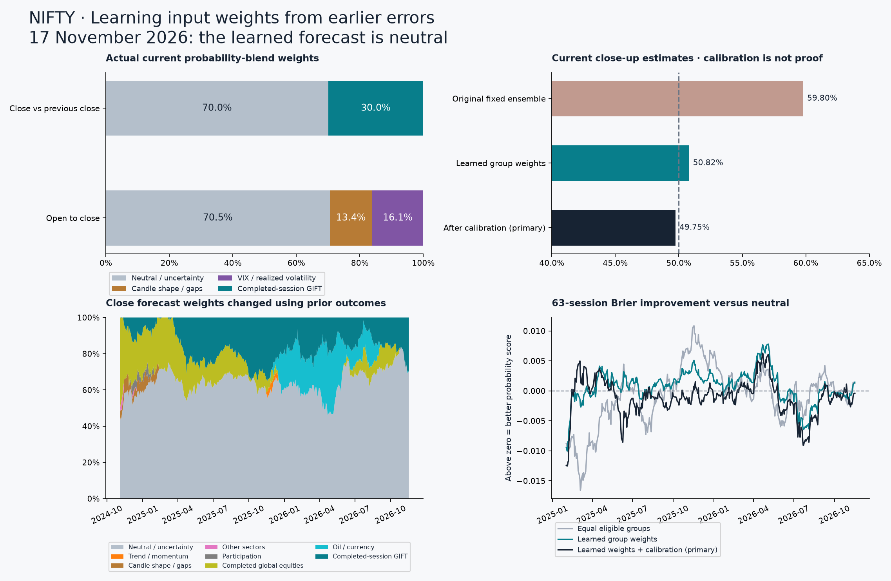

# NIFTY inputs weighted by historical prediction errors

**The learned-weight call for 17 November 2026 is neutral.** The primary estimate
is **49.75%** for a close above the preceding close and **49.45%** for
a close above today's open. This replaces the bullish interpretation of the
first experiment for this new version; the original timestamped 59.8% call is
preserved as a separate experiment. Neither call has an observed outcome yet.

Issued **2026-11-17T01:01:51.605976+05:30**. Reference: **25,291.10**. It reuses the earlier
pre-market price freeze, with a separately acquired institutional-history batch.
There are still no 17 November Indian-session prices in the model.



## Actual learned allocations

These are probability-blend weights, before the final calibration step. Each
target has a separate set and its weights sum to 100%. A neutral expert always
predicts 50%; its high allocation shrinks weak evidence toward uncertainty.

|Input group|Close vs previous close weight|Open-to-close weight|Current group close-up estimate|Past OOS predictions|Eligibility|
|---|---:|---:|---:|---:|---|
|Neutral / uncertainty|70.03%|70.52%|50.0%|1922|Fixed uncertainty anchor|
|Trend / momentum|0.00%|0.00%|47.8%|1922|Eligible; zero can be selected|
|Short-term price / RSI|0.00%|0.00%|54.6%|1922|Eligible; zero can be selected|
|Candle shape / gaps|0.00%|13.36%|50.7%|1922|Eligible; zero can be selected|
|VIX / realized volatility|0.00%|16.13%|54.2%|1922|Eligible; zero can be selected|
|Banks / financials|0.00%|0.00%|45.3%|1922|Eligible; zero can be selected|
|Other sectors|0.00%|0.00%|52.0%|1922|Eligible; zero can be selected|
|Participation|0.00%|0.00%|51.2%|1922|Eligible; zero can be selected|
|Completed global equities|0.00%|0.00%|54.3%|1376|Eligible; zero can be selected|
|Oil / currency|0.00%|0.00%|49.7%|1376|Eligible; zero can be selected|
|Completed-session GIFT|29.97%|0.00%|52.7%|1376|Eligible; zero can be selected|
|Institutional cash ratios|0.00%|0.00%|64.4%|73|Shadow: short history|
|FII derivative positioning|0.00%|0.00%|63.0%|73|Shadow: short history|

For the close forecast, the arithmetic is approximately
**70.03% × 50% + 29.97% × 52.73% = 50.82%**, before calibration.
The calibrator, learned only from prior predictions and outcomes, moves it to
**49.75%**. For open-to-close, the blend uses 70.52% neutral, 13.36% candle/gap
signals and 16.13% volatility signals, yielding 49.73% before calibration and
49.45% afterward.

The GIFT allocation is applied to **completed-session historical GIFT return and
volatility features**, using the safe date lag from the first experiment. It is
not a fitted weight on the live after-hours GIFT quote. The ongoing US cash
sell-off remains qualitative context; final US closes cannot be inserted into
a 00:30 IST historical forecast whose US session was still open.

A zero weight has two meanings here. Eligible groups can receive zero when
their earlier predictions do not improve the joint, regularized blend. Groups
with inadequate evidence receive zero by an explicit sample-size gate. Neither
means the underlying market variable has no economic effect. Highly correlated
inputs can substitute for one another, so percentages are conditional on this
feature set, history window and shrinkage rule.

## How the machine assigns weights

The design is recorded in [ADAPTIVE_PROTOCOL.md](research/nifty_forecast/ADAPTIVE_PROTOCOL.md).
There are **71 raw features in 12 disjoint groups**. The feature and group layers
have different jobs:

1. **Learn each input's signed coefficient.** Every group has an L2 logistic
   expert. Monthly fits use only already resolved sessions, up to 1,260 rows,
   with a 252-session recency half-life and fixed penalty 25. Normalization and
   missing-value handling use only its own training data. Missingness has its
   own coefficients.
2. **Make historical predictions before seeing their answers.** For example, a
   prediction for session D uses only resolved targets before D. The actual D
   result becomes eligible for changing the next session's blend, not D's own
   forecast. Monthly experts stay frozen within their month; the current forward
   call receives a fresh fit with all outcomes now resolved.
3. **Learn group trust from those errors.** Before each decision, choose
   nonnegative weights summing to one to minimize Brier loss on up to the prior
   504 out-of-sample forecasts. Recent errors have a 126-session half-life. A
   fixed 0.005 squared penalty favors the neutral expert when evidence is weak.
   This joint fit accounts for overlap between experts rather than counting
   correlated indicators as independent votes.
4. **Fit calibration to previous forecasts.** A monotone logistic mapping learns
   from at most 252 preceding adaptive forecasts, with at least 126 required.
   It has penalty 10 toward no adjustment. Calibration is evaluated as a
   separate layer; it is not assumed to improve every test period.

No weights are chosen from the entire evaluation period and then applied back
to its beginning. Group allocations change daily as earlier results resolve.
[Daily weights](artifacts/nifty_forecast/2026-11-17/adaptive-v2/daily-weights-close_return.csv),
[historical expert predictions](artifacts/nifty_forecast/2026-11-17/adaptive-v2/expert-predictions-close_return.csv)
and the dated expert-fit files make that sequence inspectable.

## Weights on individual inputs

The [full coefficient table](artifacts/nifty_forecast/2026-11-17/adaptive-v2/input-coefficients.csv)
contains all 71 inputs for both outcomes, including inputs whose group currently
has zero allocation. Standardized coefficients act on log odds **inside each
expert**; they are not percentages of the overall forecast.

The table below shows inputs in groups with nonzero current allocations.
Sensitivity is the local change in the final upward estimate, in percentage
points, for a one-training-standard-deviation increase in that feature, holding
other features fixed. It includes both its group weight and the fitted
calibration slope. It is a mathematical local sensitivity, not a causal claim
or a guarantee that such an isolated market change can occur.

|Prediction target|Input|Signed expert coefficient|Local final sensitivity / training SD|
|---|---|---:|---:|
|Close vs previous close|lagged_global_gift_nifty_return1|+0.2122|+1.601 pp|
|Close vs previous close|lagged_global_gift_nifty_vol20|+0.1453|+1.097 pp|
|Close vs previous close|lagged_global_gift_nifty_return5|+0.0601|+0.453 pp|
|Open to close|atr_pct|+0.2325|+0.925 pp|
|Open to close|body|-0.2052|-0.669 pp|
|Open to close|vix_change1|+0.1583|+0.630 pp|
|Open to close|realized_vol20|-0.1457|-0.580 pp|
|Open to close|daily_range|+0.1354|+0.442 pp|
|Open to close|vix_level|+0.0976|+0.389 pp|
|Open to close|previous_gap|+0.0923|+0.301 pp|
|Open to close|vol_ratio5_20|-0.0702|-0.280 pp|
|Open to close|close_location|+0.0602|+0.196 pp|
|Open to close|vix_change5|-0.0171|-0.068 pp|

An expert's intercept, feature-missingness effects and neutral allocation remain
explicit. They are not relabeled as weights on named market inputs. Full values
and preprocessing are saved in the expert-fit JSON files.

## Institutional history: more data, carefully used

The [Upstox FII documentation](https://upstox.com/developer/api-documentation/get-fii-data/)
states that collection begins on 1 April 2026 and daily requests return at most
30 trading days. Overlapping requests and the saved current window recovered
**156 unique source sessions**, 1 April–16 November,
with **155 aligned training rows** and no conflicting duplicate revisions.
Returned session timestamps, rather than the misleading request parameter name,
govern the join. One source date does not align to the NIFTY daily calendar.

The cash features are **(buy − sell)/(buy + sell)**, including five-session
averages. A common INR/crore scale cancels exactly; absolute crore values remain
unverified. Negative amounts, invalid values and a zero denominator are rejected.
Futures features use long/short and trade-contract imbalances; participant option
positioning uses normalized long-call/short-put versus long-put/short-call
exposure. That last measure is a contract-count proxy, not a delta-weighted book.

These experts have **73 genuine historical OOS predictions**
after their initial training requirement. The primary blend requires 126 such
predictions and 252 training rows. They therefore receive **0% primary weight**
and are retained in shadow, where their predictions and coefficients can be
scored as additional history arrives. Their current close-up estimates of
64.4% and 63.0% do not bypass that gate.

Institutional EOD values are assumed published before the next 00:30 IST
decision. The API's session timestamp does not prove a publication clock, so
this is reconstructed history rather than an archived publication-vintage replay.
Unknown-time chain PCR, IV, max pain, and unarchived macro/news concepts likewise
have no fitted primary weight; no synthetic years of observations were created.

## Did learning weights improve the predictions?

The evaluation contains **504 sessions, 4 November 2024–16 November 2026**.
The latest 126 and both chronological halves are reported in JSON. This period
was already examined in the first study, so it is an **exploratory reused
evaluation**, not an untouched confirmation set. Its individual forecasts still
obey historical information boundaries. The next actual session remains forward.

|Method|Close Brier ↓|Close accuracy|Intraday Brier ↓|Intraday accuracy|
|---|---:|---:|---:|---:|
|Neutral 50/50|0.25000|—|0.25000|—|
|Daily rolling frequency|0.25289|49.4%|0.24976|52.8%|
|Equal eligible groups|0.25115|48.8%|0.24816|55.4%|
|Learned group weights|0.25025|52.8%|0.24971|50.8%|
|Learned weights + calibration (primary)|0.25232|49.6%|0.25090|51.0%|
|Original fixed ensemble|0.25541|51.6%|0.24970|52.8%|

The raw learned blend improves close Brier loss from the first ensemble's
0.25541 to **0.25025** and scores **52.8%** direction
accuracy. It remains essentially tied with the neutral 0.25000 reference. Its
paired improvement against neutral is -0.00025,
with conditional 95% block interval **-0.00281 to +0.00284**.

The predeclared primary calibrated model scores **0.25232** and
**49.6%** close accuracy. Its improvement versus neutral is
-0.00232, interval **-0.00545 to +0.00145**.
**Calibration made this evaluation worse.** It is retained and disclosed as
specified, rather than replacing the primary method with whichever control won
after seeing the results. Intraday learned weighting and calibration also fail
to establish an advantage over the controls. The equal-group intraday control
has a better point estimate, with its uncertainty interval still crossing zero.

Thus weights have been learned and changed the forecast, but a reliable
directional edge has **not** been established. Improvement from an overconfident
first model is not the same as beating a neutral forecast. A separate
[503-session check](artifacts/nifty_forecast/2026-11-17/adaptive-v2/validation.json)
excludes Monday's provisional quote-derived target and reaches the same broad
conclusion. Both raw and calibrated estimates are frozen; a 49.7% estimate is
operationally neutral, not a high-confidence bearish call.

## How stable are the weights?

A diagnostic 300-resample, ten-session-block bootstrap refits the current stack
on resampled historical predictions. The close GIFT allocation ranges from
**0.0% to 45.6%** across its central 95%
resample range, including zero. The neutral allocation's range is also broad.
These are conditional weight-stability diagnostics, not confidence bounds for
universal economic importance. The regularization and selected feature groups
remain fixed; historical stationarity is not guaranteed.

The correct reading of 29.97% is therefore "today's fitted allocation under the
specified method," not a permanent market constant. Full
[weight stability](artifacts/nifty_forecast/2026-11-17/adaptive-v2/weight-stability.csv),
[input sensitivity](artifacts/nifty_forecast/2026-11-17/adaptive-v2/input-sensitivity.csv)
and [paired comparison with the original](artifacts/nifty_forecast/2026-11-17/adaptive-v2/comparison-with-original.json)
are saved.

## Verification and the next observation

Eight additional checks pass: common-scale cash-ratio invariance, simplex
constraints, preference for the historically better expert, invariance of past
weights/calibration to future labels, zero allocation for missing or insufficient
history, invariance of earlier expert fits to future labels, monotone calibration,
and saved chronological boundaries/weight sums. The original seven checks remain
available. The original forecast's hash is preserved.

```powershell
.\.venv\Scripts\python.exe -m research.nifty_forecast.verify_adaptive
.\.venv\Scripts\python.exe -m research.nifty_forecast.adaptive --out artifacts/nifty_forecast/2026-11-17/adaptive-reproduction-01
```

After the target session's daily candle is published:

```powershell
.\.venv\Scripts\python.exe -m research.nifty_forecast.score --run artifacts/nifty_forecast/2026-11-17/adaptive-v2
```

This writes a separate outcome file for the new
[frozen forecast](artifacts/nifty_forecast/2026-11-17/adaptive-v2/forecast.json).
The original experiment can be scored separately with the scorer's default run.
New-day reruns accept `--inputs`, `--supplement`, `--institutional`,
`--reference-run`, and a new `--out` path, so new resolved sessions can change
weights without rewriting earlier calls. Each needs a newly frozen reference
run and its dated input snapshots. No unattended watcher has been started.
