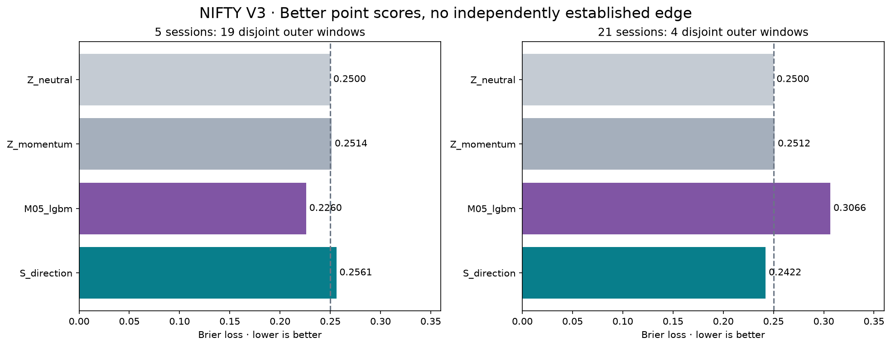

# NIFTY V3 research — 2025–2026

**No independently established predictive edge.** The controlled study improves
data coverage and some exploratory scores, but no weekly model/target comparison
survives the 170-contrast simultaneous uncertainty family; monthly evaluation
contains only four non-overlapping outer windows. All historical dates are exposed.

New data: 70 successful Upstox histories, 465 official NSE FO sessions, all 465
underlying closes exactly corroborated, 129 features and 402 eligible origins.
Batch: 19 fitted configurations plus five deterministic controls, independently
trained at two horizons;532 configuration/fold evaluations, no failed configs;
six randomized-direction diagnostics;15 verification checks passed.

Exploratory weekly LightGBM:66.3% accuracy, Brier .22605; simultaneous improvement
interval versus strongest fixed baseline -.09303 to+.13941. The actual nested
direction selector scores 63.0% with Brier .25612, worse than neutral .25.
Monthly selector:60.5%, Brier .24220; sample too small for a supported interval.
No model is called independently validated. Returns/volatility/tail leaders differ.

Final numeric scenarios are **NOT VALIDATED and late-issued** at 2026-11-17T09:55:34.610340+05:30,
using 16 November completed-session inputs after 17 November open. They are not fresh
premarket evidence: weekly direction estimate 72.4% and monthly 55.0%, with substantial
cross-target inconsistencies and under-covering distributions. Do not interpret
these as calibrated odds or a coherent trading signal.



- [01_DATA_AUDIT.md](artifacts/nifty_forecast_v3/2026-11-17/run-001/01_DATA_AUDIT.md)
- [02_FEATURE_DISCOVERY.md](artifacts/nifty_forecast_v3/2026-11-17/run-001/02_FEATURE_DISCOVERY.md)
- [03_TARGET_RESEARCH.md](artifacts/nifty_forecast_v3/2026-11-17/run-001/03_TARGET_RESEARCH.md)
- [04_MODEL_EXPERIMENTS.md](artifacts/nifty_forecast_v3/2026-11-17/run-001/04_MODEL_EXPERIMENTS.md)
- [05_VALIDATION_AND_LEAKAGE_AUDIT.md](artifacts/nifty_forecast_v3/2026-11-17/run-001/05_VALIDATION_AND_LEAKAGE_AUDIT.md)
- [06_WEEKLY_FORECAST_RESEARCH.md](artifacts/nifty_forecast_v3/2026-11-17/run-001/06_WEEKLY_FORECAST_RESEARCH.md)
- [07_MONTHLY_FORECAST_RESEARCH.md](artifacts/nifty_forecast_v3/2026-11-17/run-001/07_MONTHLY_FORECAST_RESEARCH.md)
- [08_MODEL_COMPARISON.md](artifacts/nifty_forecast_v3/2026-11-17/run-001/08_MODEL_COMPARISON.md)
- [09_FINAL_FORECASTS.md](artifacts/nifty_forecast_v3/2026-11-17/run-001/09_FINAL_FORECASTS.md)
- [10_NEXT_RESEARCH_PRIORITIES.md](artifacts/nifty_forecast_v3/2026-11-17/run-001/10_NEXT_RESEARCH_PRIORITIES.md)

[Final comparison CSV](artifacts/nifty_forecast_v3/2026-11-17/run-001/final-model-comparison.csv) ·
[Frozen scenarios](artifacts/nifty_forecast_v3/2026-11-17/run-001/09_FINAL_FORECASTS.json) ·
[Verification](artifacts/nifty_forecast_v3/2026-11-17/run-001/verification.json)

Reproduce in a new directory:

```powershell
.\.venv\Scripts\python.exe -m research.nifty_forecast_v3.reproduce --out artifacts/nifty_forecast_v3/2026-11-17/reproduction-002
```

Exact initial fitted source is archived separately from documented guard hardening.
All earlier reports and forecasts are preserved. No trading settings, orders or
unattended automation were created. Source/target assumptions and skipped research
families are documented, and extending evidence into 2027 requires a scope change.
