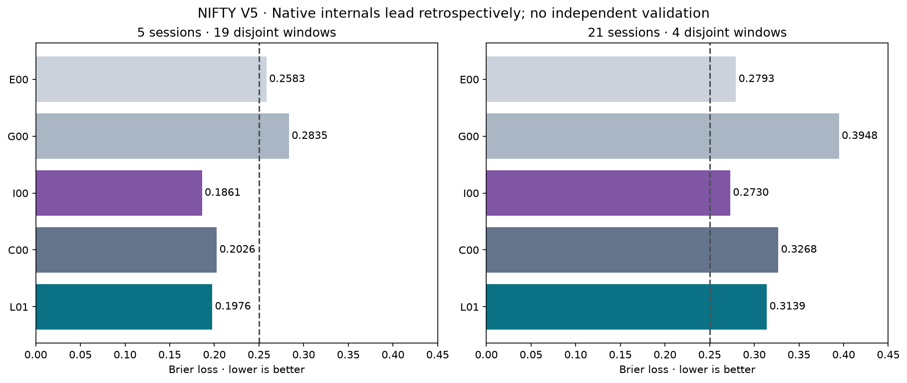

# NIFTY V5 research

**New retrospective leads; no independently validated edge. NO DEPLOYMENT.**

193 instrument histories,176 initial features plus separate liquidity inputs,
34 evaluated systems,976 global/IT lead-lag tests,320 exact-condition comparisons.
Native weekly internals:76.09% accuracy/Brier.18610; no-size removal.18205;
ETF/native system CRPS.009963 and77.2% coverage for nominal80% intervals.
Global/derivative additions and panel transfer did not establish incremental value.

Some adjusted gains beat weak baselines, but none establishes superiority over
the strongest prior V4 coherent forecasts. Monthly independent sample remains4.
All historical dates are exposed. A fresh experimental snapshot was frozen at
2026-11-18T22:51:50.449640+05:30 from official18November NIFTY close25,227.95, before the first
target session. It is postselected, uncalibrated and unresolved; V4 ledger unchanged.

- [V5_DATA_UNIVERSE.md](artifacts/nifty_forecast_v5/2026-11-18/run-001/V5_DATA_UNIVERSE.md)
- [V5_GLOBAL_MARKET_RESEARCH.md](artifacts/nifty_forecast_v5/2026-11-18/run-001/V5_GLOBAL_MARKET_RESEARCH.md)
- [V5_INDIAN_MARKET_INTERNALS.md](artifacts/nifty_forecast_v5/2026-11-18/run-001/V5_INDIAN_MARKET_INTERNALS.md)
- [V5_DERIVATIVES_INTELLIGENCE.md](artifacts/nifty_forecast_v5/2026-11-18/run-001/V5_DERIVATIVES_INTELLIGENCE.md)
- [V5_CROSS_MARKET_FEATURES.md](artifacts/nifty_forecast_v5/2026-11-18/run-001/V5_CROSS_MARKET_FEATURES.md)
- [V5_ADVANCED_MODEL_EXPERIMENTS.md](artifacts/nifty_forecast_v5/2026-11-18/run-001/V5_ADVANCED_MODEL_EXPERIMENTS.md)
- [V5_CONDITIONAL_SIGNALS.md](artifacts/nifty_forecast_v5/2026-11-18/run-001/V5_CONDITIONAL_SIGNALS.md)
- [V5_VALIDATION_AND_STRESS_TESTS.md](artifacts/nifty_forecast_v5/2026-11-18/run-001/V5_VALIDATION_AND_STRESS_TESTS.md)
- [V5_SIGNAL_RANKING.md](artifacts/nifty_forecast_v5/2026-11-18/run-001/V5_SIGNAL_RANKING.md)
- [V5_WEEKLY_MODEL_RESEARCH.md](artifacts/nifty_forecast_v5/2026-11-18/run-001/V5_WEEKLY_MODEL_RESEARCH.md)
- [V5_MONTHLY_MODEL_RESEARCH.md](artifacts/nifty_forecast_v5/2026-11-18/run-001/V5_MONTHLY_MODEL_RESEARCH.md)
- [V5_FINAL_COMPARISON.md](artifacts/nifty_forecast_v5/2026-11-18/run-001/V5_FINAL_COMPARISON.md)
- [V5_RESEARCH_CONCLUSIONS.md](artifacts/nifty_forecast_v5/2026-11-18/run-001/V5_RESEARCH_CONCLUSIONS.md)
- [V5_NEXT_HYPOTHESES.md](artifacts/nifty_forecast_v5/2026-11-18/run-001/V5_NEXT_HYPOTHESES.md)

[Complete comparison CSV](artifacts/nifty_forecast_v5/2026-11-18/run-001/final-comparison.csv) ·
[Searchable registry](artifacts/nifty_forecast_v5/2026-11-18/run-001/experiment-registry.csv) ·
[Frozen experimental laws](artifacts/nifty_forecast_v5/2026-11-18/run-001/experimental-forecasts.json) ·
[27 passing verification checks](artifacts/nifty_forecast_v5/2026-11-18/run-001/verification.json) ·
[Source and reproduction](research/nifty_forecast_v5/README.md)

No trades, deployment, automatic schedules or silent extension beyond2025–2026.
