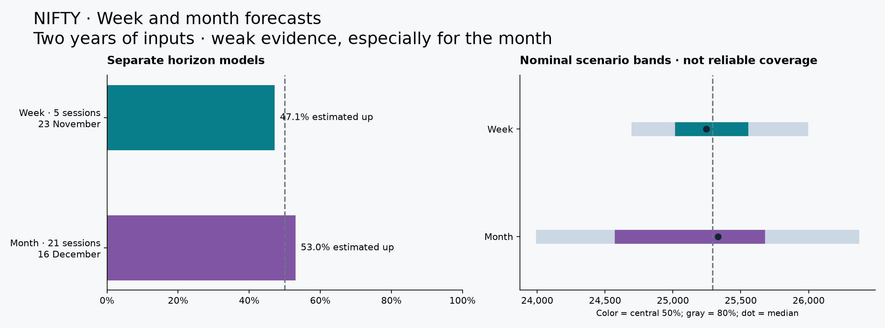

# NIFTY: one-week and one-month experiment

**Working call: roughly flat with a slight downward weekly lean, and roughly
flat with a slight upward monthly lean. Neither is an established edge.**
The separate models estimate **47.1% upward over
5 trading sessions** and **53.0% upward over
21 sessions**. The monthly validation is poor and too small to support a confident call.

Issued **2026-11-17T01:23:50.738940+05:30**, using the same frozen pre-market context and the
**25,291.10 close on 16 November 2026**. The entire input, indicator-initialization,
training and prediction-error history remains limited to **17 November 2024–16
November 2026**: 495 NIFTY sessions, 475 eligible feature rows, 71 features and
12 input groups. Earlier daily calls remain unchanged.



## Frozen forecasts

|Horizon|Trading sessions|Expected endpoint close|Estimated probability above 25,291.10|Model median endpoint|Nominal central 50% scenario band|Nominal central 80% scenario band|
|---|---:|---|---:|---:|---:|---:|
|Week|5|2026-11-23|47.13%|25,245 (-0.18%)|25,016–25,555|24,693–25,994|
|Month|21|2026-12-16|53.01%|25,332 (+0.16%)|24,571–25,677|23,990–26,372|

These are **model scenario quantiles, not validated coverage probabilities**.
They describe the endpoint, not the within-period high/low. Historical 80% band
coverage was only **72.6% weekly** and
**41.7% monthly**. In particular, the monthly band must
not be described as having a demonstrated 80% chance of containing the outcome.

The dates account for the 24 November NSE holiday, using a frozen Upstox calendar
corroborated by the [official NSE 2026 circular](https://nsearchives.nseindia.com/content/circulars/CMTR71775.pdf).
The outcome definition is the next 5/21 actual trading sessions; unexpected
calendar changes or missing candles require review before scoring a changed date.

The means differ from the medians because of tail sizes. The weekly mixture
mean is 25,313 (+0.09%),
while the monthly mean is 25,221
(-0.28%). Frequent small gains can coexist
with a negative mean if down moves are larger. These tiny central moves and broad,
poorly validated distributions support low confidence rather than precise targets.

## Horizon-specific learned weights

|Group|Week allocation|Month allocation|
|---|---:|---:|
|Neutral baseline|48.98%|68.02%|
|Other sector leadership|24.80%|31.98%|
|Participation/breadth proxy|26.23%|0.00%|

All other groups have zero current allocation. Each horizon retrains its input
coefficients, group trust and calibration; the daily estimate is not compounded
or stretched. Zero fitted allocation is not a statement of economic irrelevance.
Institutional groups remain below the evidence gate. Full
[group weights](artifacts/nifty_forecast/2026-11-17/horizons-v2/group-weights.csv) and
[individual coefficients](artifacts/nifty_forecast/2026-11-17/horizons-v2/input-coefficients.csv)
are saved for both horizons.

## Outcome maturity and move-size estimation

For an origin after session t's close, the return is **C[t+h]/C[t] − 1**. An
earlier forecast may teach the model only after its endpoint has closed.
Yesterday's monthly forecast is still unresolved today. This restriction applies
to expert fitting, group-weight learning, calibration and magnitude history.

The earlier fixed penalties, feature groups and recency half-lives are retained.
Historical experts refit monthly; the current call gets a fresh fit. The first
expert forecast waits for 252 matured training labels, and primary weighting and
calibration each need 126 matured OOS errors. No parameter grid was searched.
The [fixed design](research/nifty_forecast/HORIZON_PROTOCOL.md) and dated fits record this.

Move sizes use up to 252 matured returns at the appropriate horizon. Positive
and nonpositive historical sizes receive total mass p and 1−p from the fitted
upward estimate. This assumes historical conditional sizes persist. It is not
a separately fitted price regressor. Quantiles use an empirical inverse CDF;
no unfinished weekly/monthly return enters the distribution.

## Historical results and overlapping outcomes

After expert startup there are 214
resolved weekly and 182 resolved
monthly forecasts. Fully learned weights/calibration leave:

|Horizon|Daily forecast origins|Origin dates|Endpoint dates|Non-overlapping windows|
|---|---:|---|---|---:|
|Week|84|2026-07-13 to 2026-11-09|2026-07-17 to 2026-11-16|17|
|Month|36|2026-08-26 to 2026-10-16|2026-09-24 to 2026-11-16|2|

Adjacent weekly forecasts share four daily returns; adjacent monthly forecasts
share twenty. They are **not independent experiments**. The greedy non-overlapping
subset avoids reusing return days but is not guaranteed statistically independent.
There are only **two** such fully learned monthly test windows.

|Horizon|Method|Brier score ↓|Direction accuracy|
|---|---|---:|---:|
|week|Neutral 50/50|0.25000|—|
|week|Matured-label frequency|0.25016|57.1%|
|week|Equal eligible groups|0.24749|59.5%|
|week|Learned weights|0.24716|57.1%|
|week|Learned weights + calibration (primary)|0.24953|57.1%|
|month|Neutral 50/50|0.25000|—|
|month|Matured-label frequency|0.28802|36.1%|
|month|Equal eligible groups|0.30280|36.1%|
|month|Learned weights|0.26861|52.8%|
|month|Learned weights + calibration (primary)|0.30749|16.7%|

Weekly primary accuracy is **57.1%**, equal to the always-down
control's 57.1%. Its **0.24953** Brier is only
marginally better than neutral 0.25000. The 10-session-block paired improvement
interval **-0.03413 to +0.04448** spans zero.
On the 17 non-overlapping windows, its Brier is
0.25525,
worse than neutral. A weekly advantage is not established.

The monthly primary is **poor** here: **16.7%** accuracy across
overlapping origins, Brier **0.30749**, versus neutral 0.25000. The raw
uncalibrated blend also fails to beat neutral. A monthly confidence interval is
withheld because two non-overlapping windows are inadequate; the fixed
42-session bootstrap block requires more history. Its scenario bands also
under-cover heavily. **Treat the monthly forecast as a very weak experimental hypothesis.**

The predeclared primary is retained instead of selecting a better-looking control
after inspection. Both chronological halves, move-size MAE, non-overlapping results
and subsets excluding the provisional 16 November endpoint appear in
[validation.json](artifacts/nifty_forecast/2026-11-17/horizons-v2/validation.json).
This is exploratory reuse of the same historical period.

## Checks and later scoring

Ten checks pass: exact horizon endpoints, holidays/special sessions, exclusion
of unfinished labels, invariance of earlier models/weights/calibration/ranges to
unfinished outcome changes, empirical median sign, disjoint test windows,
withholding unsupported monthly intervals, matured update endpoints and weight
sums, horizon-specific scoring, and source/previous-call hashes.

```powershell
.\.venv\Scripts\python.exe -m research.nifty_forecast.verify_horizons
.\.venv\Scripts\python.exe -m research.nifty_forecast.horizons --out artifacts/nifty_forecast/2026-11-17/horizons-reproduction-01
.\.venv\Scripts\python.exe -m research.nifty_forecast.score_horizons --run artifacts/nifty_forecast/2026-11-17/horizons-v2
```

The scorer can resolve the week while the month remains pending. It uses
published daily candles and writes a separate outcome artifact, preserving the
[frozen forecasts](artifacts/nifty_forecast/2026-11-17/horizons-v2/forecast.json).
No unattended watcher or scheduled task was created. The earlier source-vintage,
conservative global-clock, institutional-publication and provisional-quote
limitations remain in force.
