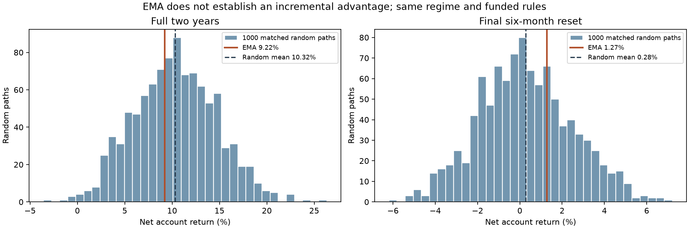
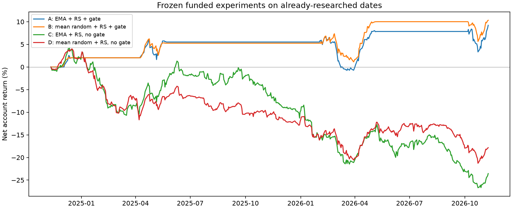

# Frozen EMA + relative strength + volatility expansion validation

**Decision: Inconclusive.** The specific claim that EMA 20/50 adds predictive information is unsupported by this conditional randomization experiment. The frozen strategy remains historically positive, but matched randomized entries with the same relative-strength eligibility, volatility gate and funded-account rules do at least as well on average over the full period. Volatility conditioning is the dominant observed contribution. Its repeatability is not established by four pooled events on an already-researched calendar. No live deployment or parameter change is recommended.

## Frozen experiment and provenance

Every original strategy and portfolio parameter was frozen before new randomization outcomes in [freeze.json](freeze.json), with exact mathematical definitions and randomization design in [DESIGN.md](../../research/ema_validation/DESIGN.md). The phase retained EMA 20/50, stock/NIFTY 60-session simple-return comparison, completed NIFTY 20/60 sample-standard-deviation ratio>1.2, next observed open,2 ATR Wilder 14 initial stop, fee-aware 2 R target,10-session holding limit,0.5% account risk, integer cash sizing,10 positions,20% name/30% sector admission caps,1% prior-volume participation,Rs 5 crore prior-turnover screen and 0.8 correlation rejection. Candidate priority remains descending prior 60 stockreturn with alphabetic ties. Baseline uses 5 bps adverse fills and audited fees/dividends; no 15% drawdown halt is added.

The cached replay reproduces the earlier funded equity and trade P&L paths exactly in baseline/universal/higher-cost regression cases. The eight factorial cells are not optimized variants: A/B/C/D keep RS eligibility on; supplementary cells remove only RS eligibility. Candidate ranking still uses prior momentum, so the RS ablation does not remove every source of momentum information.

All dates from 11 November 2024 through 9 November 2026 have been inspected previously. The final reset horizon starts cash on 11 May 2026 and ends 9 November 2026. It is not untouched OOS. Full-period paths carry positions across internal calendar boundaries; final-reset paths restart independently. Neither horizon supplies pristine validation.

## Four controlled experiments

| Cell | Entry opportunity | RS eligibility | Expansion |
| --- | --- | --- | --- |
| A | EMA20 crosses above EMA50 | On | On |
| B | Random stock opportunities | On | On |
| C | EMA20 crosses above EMA50 | On | Off |
| D | Random stock opportunities | On | Off |

One thousand common seeds were retained, with each seed running B/D under RS-on/off and both horizons:8000 randomized funded paths plus 8 deterministic paths. No seed was selected. Every seed’s equity, cash, utilization, positions, trade journal and rejection metrics is preserved. Random choices use only the same completed-day eligible pool and match its EMA raw opportunity count exactly on each signal date. Gate/no-gate pairs reuse the same random stock priorities on expansion dates.

**Matching limit:** independent holding/cash paths cannot guarantee the original realized fill count without overriding exits/cash or conditioning on later outcomes. We match opportunities exactly, preserve constraints and quantify executed differences. In the main gated full-period comparison actual 114 trades vs randomized mean 113.406, actual utilization 11.817% vs 12.749%, mean holding 7.930 vs 8.044 sessions. Mean executed-date-profile total-variation distance is 0.181; final-reset gated distance 0.261. These are close overall trade counts, but not identical executed timing or exposure. This is a causal opportunity-matched placebo, not a perfect per-trade exposure-matched randomization.

| stage | experiment | paths | net_return_pct | max_drawdown_pct | sharpe | trades | exposure_pct | turnover_multiple |
| --- | --- | --- | --- | --- | --- | --- | --- | --- |
| two_year | A | 1 | 9.2165 | 6.9311 | 0.9242 | 114.0000 | 11.8172 | 15.4649 |
| two_year | B | 1000 | 10.3243 | 6.7504 | 0.9192 | 113.4060 | 12.7490 | 16.6625 |
| two_year | C | 1 | -23.5579 | 29.5899 | -1.2321 | 495.0000 | 55.7156 | 66.3733 |
| two_year | D | 1000 | -17.8416 | 26.1994 | -0.8594 | 487.5230 | 57.2224 | 65.0452 |
| final_reset | A | 1 | 1.2736 | 4.6644 | 0.5082 | 27.0000 | 9.6871 | 3.4232 |
| final_reset | B | 1000 | 0.2754 | 4.4038 | 0.1143 | 27.6050 | 10.3394 | 3.9516 |
| final_reset | C | 1 | -9.5646 | 13.3346 | -1.8322 | 138.0000 | 60.4399 | 19.2931 |
| final_reset | D | 1000 | -4.9737 | 11.9561 | -0.9306 | 138.3380 | 61.3185 | 20.1653 |

For B/D, metrics are arithmetic means across 1000 funded paths; mean drawdown/Sharpe is not the metric of the mean-equity curve. Turnover counts buy+sell notional divided by originalRs 1 m capital. Exposure is average marked investedNAV fraction. All results are net of modeled baseline costs. [Complete random runs](random-results.csv), [deterministic runs](deterministic-results.csv), [matching diagnostics](matching-diagnostics.csv).

## Randomization rank and incremental EMA contribution

| stage | observed_cell | random_cell | observed_return_pct | random_mean_return_pct | random_q05 | random_median | random_q95 | percentile | conditional_upper_p |
| --- | --- | --- | --- | --- | --- | --- | --- | --- | --- |
| two_year | A | B | 9.2165 | 10.3243 | 3.2860 | 10.2843 | 17.3610 | 39.8000 | 0.6024 |
| two_year | C | D | -23.5579 | -17.8416 | -28.8463 | -18.3026 | -5.3314 | 23.0000 | 0.7702 |
| final_reset | A | B | 1.2736 | 0.2754 | -3.2398 | 0.1786 | 4.1289 | 69.3000 | 0.3077 |
| final_reset | C | D | -9.5646 | -4.9737 | -12.6469 | -5.0014 | 2.8807 | 17.3000 | 0.8272 |

Over two years, A returns 9.2165% while B averages 10.3243%; EMA ranks at the 39.8 thpercentile. The EMA contribution A−mean(B) is−1.1078 percentagepoints. Its paired 10-session block 95% interval is[-9.3984,+7.7235]points. In final reset, A returns 1.2736% vs B mean 0.2754%; the positive 0.9982 point difference is not statistically clear (conditional upper-tail p=.3077).

Conditional Monte Carlo p=(1+number of placebo outcomes at least observed)/(1001). These ranks measure variation across random draws on this market history. They are not probabilities that an edge exists, independent market evidence, or a correction for the original strategy discovery. Exact stock exchangeability is not established; differences in selected sectors/lagged stock volatility can still contribute to the opportunity-selection comparison.

| stage | test | observed_pct | null_mean_pct | conditional_upper_p | holm_p |
| --- | --- | --- | --- | --- | --- |
| two_year | EMA_given_expansion | 9.2165 | 10.3243 | 0.6024 | 1.0000 |
| two_year | EMA_without_expansion | -23.5579 | -17.8416 | 0.7702 | 1.0000 |
| two_year | EMA_gate_interaction | 32.7743 | 28.1659 | 0.2657 | 0.7972 |
| final_reset | EMA_given_expansion | 1.2736 | 0.2754 | 0.3077 | 0.6154 |
| final_reset | EMA_without_expansion | -9.5646 | -4.9737 | 0.8272 | 0.8272 |
| final_reset | EMA_gate_interaction | 10.8382 | 5.2490 | 0.1039 | 0.3117 |

Three primary tests are Holm-adjusted separately per horizon: EMA conditional on expansion, EMA without expansion, and EMA×gate interaction. None establishes positive incremental EMA information. [Complete rankings, including RS ablations](randomization-ranking.csv), [factorial tests](factorial-randomization.csv).

## Factorial attribution: what produced the historical profit?

| stage | test | contrast_pct | ci95_low_pct | ci95_high_pct | simultaneous95_low_pct | simultaneous95_high_pct |
| --- | --- | --- | --- | --- | --- | --- |
| two_year | EMA_expansion | -1.1078 | -9.3984 | 7.7235 | -13.2955 | 11.0799 |
| two_year | EMA_no_gate | -5.7162 | -19.4671 | 9.7849 | -26.0209 | 14.5885 |
| two_year | gate_given_EMA | 32.7743 | 11.0561 | 51.2298 | 4.8891 | 60.6596 |
| two_year | gate_given_random | 28.1659 | 9.3506 | 44.4633 | 3.5723 | 52.7595 |
| two_year | EMA_gate_interaction | 4.6084 | -9.7062 | 17.9172 | -14.7283 | 23.9451 |
| two_year | RS_filter_given_EMA_gate | -3.6230 | -10.4113 | 1.5836 | -12.4479 | 5.2020 |
| two_year | RS_filter_given_random_gate | 0.4525 | -2.7449 | 3.3133 | -3.8035 | 4.7085 |

Gate contribution with EMA A−C is+32.7743 points; with randomized entries mean(B−D) it is+28.1659 points. Both are positive under the conditional market-date block analysis, even after the stated simultaneous contrast adjustment. This is evidence of regime-conditioned economics on this sample, not proof that the gate will transfer to new events.

The extra interaction (A−B)−(C−D) is+4.6084 points,95% interval[-9.7062,+17.9172]; Holm conditional randomization p=.7972. Thus the combination does not demonstrate an additional EMA-specific benefit beyond the gate.

Removing RS eligibility increases the deterministic gated two-year return to 12.8394%. RS eligibility contribution is−3.6230 points,95% interval[-10.4113,+1.5836]. On randomized gated paths its contribution is+0.4525 points with an interval spanning zero. Final gated EMA executions are unchanged by that eligibility removal. There is no independently established benefit from this RS filter here; its effect must not be generalized to removing momentum ranking, which was frozen and remains in every cell.

Seven simultaneous contrast intervals use the maximum absolute standardized bootstrap error, alongside ordinary 95% intervals. All cells share the same circular 10-session market-date resamples, retaining same-day dependence. Random controls use equal-initial-capital mean NAV, not mean daily returns. These fixed-path resamples do not re-execute cash/risk rules and may understate event-to-event uncertainty when there are so few events. [Confidence values](factorial-confidence.csv), [inference scope](inference-scope.json).

## Market episodes, concentration and entry delay

Expansion is not continuously active. There are 6 contiguous expansion runs and 4 pooled events, merging runs separated by fewer than 10 non-expansion sessions. The gate is active on 91/495 observed sessions; final reset has 22 expansion sessions. Future episode endpoints are used only for retrospective attribution, never to decide entries.

| event | start | end | expansion_sessions | calendar_sessions | trades | stocks | net_pnl | mean_net_r | signal_days |
| --- | --- | --- | --- | --- | --- | --- | --- | --- | --- |
| 0 | 2024-11-25 | 2024-12-03 | 4 | 7 | 10 | 10 | 20,287.0351 | 0.4129 | 3 |
| 1 | 2025-04-07 | 2025-05-08 | 20 | 20 | 24 | 24 | 34,888.5323 | 0.2940 | 13 |
| 2 | 2026-02-01 | 2026-04-21 | 45 | 53 | 53 | 49 | 23,299.7832 | 0.0977 | 25 |
| 3 | 2026-10-06 | 2026-11-05 | 22 | 22 | 27 | 26 | 13,689.2959 | 0.1544 | 14 |

PnL is attributed to the entry event and includes the subsequent exit, potentially after the event closes. All four EMA event contributions are positive, but EMA beats the matched random event mean in only two of four events. The February–April 2026 event supplies its largest shortfall relative to random entries.

| event | start | end | EMA_pnl | random_mean_pnl | EMA_increment_pnl | conditional_upper_p |
| --- | --- | --- | --- | --- | --- | --- |
| 0 | 2024-11-25 | 2024-12-03 | 20,287.0351 | 20,380.8959 | -93.8608 | 0.4985 |
| 1 | 2025-04-07 | 2025-05-08 | 34,888.5323 | 32,177.4242 | 2,711.1081 | 0.4366 |
| 2 | 2026-02-01 | 2026-04-21 | 23,299.7832 | 47,604.1929 | -24,304.4097 | 0.7822 |
| 3 | 2026-10-06 | 2026-11-05 | 13,689.2959 | 3,080.3030 | 10,608.9928 | 0.3117 |

Only four event clusters give 16 possible sign assignments. Even the strongest one-sided complete sign enumeration could attain onlyp=.0625 before multiple-testing adjustment. The descriptive sign-flip calculation is retained in [episode-inference.json](episode-inference.json); sign symmetry/exchangeability is not assumed proven. Trades from one signal day/event are not counted as independent confirmations.

The largest individual contributor is MOTILALOFS, net Rs 14,110.88, about 15.31% of total net profit. Top five names contribute Rs 58,094.69, about 63.03%. Excluding the highest-profit name and re-executing cash competition retains+8.2222%, rather than merely subtracting its old trades. Leave-one-pooled-event-out replays retain positive returns approximately+5.56% to+7.85%. These are post-outcome sensitivity tests, not new selected candidates.

| symbol | trades | net_pnl | fees | mean_net_r | contribution_pct_initial |
| --- | --- | --- | --- | --- | --- |
| MOTILALOFS | 2 | 14,110.8834 | 393.2247 | 1.3578 | 1.4111 |
| CCL | 2 | 12,416.6671 | 306.4420 | 1.2220 | 1.2417 |
| GLENMARK | 1 | 10,606.4358 | 78.8219 | 2.0349 | 1.0606 |
| AVANTIFEED | 1 | 10,532.3994 | 202.8640 | 2.0000 | 1.0532 |
| BHEL | 1 | 10,428.3069 | 224.3648 | 2.0000 | 1.0428 |
| TORNTPOWER | 1 | 10,391.1461 | 237.1845 | 2.0000 | 1.0391 |
| LEMONTREE | 1 | 9,990.6647 | 262.3518 | 2.0000 | 0.9991 |
| SWANCORP | 1 | 9,911.5771 | 189.3786 | 2.0000 | 0.9912 |
| SYRMA | 1 | 9,897.5151 | 186.9041 | 2.0000 | 0.9898 |
| BANDHANBNK | 1 | 9,462.1655 | 216.1669 | 1.7987 | 0.9462 |
| LLOYDSME | 1 | 8,947.3664 | 196.0336 | 1.8077 | 0.8947 |
| BSE | 1 | 8,776.0529 | 176.2471 | 1.7750 | 0.8776 |

Median entry expansion age is 10.0 observed sessions within a contiguous expansion run; mean preceding 5/20-session NIFTY returns at signals are 0.306% / -0.706%. This reports known entry context. It does not establish an optimal earlier/later entry or a causal news-event mechanism. See [all entry context](entry-event-context.csv), [all stock contributions](stock-contributions.csv), [exclusion replays](exclusion-replays.csv), [all episode placebo results](episode-random-results.csv).

## Threshold and volatility-method robustness without final selection

The 1.2 threshold remains unchanged. Only the original development dates compare 1.1/1.2/1.3 and a bias-corrected EWMA-span 20/60 variance alternative. No final-date threshold is selected or recommended.

| method | threshold | total_return_pct | n_trades | exposure_pct | max_drawdown_pct |
| --- | --- | --- | --- | --- | --- |
| sample_std20_60 | 1.1000 | 6.2815 | 54 | 12.7879 | 4.1092 |
| sample_std20_60 | 1.2000 | 5.5176 | 34 | 7.8382 | 4.1062 |
| sample_std20_60 | 1.3000 | 2.7180 | 23 | 5.3554 | 4.3467 |
| ewma_span20_60 | 1.1000 | 11.0263 | 40 | 9.4194 | 3.1559 |
| ewma_span20_60 | 1.2000 | 5.1148 | 20 | 5.5232 | 1.8597 |
| ewma_span20_60 | 1.3000 | 0.7589 | 10 | 2.7934 | 2.7139 |

Development returns remain positive across these references, but participation and returns change substantially. Sample-STD 1.2 has 34 trades; EWMA 1.2 has 20. This shows sensitivity to the volatility estimator and gate duration, rather than evidence that the observed best development setting should replace the frozen gate. The sample ratio can remain elevated after a shock because overlapping 20/60 windows carry that shock for multiple sessions; its 91 on-days are not 91 independent events.

## Costs, drawdown and exposure-matched portfolio benchmarks

| stage | scenario | total_return_pct | max_drawdown_pct | n_trades | exposure_pct | turnover_multiple |
| --- | --- | --- | --- | --- | --- | --- |
| two_year | baseline | 9.2165 | 6.9311 | 114 | 11.8172 | 15.4649 |
| two_year | double_fees10bps | 6.9228 | 7.1338 | 115 | 11.3677 | 14.7020 |
| two_year | triple_fees20bps | 3.7281 | 7.3249 | 115 | 10.8937 | 13.8263 |
| final_reset | baseline | 1.2736 | 4.6644 | 27 | 9.6871 | 3.4232 |
| final_reset | double_fees10bps | 0.7078 | 4.7499 | 27 | 9.2669 | 3.2773 |
| final_reset | triple_fees20bps | -0.1413 | 4.8867 | 27 | 8.9081 | 3.1774 |

The two-year frozen rule survives doubled fees/10 bps at+6.9228% and tripled fees/20 bps at+3.7281%. Final reset survives the first stress at+0.7078% but becomes−0.1413% under the second. Cost survival alone does not demonstrate superiority to placebo/benchmark returns. Absolute full-period block 95% interval is approximately[-10.36%,+33.15%], spanning zero.

| stage | benchmark | total_return_pct | max_drawdown_pct | exposure_pct | EMA_advantage_pct | advantage_ci95_low_pct | advantage_ci95_high_pct |
| --- | --- | --- | --- | --- | --- | --- | --- |
| two_year | Nifty 50 | 9.7183 | 6.1335 | 11.8172 | -0.5018 | -14.0768 | 13.9393 |
| two_year | Nifty 500 | 10.2724 | 6.0370 | 11.8172 | -1.0559 | -11.8304 | 9.9714 |
| two_year | Frozen470 equal-weight total-return proxy | 9.9550 | 6.6618 | 11.8172 | -0.7385 | -9.3020 | 8.3004 |
| two_year | Bank_IT_Pharma sector TRI; N500 fallback | 9.9750 | 4.7595 | 11.8172 | -0.7585 | -12.2714 | 11.2162 |
| final_reset | Nifty 50 | 5.7221 | 1.6565 | 9.6871 | -4.4485 | -13.2471 | 1.5867 |
| final_reset | Nifty 500 | 3.6046 | 2.3988 | 9.6871 | -2.3310 | -8.4305 | 2.3672 |
| final_reset | Frozen470 equal-weight total-return proxy | 0.3698 | 3.8384 | 9.6871 | 0.9038 | -3.1844 | 6.3984 |
| final_reset | Bank_IT_Pharma sector TRI; N500 fallback | 2.7169 | 1.8999 | 9.6871 | -1.4433 | -6.8016 | 2.3790 |

Benchmarks follow the strategy’s previous-close-known utilization schedule, with zero cash yield and modeled fees/slippage on allocation changes. They are daily close-to-close idealized TRI exposures, not exact next-open ETF fills or equal beta. In the full period, costed NIFTY 50/500 controls return about 9.72%/10.27%, versus EMA 9.22%; EMA does not show positive advantage. Final NIFTY controls also exceed EMA. Paired advantage intervals span zero. The frozen 470 daily-equalweight total-return proxy inherits the cohort/data-completeness bias and implicit rebalancing.

The sector context uses exact known Banks/IT-Software/Pharmaceuticals mappings to official Bank/IT/Pharma TRI; unmatched sectors explicitly use NIFTY 500. It is not a complete sector-neutral alpha test. Aggregated modeled rebalance fees do not certify the cost of multiple actual sector ETF orders, tracking error, liquidity or tax handling. Prior-close exposure omits same-day stock round trips and cannot exactly match intraday market timing. These limits prevent treating small benchmark differences as definitive alpha. [Benchmark assumptions](benchmark-caveats.json), [complete comparison](exposure-matched-benchmarks.csv).

## Earlier history: useful new primary snapshots, no fabricated performance

Official January 2016 and January 2020 monthly archives were retrieved successfully. The 29 January 2016 NIFTY 500 PDF yielded 500 unique symbol rows; the 31 January 2020 document yielded 501 unique rows and needs corporate-action/component reconciliation. The 2016 snapshot was visually checked against its source page. This improves the earlier feasibility assessment: dated historical membership snapshots do exist.

A snapshot does not yet supply an audited ISIN/name-change/merger/delist/action ledger or executable prices for removed securities. We did not silently drop those names, backdate the 2024 cohort, or report a survivorship-safe earlier performance test. The 2016 fixed starting cohort could support a longer experiment after those identities and entitlements are reconstructed; a monthly reconstituting universe needs more snapshots/events. The retrieved event workbook remains stale after 2020. The archive CDX query returned no matching 2015–2017 snapshots at the queried URL.

Primary archives: [January2016](https://www.niftyindices.com/Indices_-_Market_Capitalisation_and_Weightage/indices_dataJan2016.zip), [January2020](https://www.niftyindices.com/Indices_-_Market_Capitalisation_and_Weightage/indices_dataJan2020.zip). [Acquisition records](historical-attempts.json), [parsed snapshot summary](historical_attempts/snapshot-summary.json), [2016rows](historical_attempts/nifty500_Jan2016-constituents.csv), [2020rows](historical_attempts/NIFTY_500_Jan2020-constituents.csv). Published TRI comes from the [official historical-data service](https://www.niftyindices.com/reports/historical-data); frozen source provenance remains in the prior diagnosis.

## Frozen prospective paper implementation

The local recorder is initialized flat atRs 1 m with code/configuration/input hashes, immutable accepted bar snapshots, append-only receipt records, pending next-open candidates, hypothetical executions, marked equity and open positions. First decision close is on/after 12 November 2026; no prestart positions are inherited. A previous signal receipt must predate the next execution-session open. Input must supply every frozen eligible stock in verified actual units, a verified observed-session calendar and complete corporate actions. Missing/unfinished/ambiguous data or changed hashes fail closed.

**Operational status:** awaiting verified completed bars. No prospective trades or return are reported. No automatic data feed, scheduled polling or broker routing was started. This is a frozen local implementation, not a claim that a running service captures future signals unattended. The feed contract and exact commands are in [README](../../research/ema_validation/README.md); use `python -m research.ema_validation.paper record --input <verified-session.json>`. Bridge the observed sessions after 9 November before the first prospective decision. The first initialization-only snapshot is preserved separately; code/data validation was finalized before accepting any paper observation.

The recorder retains daily hypothetical-open execution assumptions and economic ex-date dividend accrual; those are not observed live fills or certified dividend pay-date buying power. Special-session data must be verified complete upstream. Parameters remain frozen throughout future observation. [Frozen paper configuration](paper/frozen.json), [current state](paper/state.json), [append-only receipts](paper/events.jsonl).

## Final decision and what would change it

**Classification 3“promising but insufficiently validated” is not retained for the EMA-specific claim. Classification 2“Inconclusive” fits the evidence:** positive historical return, but no incremental EMA advantage over matched opportunity randomization, no clear interaction or independent RS-eligibility benefit, no benchmark outperformance and only four pooled events. Lack of significance does not prove the true EMA effect is zero. It does mean there is no supported reason to promote this EMA implementation based on the current positive curve.

The distinct regime/portfolio hypothesis remains exploratory: matching when and how much capital is deployed captures similar positive economics without EMA. Next steps are a verified earlier cohort with removed identities, further independent volatility episodes, and unchanged prospective recording. Any later analysis must preserve the same nulls and report costed benchmark advantage and event-level uncertainty. Do not optimize the threshold or indicator periods using these results.

All prior research is preserved. [Full verification](verification.json) scans the retained journals for chronology, eligible stocks, RS/gate conditions, entry fills, liquidity, integer shares, cash/position bounds and P&L identities.77 unit/regression tests passed, including exact replay parity, randomization-prefix causality and append-only paper-ledger behavior. Source hashes and [path fingerprints](path-fingerprints.json) retain reproducibility. Unit correctness is separate from economic significance.
