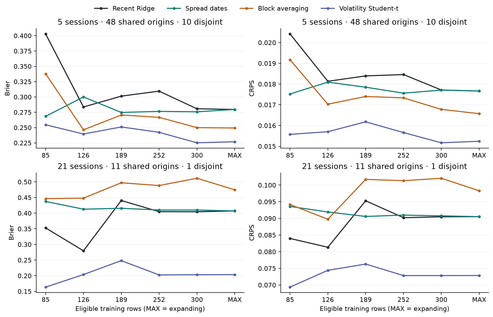

# V10 Learning Curves And Generalization

After initial results V10 selected systematic history coverage, return-block estimating equations and a volatility Student-t law for deeper curves. Each keeps the ten-input frame and compares with the same raw recent-window model. Budgets are 85, 126, 189, 252, 300 and expanding, subject to enough matured labels and an identical calibration mask. The history-spread selector converges to recent at the expanding cap because both include all dates. Larger budgets start later. Compare methods at a given budget using exact matches. Do not interpret differences between different sets of evaluation dates as pure learning effects.

## Weekly and monthly curves by scope

| horizon | cohort | model | registered_budget | n | training | overlap_effective_count | brier | crps | coverage80 | width80 |
| --- | --- | --- | --- | --- | --- | --- | --- | --- | --- | --- |
| 5 | combined | LC_BLOCK_85 | 85.000000 | 265 | 85.000000 | 17.326139 | 0.296250 | 0.012935 | 0.694340 | 0.041800 |
| 5 | combined | LC_PLAIN_85 | 85.000000 | 265 | 85.000000 | 17.326139 | 0.313266 | 0.013378 | 0.686792 | 0.041726 |
| 5 | combined | LC_SPREAD_85 | 85.000000 | 265 | 85.000000 | 43.607309 | 0.275547 | 0.012237 | 0.713208 | 0.039866 |
| 5 | combined | LC_STUDENT_85 | 85.000000 | 265 | 85.000000 | 17.326139 | 0.269162 | 0.011577 | 0.743396 | 0.043414 |
| 5 | combined | LC_BLOCK_126 | 126.000000 | 234 | 126.000000 | 25.524116 | 0.280623 | 0.013844 | 0.662393 | 0.042523 |
| 5 | combined | LC_PLAIN_126 | 126.000000 | 234 | 126.000000 | 25.524116 | 0.296829 | 0.013922 | 0.658120 | 0.041575 |
| 5 | combined | LC_SPREAD_126 | 126.000000 | 234 | 126.000000 | 46.884879 | 0.288250 | 0.013121 | 0.670940 | 0.039784 |
| 5 | combined | LC_STUDENT_126 | 126.000000 | 234 | 126.000000 | 25.524116 | 0.272733 | 0.012607 | 0.726496 | 0.044207 |
| 5 | combined | LC_BLOCK_189 | 189.000000 | 171 | 189.000000 | 38.122732 | 0.280171 | 0.014628 | 0.690058 | 0.045979 |
| 5 | combined | LC_PLAIN_189 | 189.000000 | 171 | 189.000000 | 38.122732 | 0.293976 | 0.015098 | 0.672515 | 0.044768 |
| 5 | combined | LC_SPREAD_189 | 189.000000 | 171 | 189.000000 | 53.330845 | 0.284610 | 0.014625 | 0.672515 | 0.043827 |
| 5 | combined | LC_STUDENT_189 | 189.000000 | 171 | 189.000000 | 38.122732 | 0.264819 | 0.013665 | 0.695906 | 0.046126 |
| 5 | combined | LC_BLOCK_MAX | expanding | 265 | 220.000000 | 44.322349 | 0.268949 | 0.012008 | 0.701887 | 0.040814 |
| 5 | combined | LC_PLAIN_MAX | expanding | 265 | 220.000000 | 44.322349 | 0.280763 | 0.012350 | 0.701887 | 0.039912 |
| 5 | combined | LC_SPREAD_MAX | expanding | 265 | 220.000000 | 44.322349 | 0.280763 | 0.012350 | 0.701887 | 0.039912 |
| 5 | combined | LC_STUDENT_MAX | expanding | 265 | 220.000000 | 44.322349 | 0.254899 | 0.011323 | 0.739623 | 0.041352 |
| 5 | early | LC_BLOCK_85 | 85.000000 | 173 | 85.000000 | 17.326139 | 0.275748 | 0.012315 | 0.705202 | 0.042406 |
| 5 | early | LC_PLAIN_85 | 85.000000 | 173 | 85.000000 | 17.326139 | 0.279462 | 0.012590 | 0.710983 | 0.042747 |
| 5 | early | LC_SPREAD_85 | 85.000000 | 173 | 85.000000 | 33.111824 | 0.281940 | 0.012086 | 0.705202 | 0.041466 |
| 5 | early | LC_STUDENT_85 | 85.000000 | 173 | 85.000000 | 17.326139 | 0.274480 | 0.011517 | 0.739884 | 0.042996 |
| 5 | early | LC_BLOCK_126 | 126.000000 | 142 | 126.000000 | 25.524116 | 0.290808 | 0.014569 | 0.647887 | 0.045640 |
| 5 | early | LC_PLAIN_126 | 126.000000 | 142 | 126.000000 | 25.524116 | 0.298180 | 0.014305 | 0.661972 | 0.044168 |
| 5 | early | LC_SPREAD_126 | 126.000000 | 142 | 126.000000 | 37.872137 | 0.295315 | 0.013303 | 0.661972 | 0.042032 |
| 5 | early | LC_STUDENT_126 | 126.000000 | 142 | 126.000000 | 25.524116 | 0.288759 | 0.013178 | 0.711268 | 0.045348 |
| 5 | early | LC_BLOCK_189 | 189.000000 | 79 | 189.000000 | 38.122732 | 0.295234 | 0.016981 | 0.645570 | 0.053264 |
| 5 | early | LC_PLAIN_189 | 189.000000 | 79 | 189.000000 | 38.122732 | 0.312751 | 0.017486 | 0.645570 | 0.054033 |
| 5 | early | LC_SPREAD_189 | 189.000000 | 79 | 189.000000 | 43.913623 | 0.310757 | 0.016908 | 0.632911 | 0.052486 |
| 5 | early | LC_STUDENT_189 | 189.000000 | 79 | 189.000000 | 38.122732 | 0.283523 | 0.015824 | 0.658228 | 0.051518 |
| 5 | early | LC_BLOCK_MAX | expanding | 173 | 170.000000 | 34.323040 | 0.273407 | 0.011920 | 0.705202 | 0.041837 |
| 5 | early | LC_PLAIN_MAX | expanding | 173 | 170.000000 | 34.323040 | 0.285984 | 0.012162 | 0.705202 | 0.041792 |
| 5 | early | LC_SPREAD_MAX | expanding | 173 | 170.000000 | 34.323040 | 0.285984 | 0.012162 | 0.705202 | 0.041792 |
| 5 | early | LC_STUDENT_MAX | expanding | 173 | 170.000000 | 34.323040 | 0.265704 | 0.011313 | 0.739884 | 0.041264 |
| 5 | later | LC_BLOCK_85 | 85.000000 | 92 | 85.000000 | 17.326139 | 0.334804 | 0.014101 | 0.673913 | 0.040661 |
| 5 | later | LC_PLAIN_85 | 85.000000 | 92 | 85.000000 | 17.326139 | 0.376831 | 0.014860 | 0.641304 | 0.039806 |
| 5 | later | LC_SPREAD_85 | 85.000000 | 92 | 85.000000 | 56.533646 | 0.263525 | 0.012521 | 0.728261 | 0.036858 |
| 5 | later | LC_STUDENT_85 | 85.000000 | 92 | 85.000000 | 17.326139 | 0.259161 | 0.011688 | 0.750000 | 0.044200 |
| 5 | later | LC_BLOCK_126 | 126.000000 | 92 | 126.000000 | 25.524116 | 0.264903 | 0.012724 | 0.684783 | 0.037711 |
| 5 | later | LC_PLAIN_126 | 126.000000 | 92 | 126.000000 | 25.524116 | 0.294744 | 0.013330 | 0.652174 | 0.037571 |
| 5 | later | LC_SPREAD_126 | 126.000000 | 92 | 126.000000 | 63.301435 | 0.277345 | 0.012840 | 0.684783 | 0.036314 |
| 5 | later | LC_STUDENT_126 | 126.000000 | 92 | 126.000000 | 25.524116 | 0.247998 | 0.011726 | 0.750000 | 0.042445 |
| 5 | later | LC_BLOCK_189 | 189.000000 | 92 | 189.000000 | 38.122732 | 0.267237 | 0.012607 | 0.728261 | 0.039724 |
| 5 | later | LC_PLAIN_189 | 189.000000 | 92 | 189.000000 | 38.122732 | 0.277855 | 0.013048 | 0.695652 | 0.036811 |
| 5 | later | LC_SPREAD_189 | 189.000000 | 92 | 189.000000 | 63.223009 | 0.262157 | 0.012665 | 0.706522 | 0.036391 |
| 5 | later | LC_STUDENT_189 | 189.000000 | 92 | 189.000000 | 38.122732 | 0.248757 | 0.011812 | 0.728261 | 0.041497 |
| 5 | later | LC_BLOCK_252 | 252.000000 | 92 | 252.000000 | 50.722045 | 0.270634 | 0.012602 | 0.684783 | 0.038941 |
| 5 | later | LC_PLAIN_252 | 252.000000 | 92 | 252.000000 | 50.722045 | 0.288010 | 0.013174 | 0.695652 | 0.037244 |
| 5 | later | LC_SPREAD_252 | 252.000000 | 92 | 252.000000 | 63.100159 | 0.267002 | 0.012586 | 0.695652 | 0.036175 |
| 5 | later | LC_STUDENT_252 | 252.000000 | 92 | 252.000000 | 50.722045 | 0.244291 | 0.011591 | 0.739130 | 0.041780 |
| 5 | later | LC_BLOCK_300 | 300.000000 | 48 | 300.000000 | 60.321716 | 0.249943 | 0.016779 | 0.479167 | 0.036435 |
| 5 | later | LC_PLAIN_300 | 300.000000 | 48 | 300.000000 | 60.321716 | 0.280723 | 0.017714 | 0.479167 | 0.034271 |
| 5 | later | LC_SPREAD_300 | 300.000000 | 48 | 300.000000 | 66.450089 | 0.275778 | 0.017709 | 0.479167 | 0.034535 |
| 5 | later | LC_STUDENT_300 | 300.000000 | 48 | 300.000000 | 60.321716 | 0.225188 | 0.015168 | 0.625000 | 0.044244 |
| 5 | later | LC_BLOCK_MAX | expanding | 92 | 314.000000 | 63.121639 | 0.260565 | 0.012173 | 0.695652 | 0.038889 |
| 5 | later | LC_PLAIN_MAX | expanding | 92 | 314.000000 | 63.121639 | 0.270945 | 0.012703 | 0.695652 | 0.036377 |
| 5 | later | LC_SPREAD_MAX | expanding | 92 | 314.000000 | 63.121639 | 0.270945 | 0.012703 | 0.695652 | 0.036377 |
| 5 | later | LC_STUDENT_MAX | expanding | 92 | 314.000000 | 63.121639 | 0.234580 | 0.011341 | 0.739130 | 0.041519 |
| 21 | combined | LC_BLOCK_85 | 85.000000 | 217 | 85.000000 | 4.409969 | 0.385768 | 0.038912 | 0.497696 | 0.088555 |
| 21 | combined | LC_PLAIN_85 | 85.000000 | 217 | 85.000000 | 4.409969 | 0.369758 | 0.038742 | 0.497696 | 0.089176 |
| 21 | combined | LC_SPREAD_85 | 85.000000 | 217 | 85.000000 | 9.821024 | 0.351169 | 0.033395 | 0.502304 | 0.075676 |
| 21 | combined | LC_STUDENT_85 | 85.000000 | 217 | 85.000000 | 4.409969 | 0.306114 | 0.032478 | 0.612903 | 0.098361 |
| 21 | combined | LC_BLOCK_126 | 126.000000 | 176 | 126.000000 | 6.352094 | 0.325964 | 0.036772 | 0.511364 | 0.095996 |
| 21 | combined | LC_PLAIN_126 | 126.000000 | 176 | 126.000000 | 6.352094 | 0.310367 | 0.037501 | 0.522727 | 0.093570 |
| 21 | combined | LC_SPREAD_126 | 126.000000 | 176 | 126.000000 | 10.702921 | 0.316699 | 0.036291 | 0.517045 | 0.086784 |
| 21 | combined | LC_STUDENT_126 | 126.000000 | 176 | 126.000000 | 6.352094 | 0.249888 | 0.034473 | 0.670455 | 0.105572 |
| 21 | combined | LC_BLOCK_189 | 189.000000 | 116 | 189.000000 | 9.345339 | 0.297836 | 0.029510 | 0.612069 | 0.092691 |
| 21 | combined | LC_PLAIN_189 | 189.000000 | 116 | 189.000000 | 9.345339 | 0.367015 | 0.031887 | 0.586207 | 0.085693 |
| 21 | combined | LC_SPREAD_189 | 189.000000 | 116 | 189.000000 | 12.226980 | 0.368240 | 0.031520 | 0.586207 | 0.085248 |
| 21 | combined | LC_STUDENT_189 | 189.000000 | 116 | 189.000000 | 9.345339 | 0.273222 | 0.024233 | 0.672414 | 0.086538 |
| 21 | combined | LC_BLOCK_MAX | expanding | 217 | 198.000000 | 9.773309 | 0.340047 | 0.034339 | 0.497696 | 0.086467 |
| 21 | combined | LC_PLAIN_MAX | expanding | 217 | 198.000000 | 9.773309 | 0.349764 | 0.034527 | 0.502304 | 0.081157 |
| 21 | combined | LC_SPREAD_MAX | expanding | 217 | 198.000000 | 9.773309 | 0.349764 | 0.034527 | 0.502304 | 0.081157 |
| 21 | combined | LC_STUDENT_MAX | expanding | 217 | 198.000000 | 9.773309 | 0.266992 | 0.029111 | 0.645161 | 0.089092 |
| 21 | early | LC_BLOCK_85 | 85.000000 | 141 | 85.000000 | 4.409969 | 0.319706 | 0.036479 | 0.567376 | 0.098647 |
| 21 | early | LC_PLAIN_85 | 85.000000 | 141 | 85.000000 | 4.409969 | 0.299279 | 0.034868 | 0.567376 | 0.094761 |
| 21 | early | LC_SPREAD_85 | 85.000000 | 141 | 85.000000 | 7.958301 | 0.286885 | 0.031095 | 0.574468 | 0.087407 |
| 21 | early | LC_STUDENT_85 | 85.000000 | 141 | 85.000000 | 4.409969 | 0.300368 | 0.033629 | 0.624113 | 0.104534 |
| 21 | early | LC_BLOCK_126 | 126.000000 | 100 | 126.000000 | 6.352094 | 0.225166 | 0.036090 | 0.620000 | 0.119409 |
| 21 | early | LC_PLAIN_126 | 126.000000 | 100 | 126.000000 | 6.352094 | 0.190687 | 0.036197 | 0.630000 | 0.113063 |
| 21 | early | LC_SPREAD_126 | 126.000000 | 100 | 126.000000 | 8.836832 | 0.198722 | 0.034424 | 0.630000 | 0.107107 |
| 21 | early | LC_STUDENT_126 | 126.000000 | 100 | 126.000000 | 6.352094 | 0.225757 | 0.038535 | 0.690000 | 0.124037 |
| 21 | early | LC_BLOCK_189 | 189.000000 | 40 | 189.000000 | 9.345339 | 0.214741 | 0.017992 | 1.000000 | 0.143303 |
| 21 | early | LC_PLAIN_189 | 189.000000 | 40 | 189.000000 | 9.345339 | 0.162683 | 0.015947 | 1.000000 | 0.125930 |
| 21 | early | LC_SPREAD_189 | 189.000000 | 40 | 189.000000 | 10.215770 | 0.161583 | 0.015872 | 1.000000 | 0.125127 |
| 21 | early | LC_STUDENT_189 | 189.000000 | 40 | 189.000000 | 9.345339 | 0.213484 | 0.013591 | 0.975000 | 0.103215 |
| 21 | early | LC_BLOCK_MAX | expanding | 141 | 159.000000 | 7.919286 | 0.303057 | 0.032790 | 0.560284 | 0.096923 |
| 21 | early | LC_PLAIN_MAX | expanding | 141 | 159.000000 | 7.919286 | 0.282984 | 0.031733 | 0.574468 | 0.090362 |
| 21 | early | LC_SPREAD_MAX | expanding | 141 | 159.000000 | 7.919286 | 0.282984 | 0.031733 | 0.574468 | 0.090362 |
| 21 | early | LC_STUDENT_MAX | expanding | 141 | 159.000000 | 7.919286 | 0.249400 | 0.028983 | 0.716312 | 0.095354 |
| 21 | later | LC_BLOCK_85 | 85.000000 | 76 | 85.000000 | 4.409969 | 0.508332 | 0.043424 | 0.368421 | 0.069831 |
| 21 | later | LC_PLAIN_85 | 85.000000 | 76 | 85.000000 | 4.409969 | 0.500516 | 0.045929 | 0.368421 | 0.078815 |
| 21 | later | LC_SPREAD_85 | 85.000000 | 76 | 85.000000 | 13.300006 | 0.470434 | 0.037663 | 0.368421 | 0.053910 |
| 21 | later | LC_STUDENT_85 | 85.000000 | 76 | 85.000000 | 4.409969 | 0.316774 | 0.030344 | 0.592105 | 0.086908 |
| 21 | later | LC_BLOCK_126 | 126.000000 | 76 | 126.000000 | 6.352094 | 0.458592 | 0.037670 | 0.368421 | 0.065189 |
| 21 | later | LC_PLAIN_126 | 126.000000 | 76 | 126.000000 | 6.352094 | 0.467840 | 0.039217 | 0.381579 | 0.067921 |
| 21 | later | LC_SPREAD_126 | 126.000000 | 76 | 126.000000 | 13.293266 | 0.471931 | 0.038748 | 0.368421 | 0.060044 |
| 21 | later | LC_STUDENT_126 | 126.000000 | 76 | 126.000000 | 6.352094 | 0.281638 | 0.029129 | 0.644737 | 0.081276 |
| 21 | later | LC_BLOCK_189 | 189.000000 | 76 | 189.000000 | 9.345339 | 0.341570 | 0.035572 | 0.407895 | 0.066053 |
| 21 | later | LC_PLAIN_189 | 189.000000 | 76 | 189.000000 | 9.345339 | 0.474557 | 0.040277 | 0.368421 | 0.064516 |
| 21 | later | LC_SPREAD_189 | 189.000000 | 76 | 189.000000 | 13.293886 | 0.477006 | 0.039756 | 0.368421 | 0.064260 |
| 21 | later | LC_STUDENT_189 | 189.000000 | 76 | 189.000000 | 9.345339 | 0.304663 | 0.029834 | 0.513158 | 0.077761 |
| 21 | later | LC_BLOCK_252 | 252.000000 | 53 | 252.000000 | 12.342058 | 0.517046 | 0.049820 | 0.150943 | 0.064701 |
| 21 | later | LC_PLAIN_252 | 252.000000 | 53 | 252.000000 | 12.342058 | 0.605526 | 0.052824 | 0.094340 | 0.057910 |
| 21 | later | LC_SPREAD_252 | 252.000000 | 53 | 252.000000 | 13.764465 | 0.608663 | 0.052563 | 0.094340 | 0.057121 |
| 21 | later | LC_STUDENT_252 | 252.000000 | 53 | 252.000000 | 12.342058 | 0.322318 | 0.037584 | 0.301887 | 0.071035 |
| 21 | later | LC_BLOCK_300 | 300.000000 | 11 | 300.000000 | 14.626219 | 0.511532 | 0.102052 | 0.000000 | 0.088006 |
| 21 | later | LC_PLAIN_300 | 300.000000 | 11 | 300.000000 | 14.626219 | 0.404444 | 0.090492 | 0.000000 | 0.067458 |
| 21 | later | LC_SPREAD_300 | 300.000000 | 11 | 300.000000 | 14.726508 | 0.409959 | 0.090772 | 0.000000 | 0.067548 |
| 21 | later | LC_STUDENT_300 | 300.000000 | 11 | 300.000000 | 14.626219 | 0.203091 | 0.072836 | 0.090909 | 0.092186 |
| 21 | later | LC_BLOCK_MAX | expanding | 76 | 271.500000 | 13.269944 | 0.408672 | 0.037212 | 0.381579 | 0.067068 |
| 21 | later | LC_PLAIN_MAX | expanding | 76 | 271.500000 | 13.269944 | 0.473657 | 0.039711 | 0.368421 | 0.064080 |
| 21 | later | LC_SPREAD_MAX | expanding | 76 | 271.500000 | 13.269944 | 0.473657 | 0.039711 | 0.368421 | 0.064080 |
| 21 | later | LC_STUDENT_MAX | expanding | 76 | 271.500000 | 13.269944 | 0.299630 | 0.029349 | 0.513158 | 0.077476 |

Matched scoring recalculates candidate and parent on the same dates. The strict intersection across all six budgets contains 48 weekly origins and 11 monthly origins, all later. The 300-row volatility Student-t monthly Brier of 0.203091 is based on those 11 rolling origins, with CRPS 0.072836. The broader 126-row result of 0.249888 uses 176 origins with CRPS 0.034473. The full-coverage neutral CRPS is 0.025420. [Budget-by-budget matched contrasts](learning-curve-matched.csv) · [All budgets on the strict origin intersection](learning-curves-fixed-origins.csv) · [Exact V9 curve](V10_REPRODUCTION_AND_BASELINES.md).

## Separate historical refresh

V10 refreshed through **2026-11-23**, validating official closes for 2026-11-18, 2026-11-19, 2026-11-20, 2026-11-23. This equals the final completed boundary previously captured by V9. The original 17 November history remains unchanged. **4 weekly** and **4 monthly** archived historical origins matured in the four additional sessions, with **32** stored model predictions checked against the reacquired outcomes. The previously issued 17 November V4 late-diagnostic forecasts remain pending to 25 November and 17 December as of this refresh. [Refresh assessment](refresh/refresh-audit.json) · [Scores on unchanged archival forecasts](refresh/frozen-forecast-rescore.csv).
