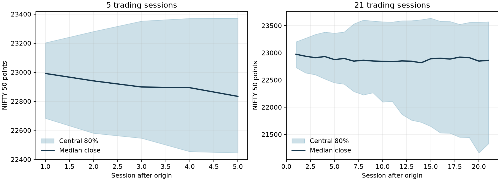

# V13 Experimental Forecast Report

Research-only demonstration replayed on a historical origin with mature outcomes. The reported endpoint, highs, lows, range, barriers and drawdowns come from one joint ensemble. The standalone volatility estimates come from their separately named models. Observations appear in their own column.

## 5 trading sessions

**2026-10-15** close **22,997.35**. Historical decision cutoff **2026-10-16 09:10 IST**. Target endpoint **2026-10-23**. V13 iv_scaled drew **512** paths from **210** matured windows using seed **181505**, with IV from **2026-10-14**. Endpoint up probability **36.13%**. Endpoint probability below −2% **13.09%** and above +2% **7.62%**. The q25–q75 and q10–q90 columns give central 50% and 80% intervals.

| target | predicted_mean | q10 | q25 | q50 | q75 | q90 | actual |
| --- | --- | --- | --- | --- | --- | --- | --- |
| endpoint_return | -0.004937 | -0.024011 | -0.015007 | -0.007094 | 0.005580 | 0.016406 | -0.017278 |
| volatility | 0.127445 | 0.072128 | 0.094833 | 0.124521 | 0.151347 | 0.180342 | 0.105906 |
| high | 0.009751 | -0.001671 | 0.003539 | 0.008251 | 0.013682 | 0.023587 | 0.007736 |
| low | -0.017143 | -0.036354 | -0.024781 | -0.016367 | -0.007871 | -0.002938 | -0.027192 |
| range | 0.026895 | 0.016276 | 0.020427 | 0.025607 | 0.031371 | 0.038983 | 0.034928 |
| drawdown | -0.017133 | -0.029107 | -0.023654 | -0.016453 | -0.009089 | -0.004281 | -0.023596 |

Standalone volatility estimates

| model | prediction |
| --- | --- |
| har21 | 0.152344 |
| iv_nearest | 0.131001 |
| iv_bracket | 0.132411 |
| fixed_iv_rv_0.50 | 0.142074 |
| har_iv | 0.119246 |

Reference-relative price and hit probabilities

| threshold | upper_price | lower_price | upper_touch | lower_touch | upper_close | lower_close | upper_endpoint | lower_endpoint | both | neither | first_upper_definite | first_lower_definite | first_ambiguous |
| --- | --- | --- | --- | --- | --- | --- | --- | --- | --- | --- | --- | --- | --- |
| 0.005000 | 23112.336750 | 22882.363250 | 0.658203 | 0.833984 | 0.529297 | 0.714844 | 0.263672 | 0.542969 | 0.492188 | 0.000000 | 0.412109 | 0.542969 | 0.044922 |
| 0.010000 | 23227.323500 | 22767.376500 | 0.382812 | 0.683594 | 0.306641 | 0.574219 | 0.171875 | 0.341797 | 0.123047 | 0.056641 | 0.326172 | 0.611328 | 0.005859 |
| 0.020000 | 23457.297000 | 22537.403000 | 0.166016 | 0.355469 | 0.113281 | 0.232422 | 0.076172 | 0.130859 | 0.005859 | 0.484375 | 0.160156 | 0.355469 | 0.000000 |
| 0.030000 | 23687.270500 | 22307.429500 | 0.048828 | 0.140625 | 0.027344 | 0.089844 | 0.025391 | 0.054688 | 0.000000 | 0.810547 | 0.048828 | 0.140625 | 0.000000 |
| 0.050000 | 24147.217500 | 21847.482500 | 0.000000 | 0.023438 | 0.000000 | 0.003906 | 0.000000 | 0.003906 | 0.000000 | 0.976562 | 0.000000 | 0.023438 | 0.000000 |

[Day-by-day conditional path](demo-5-path.csv) · [Joint sample outcomes](demo-5-sample-outcomes.csv).

## 21 trading sessions

**2026-10-15** close **22,997.35**. Historical decision cutoff **2026-10-16 09:10 IST**. Target endpoint **2026-11-16**. V13 iv_scaled drew **512** paths from **210** matured windows using seed **341505**, with IV from **2026-10-14**. Endpoint up probability **42.77%**. Endpoint probability below −2% **39.84%** and above +2% **12.89%**. The q25–q75 and q10–q90 columns give central 50% and 80% intervals.

| target | predicted_mean | q10 | q25 | q50 | q75 | q90 | actual |
| --- | --- | --- | --- | --- | --- | --- | --- |
| endpoint_return | -0.017952 | -0.072562 | -0.040953 | -0.006078 | 0.011710 | 0.024959 | 0.099740 |
| volatility | 0.136996 | 0.089256 | 0.101795 | 0.115442 | 0.163381 | 0.203965 | 0.158170 |
| high | 0.019720 | -0.000354 | 0.008225 | 0.017970 | 0.030157 | 0.042099 | 0.105534 |
| low | -0.042901 | -0.093358 | -0.060024 | -0.030522 | -0.017540 | -0.009413 | -0.027192 |
| range | 0.062621 | 0.032114 | 0.039557 | 0.053108 | 0.080269 | 0.102773 | 0.132726 |
| drawdown | -0.046274 | -0.091166 | -0.059902 | -0.032567 | -0.025149 | -0.021538 | -0.023596 |

Standalone volatility estimates

| model | prediction |
| --- | --- |
| har21 | 0.152344 |
| iv_nearest | 0.135695 |
| iv_bracket | 0.136268 |
| fixed_iv_rv_0.50 | 0.144530 |
| har_iv | 0.142494 |

Reference-relative price and hit probabilities

| threshold | upper_price | lower_price | upper_touch | lower_touch | upper_close | lower_close | upper_endpoint | lower_endpoint | both | neither | first_upper_definite | first_lower_definite | first_ambiguous |
| --- | --- | --- | --- | --- | --- | --- | --- | --- | --- | --- | --- | --- | --- |
| 0.005000 | 23112.336750 | 22882.363250 | 0.800781 | 0.951172 | 0.738281 | 0.910156 | 0.371094 | 0.507812 | 0.751953 | 0.000000 | 0.388672 | 0.554688 | 0.056641 |
| 0.010000 | 23227.323500 | 22767.376500 | 0.714844 | 0.890625 | 0.617188 | 0.816406 | 0.306641 | 0.460938 | 0.605469 | 0.000000 | 0.402344 | 0.591797 | 0.005859 |
| 0.020000 | 23457.297000 | 22537.403000 | 0.464844 | 0.681641 | 0.343750 | 0.609375 | 0.128906 | 0.398438 | 0.230469 | 0.083984 | 0.279297 | 0.636719 | 0.000000 |
| 0.030000 | 23687.270500 | 22307.429500 | 0.251953 | 0.511719 | 0.181641 | 0.441406 | 0.062500 | 0.326172 | 0.042969 | 0.279297 | 0.218750 | 0.501953 | 0.000000 |
| 0.050000 | 24147.217500 | 21847.482500 | 0.052734 | 0.316406 | 0.025391 | 0.277344 | 0.000000 | 0.185547 | 0.000000 | 0.630859 | 0.052734 | 0.316406 | 0.000000 |

[Day-by-day conditional path](demo-21-path.csv) · [Joint sample outcomes](demo-21-sample-outcomes.csv).

[Historical endpoint calibration](endpoint-calibration.csv) · [Historical barrier calibration](barrier-calibration.csv) · [Fit and simulation receipts](path-ledger.json).
