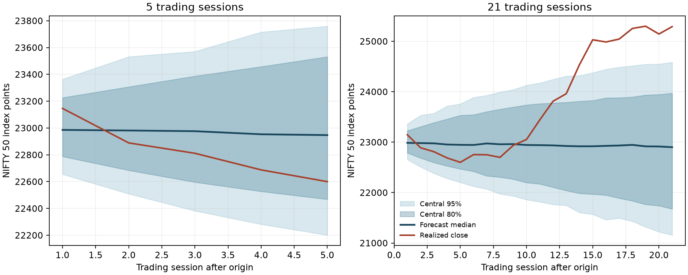

# V14 Experimental Market Intelligence

This research-only case uses a frozen historical origin. The realized series is shown separately. Probabilities for endpoint, extrema, range, drawdown, passage and volatility expansion are projections of one archived OHLC law. Stronger point risk models and standalone interval adjustments are reported elsewhere. The model missed important outcomes in the October episode, and the observed series is included to make those misses visible. In the barrier table an observed time of H+1 means the threshold was untouched at H.

## 5 trading sessions

**2026-10-15** reference close **22,997.35**. Inherited decision clock **2026-10-16 09:10 IST**, with options marks dated **2026-10-14**. Endpoint **2026-10-23**. The V14 joint_tail_width law contains **2,048** paths. It assigned **46.09%** to a positive endpoint. Forecast quantiles below are relative to the reference, except annualized volatility. The interval columns are paired at q25–q75, q10–q90 and q025–q975.

| target | predicted_mean | predicted_median | q025 | q10 | q25 | q75 | q90 | q975 | actual |
| --- | --- | --- | --- | --- | --- | --- | --- | --- | --- |
| endpoint_return | -0.000708 | -0.002208 | -0.034626 | -0.023070 | -0.012067 | 0.011263 | 0.023246 | 0.033137 | -0.017278 |
| abs_return | 0.014290 | 0.011668 | 0.000620 | 0.002317 | 0.006221 | 0.020446 | 0.029589 | 0.039531 | 0.017278 |
| volatility | 0.116000 | 0.111317 | 0.047066 | 0.066270 | 0.087360 | 0.142043 | 0.170414 | 0.206439 | 0.105906 |
| range | 0.025750 | 0.024442 | 0.013276 | 0.016070 | 0.019457 | 0.030393 | 0.037499 | 0.046156 | 0.034928 |
| high | 0.012215 | 0.009727 | -0.002347 | -0.000220 | 0.003637 | 0.018693 | 0.028200 | 0.037579 | 0.007736 |
| low | -0.013535 | -0.011849 | -0.040219 | -0.027038 | -0.020370 | -0.005037 | -0.000900 | 0.002463 | -0.027192 |
| drawdown | -0.013887 | -0.012314 | -0.038865 | -0.026765 | -0.018654 | -0.007283 | -0.003035 | 0.000000 | -0.023596 |
| rebound | 0.013340 | 0.011121 | 0.000000 | 0.001651 | 0.005686 | 0.018957 | 0.027666 | 0.037579 | 0.006470 |

### Volatility and extreme events

The joint path already supplies a realized-volatility law. The following point estimates use separate daily risk models.

| model | prediction | realized |
| --- | --- | --- |
| gjr_student | 0.123897 | 0.105906 |
| blend_gjr_iv | 0.128863 | 0.105906 |
| latent_iv | 0.113837 | 0.105906 |
| har | 0.155089 | 0.105906 |
| intraday_har | 0.125033 | 0.105906 |
| raw_iv | 0.131001 | 0.105906 |

| event | p | actual |
| --- | --- | --- |
| upper_fixed | 0.044922 | 0 |
| lower_fixed | 0.042969 | 0 |
| upper_relative | 0.197266 | 0 |
| lower_relative | 0.075195 | 0 |
| range_relative | 0.021484 | 0 |
| expand | 0.003418 | 0 |
| contract | 0.842285 | 1 |
| persist_high | 0.033203 | 0 |
| variance_extreme | 0.011230 | 0 |
| persist_up | 0.115723 | 0 |
| persist_down | 0.055664 | 0 |
| gap_relative | 0.000000 | 0 |

### Passage probability and time

Expected time is measured in trading sessions conditional on a hit by the horizon. Survival is cumulative no-touch probability at the horizon.

| side | threshold | index_level | p_touch | p_close | p_endpoint | expected_time_given_touch | survival | actual_time |
| --- | --- | --- | --- | --- | --- | --- | --- | --- |
| upper | 0.005000 | 23112.336750 | 0.701172 | 0.542969 | 0.363281 | 1.682451 | 0.298828 | 1 |
| lower | 0.005000 | 22882.363250 | 0.750000 | 0.620117 | 0.443359 | 1.642578 | 0.250000 | 2 |
| upper | 0.010000 | 23227.323500 | 0.482422 | 0.378906 | 0.268066 | 2.284413 | 0.517578 | 6 |
| lower | 0.010000 | 22767.376500 | 0.571777 | 0.450684 | 0.300781 | 2.432109 | 0.428223 | 3 |
| upper | 0.020000 | 23457.297000 | 0.227051 | 0.173828 | 0.125977 | 3.363441 | 0.772949 | 6 |
| lower | 0.020000 | 22537.403000 | 0.257324 | 0.164062 | 0.131348 | 3.502846 | 0.742676 | 5 |
| upper | 0.030000 | 23687.270500 | 0.083008 | 0.060059 | 0.044922 | 4.129412 | 0.916992 | 6 |
| lower | 0.030000 | 22307.429500 | 0.079102 | 0.052734 | 0.042969 | 4.012346 | 0.920898 | 6 |
| upper | 0.050000 | 24147.217500 | 0.003418 | 0.002930 | 0.002930 | 4.857143 | 0.996582 | 6 |
| lower | 0.050000 | 21847.482500 | 0.003906 | 0.002930 | 0.002441 | 4.375000 | 0.996094 | 6 |

| threshold | p_both | p_neither | p_upper_first | p_lower_first | p_same_candle | intraday_resolved_order |
| --- | --- | --- | --- | --- | --- | --- |
| 0.005000 | 0.451172 | 0.000000 | 0.435547 | 0.501465 | 0.062988 | upper |
| 0.010000 | 0.114258 | 0.060059 | 0.421387 | 0.512695 | 0.005859 | lower |
| 0.020000 | 0.000000 | 0.515625 | 0.227051 | 0.257324 | 0.000000 | lower |
| 0.030000 | 0.000000 | 0.837891 | 0.083008 | 0.079102 | 0.000000 | neither |
| 0.050000 | 0.000000 | 0.992676 | 0.003418 | 0.003906 | 0.000000 | neither |

### Sensitivity to the chosen path model

These are separate model projections at the same forecast cutoff. The spread across models measures forecast disagreement.

| model | target | p_up | predicted_mean | q10 | q90 |
| --- | --- | --- | --- | --- | --- |
| constant_iv | endpoint_return | 0.498535 | 0.000433 | -0.022845 | 0.025069 |
| constant_iv | volatility | — | 0.124621 | 0.074855 | 0.178842 |
| constant_iv | range | — | 0.027370 | 0.017484 | 0.039556 |
| gjr_iv | endpoint_return | 0.503418 | 0.000396 | -0.021652 | 0.023267 |
| gjr_iv | volatility | — | 0.117513 | 0.069379 | 0.171232 |
| gjr_iv | range | — | 0.025833 | 0.016337 | 0.037672 |
| gjr_student | endpoint_return | 0.510254 | 0.000402 | -0.021251 | 0.022980 |
| gjr_student | volatility | — | 0.115813 | 0.066206 | 0.174163 |
| gjr_student | range | — | 0.025560 | 0.015890 | 0.037380 |
| path_mixture | endpoint_return | 0.460938 | -0.000667 | -0.023070 | 0.023256 |
| path_mixture | volatility | — | 0.116923 | 0.066743 | 0.169745 |
| path_mixture | range | — | 0.025958 | 0.016330 | 0.037444 |
| joint_tail_width | endpoint_return | 0.460938 | -0.000708 | -0.023070 | 0.023246 |
| joint_tail_width | volatility | — | 0.116000 | 0.066270 | 0.170414 |
| joint_tail_width | range | — | 0.025750 | 0.016070 | 0.037499 |

[Day-by-day conditional path](demo-5-conditional-path.csv).

## 21 trading sessions

**2026-10-15** reference close **22,997.35**. Inherited decision clock **2026-10-16 09:10 IST**, with options marks dated **2026-10-14**. Endpoint **2026-11-16**. The V14 joint_tail_width law contains **2,048** paths. It assigned **45.21%** to a positive endpoint. Forecast quantiles below are relative to the reference, except annualized volatility. The interval columns are paired at q25–q75, q10–q90 and q025–q975.

| target | predicted_mean | predicted_median | q025 | q10 | q25 | q75 | q90 | q975 | actual |
| --- | --- | --- | --- | --- | --- | --- | --- | --- | --- |
| endpoint_return | -0.005616 | -0.004221 | -0.080265 | -0.057661 | -0.033873 | 0.020212 | 0.042321 | 0.069082 | 0.099740 |
| abs_return | 0.031035 | 0.025664 | 0.001491 | 0.004769 | 0.012175 | 0.045951 | 0.064926 | 0.086717 | 0.099740 |
| volatility | 0.122495 | 0.121435 | 0.073549 | 0.089632 | 0.103189 | 0.139307 | 0.157205 | 0.187099 | 0.158170 |
| range | 0.057019 | 0.053443 | 0.029271 | 0.035667 | 0.043156 | 0.068820 | 0.082594 | 0.099450 | 0.132726 |
| high | 0.025484 | 0.021559 | -0.001768 | 0.001591 | 0.007710 | 0.037579 | 0.055770 | 0.080474 | 0.105534 |
| low | -0.031534 | -0.025499 | -0.092181 | -0.068557 | -0.046952 | -0.011968 | -0.003434 | 0.001181 | -0.027192 |
| drawdown | -0.038810 | -0.033767 | -0.086288 | -0.069683 | -0.051070 | -0.023773 | -0.016492 | -0.010999 | -0.023596 |
| rebound | 0.035493 | 0.031300 | 0.011202 | 0.014717 | 0.020752 | 0.045829 | 0.061338 | 0.084924 | 0.119440 |

### Volatility and extreme events

The joint path already supplies a realized-volatility law. The following point estimates use separate daily risk models.

| model | prediction | realized |
| --- | --- | --- |
| gjr_student | 0.116528 | 0.158170 |
| blend_gjr_iv | 0.119833 | 0.158170 |
| latent_iv | 0.088824 | 0.158170 |
| har | 0.167870 | 0.158170 |
| intraday_har | 0.137363 | 0.158170 |
| raw_iv | 0.136268 | 0.158170 |

| event | p | actual |
| --- | --- | --- |
| upper_fixed | 0.067871 | 1 |
| lower_fixed | 0.130859 | 0 |
| upper_relative | 0.163574 | 1 |
| lower_relative | 0.101074 | 0 |
| range_relative | 0.015625 | 1 |
| expand | 0.011230 | 0 |
| contract | 0.508301 | 0 |
| persist_high | 0.053223 | 0 |
| variance_extreme | 0.000000 | 0 |
| persist_up | 0.058594 | 0 |
| persist_down | 0.034180 | 0 |
| gap_relative | 0.000000 | 0 |

### Passage probability and time

Expected time is measured in trading sessions conditional on a hit by the horizon. Survival is cumulative no-touch probability at the horizon.

| side | threshold | index_level | p_touch | p_close | p_endpoint | expected_time_given_touch | survival | actual_time |
| --- | --- | --- | --- | --- | --- | --- | --- | --- |
| upper | 0.005000 | 23112.336750 | 0.822754 | 0.729492 | 0.408203 | 2.962611 | 0.177246 | 1 |
| lower | 0.005000 | 22882.363250 | 0.874512 | 0.805176 | 0.487305 | 2.958682 | 0.125488 | 2 |
| upper | 0.010000 | 23227.323500 | 0.693359 | 0.624512 | 0.363770 | 4.818310 | 0.306641 | 11 |
| lower | 0.010000 | 22767.376500 | 0.788086 | 0.722168 | 0.433105 | 4.768897 | 0.211914 | 3 |
| upper | 0.020000 | 23457.297000 | 0.524414 | 0.473633 | 0.250977 | 7.994413 | 0.475586 | 12 |
| lower | 0.020000 | 22537.403000 | 0.595703 | 0.520996 | 0.345215 | 7.719672 | 0.404297 | 5 |
| upper | 0.030000 | 23687.270500 | 0.349609 | 0.309570 | 0.170410 | 10.418994 | 0.650391 | 12 |
| lower | 0.030000 | 22307.429500 | 0.437012 | 0.391113 | 0.276367 | 10.354190 | 0.562988 | 22 |
| upper | 0.050000 | 24147.217500 | 0.136230 | 0.114258 | 0.067871 | 13.448029 | 0.863770 | 14 |
| lower | 0.050000 | 21847.482500 | 0.221680 | 0.200684 | 0.130859 | 14.138767 | 0.778320 | 22 |

| threshold | p_both | p_neither | p_upper_first | p_lower_first | p_same_candle | intraday_resolved_order |
| --- | --- | --- | --- | --- | --- | --- |
| 0.005000 | 0.697266 | 0.000000 | 0.435547 | 0.501465 | 0.062988 | upper |
| 0.010000 | 0.481445 | 0.000000 | 0.449707 | 0.544434 | 0.005859 | lower |
| 0.020000 | 0.157715 | 0.037598 | 0.436523 | 0.525879 | 0.000000 | lower |
| 0.030000 | 0.019043 | 0.232422 | 0.338867 | 0.428711 | 0.000000 | upper |
| 0.050000 | 0.000000 | 0.642090 | 0.136230 | 0.221680 | 0.000000 | upper |

### Sensitivity to the chosen path model

These are separate model projections at the same forecast cutoff. The spread across models measures forecast disagreement.

| model | target | p_up | predicted_mean | q10 | q90 |
| --- | --- | --- | --- | --- | --- |
| constant_iv | endpoint_return | 0.518066 | 0.001939 | -0.045149 | 0.048321 |
| constant_iv | volatility | — | 0.129830 | 0.104372 | 0.155088 |
| constant_iv | range | — | 0.058599 | 0.038760 | 0.082707 |
| gjr_iv | endpoint_return | 0.521484 | 0.001772 | -0.042510 | 0.044439 |
| gjr_iv | volatility | — | 0.122232 | 0.096011 | 0.149348 |
| gjr_iv | range | — | 0.055148 | 0.036370 | 0.078804 |
| gjr_student | endpoint_return | 0.535645 | 0.001616 | -0.040324 | 0.040977 |
| gjr_student | volatility | — | 0.113651 | 0.082310 | 0.149573 |
| gjr_student | range | — | 0.051151 | 0.032194 | 0.073985 |
| path_mixture | endpoint_return | 0.452148 | -0.005665 | -0.057708 | 0.042321 |
| path_mixture | volatility | — | 0.123387 | 0.092674 | 0.156107 |
| path_mixture | range | — | 0.057401 | 0.036957 | 0.082234 |
| joint_tail_width | endpoint_return | 0.452148 | -0.005616 | -0.057661 | 0.042321 |
| joint_tail_width | volatility | — | 0.122495 | 0.089632 | 0.157205 |
| joint_tail_width | range | — | 0.057019 | 0.035667 | 0.082594 |

[Day-by-day conditional path](demo-21-conditional-path.csv).
[Historical calibration](V14_PREDICTIVE_CALIBRATION_AND_INTERVALS.md) · [Model uncertainty](matched-search-adjusted.csv) · [Case forensics](V14_FORECAST_FAILURE_FORENSICS.md).
