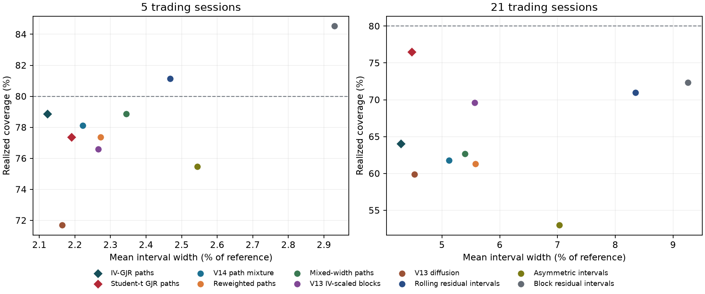

# V14 Predictive Calibration And Intervals

Central 50%, 80%, 90% and 95% ranges are scored jointly with interval width, interval score and the two miss directions. PIT reweighting uses the frequency with which matured observations fell in each forecast rank bin, with strong shrinkage toward equal weights across the same set of OHLC paths. A separate width mixture changes complete paths using prior residual tail ratios. Both variants retain joint and cross-horizon relationships. Standalone normalized residual, asymmetric, risk-matched and calendar-block corrections fit on matured prior forecast errors. Those intervals have separate scores and may differ from marginal intervals of a joint predictive distribution. The dependence and regime variation in rolling outcomes limit the applicability of standard exchangeability-based coverage guarantees.

| horizon | cohort | model | method | target | central | n | disjoint | coverage | width | interval_score | lower_miss | upper_miss | fitted |
| --- | --- | --- | --- | --- | --- | --- | --- | --- | --- | --- | --- | --- | --- |
| 5 | combined | constant_iv | whole_law | range | 50 | 265 | 53 | 0.449057 | 0.011289 | 0.025924 | 0.286792 | 0.264151 | 1.000000 |
| 5 | combined | V13_diffusion_iv | whole_law | range | 50 | 265 | 53 | 0.449057 | 0.011245 | 0.026030 | 0.279245 | 0.271698 | 1.000000 |
| 5 | combined | gjr_iv | whole_law | range | 50 | 265 | 53 | 0.445283 | 0.010892 | 0.026211 | 0.237736 | 0.316981 | 1.000000 |
| 5 | combined | path_mixture | whole_law | range | 50 | 265 | 53 | 0.452830 | 0.011448 | 0.026362 | 0.237736 | 0.309434 | 1.000000 |
| 5 | combined | joint_tail_width | whole_law | range | 50 | 265 | 53 | 0.467925 | 0.011981 | 0.026485 | 0.230189 | 0.301887 | 1.000000 |
| 5 | combined | joint_pit | whole_law | range | 50 | 265 | 53 | 0.467925 | 0.011633 | 0.026662 | 0.237736 | 0.294340 | 1.000000 |
| 5 | combined | V13_iv_scaled | whole_law | range | 50 | 265 | 53 | 0.464151 | 0.011129 | 0.026774 | 0.237736 | 0.298113 | 1.000000 |
| 5 | combined | jump_diffusion | whole_law | range | 50 | 265 | 53 | 0.532075 | 0.011023 | 0.027344 | 0.113208 | 0.354717 | 1.000000 |
| 5 | combined | iv_scaled_blocks | whole_law | range | 50 | 265 | 53 | 0.460377 | 0.010828 | 0.027368 | 0.230189 | 0.309434 | 1.000000 |
| 5 | combined | gjr_student | whole_law | range | 50 | 265 | 53 | 0.483019 | 0.011107 | 0.028963 | 0.184906 | 0.332075 | 1.000000 |
| 5 | combined | path_mixture | asymmetric_residual | range | 80 | 265 | 53 | 0.754717 | 0.025438 | 0.042238 | 0.109434 | 0.135849 | 0.890566 |
| 5 | combined | path_mixture | calendar_block_cqr | range | 80 | 265 | 53 | 0.845283 | 0.029301 | 0.042328 | 0.026415 | 0.128302 | 0.890566 |
| 5 | combined | path_mixture | rolling_cqr | range | 80 | 265 | 53 | 0.811321 | 0.024675 | 0.040357 | 0.049057 | 0.139623 | 0.890566 |
| 5 | combined | path_mixture | state_residual | range | 80 | 265 | 53 | 0.762264 | 0.026196 | 0.042310 | 0.109434 | 0.128302 | 0.890566 |
| 5 | combined | constant_iv | whole_law | range | 80 | 265 | 53 | 0.716981 | 0.021797 | 0.038142 | 0.147170 | 0.135849 | 1.000000 |
| 5 | combined | V13_diffusion_iv | whole_law | range | 80 | 265 | 53 | 0.716981 | 0.021638 | 0.038161 | 0.147170 | 0.135849 | 1.000000 |
| 5 | combined | gjr_iv | whole_law | range | 80 | 265 | 53 | 0.788679 | 0.021226 | 0.038165 | 0.060377 | 0.150943 | 1.000000 |
| 5 | combined | path_mixture | whole_law | range | 80 | 265 | 53 | 0.781132 | 0.022215 | 0.038225 | 0.064151 | 0.154717 | 1.000000 |
| 5 | combined | joint_tail_width | whole_law | range | 80 | 265 | 53 | 0.788679 | 0.023445 | 0.038917 | 0.071698 | 0.139623 | 1.000000 |
| 5 | combined | V13_iv_scaled | whole_law | range | 80 | 265 | 53 | 0.766038 | 0.022660 | 0.039164 | 0.109434 | 0.124528 | 1.000000 |
| 5 | combined | joint_pit | whole_law | range | 80 | 265 | 53 | 0.773585 | 0.022727 | 0.039285 | 0.079245 | 0.147170 | 1.000000 |
| 5 | combined | jump_diffusion | whole_law | range | 80 | 265 | 53 | 0.796226 | 0.021582 | 0.039746 | 0.018868 | 0.184906 | 1.000000 |
| 5 | combined | iv_scaled_blocks | whole_law | range | 80 | 265 | 53 | 0.754717 | 0.022369 | 0.039779 | 0.113208 | 0.132075 | 1.000000 |
| 5 | combined | gjr_student | whole_law | range | 80 | 265 | 53 | 0.773585 | 0.021903 | 0.043306 | 0.052830 | 0.173585 | 1.000000 |
| 5 | combined | V13_iv_scaled | whole_law | range | 90 | 265 | 53 | 0.860377 | 0.032592 | 0.046072 | 0.056604 | 0.083019 | 1.000000 |
| 5 | combined | V13_diffusion_iv | whole_law | range | 90 | 265 | 53 | 0.845283 | 0.028172 | 0.047286 | 0.067925 | 0.086792 | 1.000000 |
| 5 | combined | constant_iv | whole_law | range | 90 | 265 | 53 | 0.852830 | 0.028196 | 0.047352 | 0.071698 | 0.075472 | 1.000000 |
| 5 | combined | iv_scaled_blocks | whole_law | range | 90 | 265 | 53 | 0.875472 | 0.031886 | 0.048560 | 0.041509 | 0.083019 | 1.000000 |
| 5 | combined | gjr_iv | whole_law | range | 90 | 265 | 53 | 0.875472 | 0.027724 | 0.049167 | 0.030189 | 0.094340 | 1.000000 |
| 5 | combined | path_mixture | whole_law | range | 90 | 265 | 53 | 0.886792 | 0.029530 | 0.049314 | 0.022642 | 0.090566 | 1.000000 |
| 5 | combined | jump_diffusion | whole_law | range | 90 | 265 | 53 | 0.898113 | 0.028449 | 0.049832 | 0.007547 | 0.094340 | 1.000000 |
| 5 | combined | joint_tail_width | whole_law | range | 90 | 265 | 53 | 0.890566 | 0.030872 | 0.049882 | 0.022642 | 0.086792 | 1.000000 |
| 5 | combined | joint_pit | whole_law | range | 90 | 265 | 53 | 0.875472 | 0.029853 | 0.050081 | 0.022642 | 0.101887 | 1.000000 |
| 5 | combined | gjr_student | whole_law | range | 90 | 265 | 53 | 0.898113 | 0.029048 | 0.056502 | 0.018868 | 0.083019 | 1.000000 |
| 5 | combined | path_mixture | asymmetric_residual | range | 95 | 265 | 53 | 0.890566 | 0.036797 | 0.066675 | 0.045283 | 0.064151 | 0.890566 |
| 5 | combined | path_mixture | calendar_block_cqr | range | 95 | 265 | 53 | 0.950943 | 0.047757 | 0.062136 | 0.003774 | 0.045283 | 0.890566 |
| 5 | combined | path_mixture | rolling_cqr | range | 95 | 265 | 53 | 0.947170 | 0.045121 | 0.063069 | 0.011321 | 0.041509 | 0.890566 |
| 5 | combined | path_mixture | state_residual | range | 95 | 265 | 53 | 0.883019 | 0.037708 | 0.070638 | 0.056604 | 0.060377 | 0.890566 |
| 5 | combined | iv_scaled_blocks | whole_law | range | 95 | 265 | 53 | 0.943396 | 0.040726 | 0.053009 | 0.030189 | 0.026415 | 1.000000 |
| 5 | combined | V13_iv_scaled | whole_law | range | 95 | 265 | 53 | 0.939623 | 0.040987 | 0.053154 | 0.030189 | 0.030189 | 1.000000 |
| 5 | combined | V13_diffusion_iv | whole_law | range | 95 | 265 | 53 | 0.898113 | 0.034002 | 0.056180 | 0.037736 | 0.064151 | 1.000000 |
| 5 | combined | constant_iv | whole_law | range | 95 | 265 | 53 | 0.901887 | 0.033823 | 0.057080 | 0.033962 | 0.064151 | 1.000000 |
| 5 | combined | path_mixture | whole_law | range | 95 | 265 | 53 | 0.932075 | 0.035958 | 0.059471 | 0.011321 | 0.056604 | 1.000000 |
| 5 | combined | joint_tail_width | whole_law | range | 95 | 265 | 53 | 0.932075 | 0.037879 | 0.060391 | 0.007547 | 0.060377 | 1.000000 |
| 5 | combined | joint_pit | whole_law | range | 95 | 265 | 53 | 0.928302 | 0.036504 | 0.060515 | 0.011321 | 0.060377 | 1.000000 |
| 5 | combined | gjr_iv | whole_law | range | 95 | 265 | 53 | 0.920755 | 0.033730 | 0.060772 | 0.015094 | 0.064151 | 1.000000 |
| 5 | combined | jump_diffusion | whole_law | range | 95 | 265 | 53 | 0.932075 | 0.034981 | 0.061554 | 0.003774 | 0.064151 | 1.000000 |
| 5 | combined | gjr_student | whole_law | range | 95 | 265 | 53 | 0.932075 | 0.035957 | 0.075990 | 0.015094 | 0.052830 | 1.000000 |
| 21 | combined | gjr_student | whole_law | range | 50 | 217 | 11 | 0.382488 | 0.022660 | 0.068947 | 0.133641 | 0.483871 | 1.000000 |
| 21 | combined | gjr_iv | whole_law | range | 50 | 217 | 11 | 0.327189 | 0.022124 | 0.072090 | 0.235023 | 0.437788 | 1.000000 |
| 21 | combined | V13_diffusion_iv | whole_law | range | 50 | 217 | 11 | 0.313364 | 0.023470 | 0.072318 | 0.313364 | 0.373272 | 1.000000 |
| 21 | combined | jump_diffusion | whole_law | range | 50 | 217 | 11 | 0.373272 | 0.022400 | 0.072975 | 0.170507 | 0.456221 | 1.000000 |
| 21 | combined | path_mixture | whole_law | range | 50 | 217 | 11 | 0.368664 | 0.025145 | 0.075088 | 0.239631 | 0.391705 | 1.000000 |
| 21 | combined | joint_tail_width | whole_law | range | 50 | 217 | 11 | 0.364055 | 0.026531 | 0.076733 | 0.248848 | 0.387097 | 1.000000 |
| 21 | combined | constant_iv | whole_law | range | 50 | 217 | 11 | 0.313364 | 0.023889 | 0.077334 | 0.327189 | 0.359447 | 1.000000 |
| 21 | combined | joint_pit | whole_law | range | 50 | 217 | 11 | 0.359447 | 0.028602 | 0.078560 | 0.253456 | 0.387097 | 1.000000 |
| 21 | combined | iv_scaled_blocks | whole_law | range | 50 | 217 | 11 | 0.359447 | 0.027767 | 0.082264 | 0.216590 | 0.423963 | 1.000000 |
| 21 | combined | V13_iv_scaled | whole_law | range | 50 | 217 | 11 | 0.341014 | 0.027504 | 0.083856 | 0.230415 | 0.428571 | 1.000000 |
| 21 | combined | path_mixture | asymmetric_residual | range | 80 | 217 | 11 | 0.529954 | 0.070287 | 0.127617 | 0.161290 | 0.308756 | 0.792627 |
| 21 | combined | path_mixture | calendar_block_cqr | range | 80 | 217 | 11 | 0.723502 | 0.092581 | 0.131712 | 0.027650 | 0.248848 | 0.792627 |
| 21 | combined | path_mixture | rolling_cqr | range | 80 | 217 | 11 | 0.709677 | 0.083485 | 0.127173 | 0.027650 | 0.262673 | 0.792627 |
| 21 | combined | path_mixture | state_residual | range | 80 | 217 | 11 | 0.483871 | 0.066422 | 0.138850 | 0.202765 | 0.313364 | 0.792627 |
| 21 | combined | gjr_student | whole_law | range | 80 | 217 | 11 | 0.764977 | 0.044758 | 0.100304 | 0.036866 | 0.198157 | 1.000000 |
| 21 | combined | V13_diffusion_iv | whole_law | range | 80 | 217 | 11 | 0.599078 | 0.045217 | 0.111077 | 0.188940 | 0.211982 | 1.000000 |
| 21 | combined | gjr_iv | whole_law | range | 80 | 217 | 11 | 0.640553 | 0.042866 | 0.114532 | 0.087558 | 0.271889 | 1.000000 |
| 21 | combined | jump_diffusion | whole_law | range | 80 | 217 | 11 | 0.682028 | 0.043587 | 0.116027 | 0.041475 | 0.276498 | 1.000000 |
| 21 | combined | path_mixture | whole_law | range | 80 | 217 | 11 | 0.617512 | 0.051225 | 0.116043 | 0.096774 | 0.285714 | 1.000000 |
| 21 | combined | joint_tail_width | whole_law | range | 80 | 217 | 11 | 0.626728 | 0.053959 | 0.117703 | 0.082949 | 0.290323 | 1.000000 |
| 21 | combined | joint_pit | whole_law | range | 80 | 217 | 11 | 0.612903 | 0.055792 | 0.120237 | 0.096774 | 0.290323 | 1.000000 |
| 21 | combined | iv_scaled_blocks | whole_law | range | 80 | 217 | 11 | 0.728111 | 0.067861 | 0.121659 | 0.050691 | 0.221198 | 1.000000 |
| 21 | combined | V13_iv_scaled | whole_law | range | 80 | 217 | 11 | 0.695853 | 0.055644 | 0.121953 | 0.046083 | 0.258065 | 1.000000 |
| 21 | combined | constant_iv | whole_law | range | 80 | 217 | 11 | 0.566820 | 0.046187 | 0.123627 | 0.170507 | 0.262673 | 1.000000 |
| 21 | combined | gjr_student | whole_law | range | 90 | 217 | 11 | 0.843318 | 0.059737 | 0.130624 | 0.023041 | 0.133641 | 1.000000 |
| 21 | combined | iv_scaled_blocks | whole_law | range | 90 | 217 | 11 | 0.801843 | 0.087663 | 0.136111 | 0.023041 | 0.175115 | 1.000000 |
| 21 | combined | joint_pit | whole_law | range | 90 | 217 | 11 | 0.760369 | 0.072347 | 0.143547 | 0.041475 | 0.198157 | 1.000000 |
| 21 | combined | joint_tail_width | whole_law | range | 90 | 217 | 11 | 0.774194 | 0.072173 | 0.146068 | 0.023041 | 0.202765 | 1.000000 |
| 21 | combined | path_mixture | whole_law | range | 90 | 217 | 11 | 0.755760 | 0.069452 | 0.147049 | 0.041475 | 0.202765 | 1.000000 |
| 21 | combined | V13_diffusion_iv | whole_law | range | 90 | 217 | 11 | 0.755760 | 0.058852 | 0.152437 | 0.101382 | 0.142857 | 1.000000 |
| 21 | combined | gjr_iv | whole_law | range | 90 | 217 | 11 | 0.792627 | 0.055670 | 0.160208 | 0.023041 | 0.184332 | 1.000000 |
| 21 | combined | jump_diffusion | whole_law | range | 90 | 217 | 11 | 0.792627 | 0.056784 | 0.162505 | 0.023041 | 0.184332 | 1.000000 |
| 21 | combined | V13_iv_scaled | whole_law | range | 90 | 217 | 11 | 0.829493 | 0.087254 | 0.165037 | 0.013825 | 0.156682 | 1.000000 |
| 21 | combined | constant_iv | whole_law | range | 90 | 217 | 11 | 0.695853 | 0.059803 | 0.168231 | 0.092166 | 0.211982 | 1.000000 |
| 21 | combined | path_mixture | asymmetric_residual | range | 95 | 217 | 11 | 0.815668 | 0.105016 | 0.196007 | 0.046083 | 0.138249 | 0.792627 |
| 21 | combined | path_mixture | calendar_block_cqr | range | 95 | 217 | 11 | 0.866359 | 0.113614 | 0.194348 | 0.009217 | 0.124424 | 0.792627 |
| 21 | combined | path_mixture | rolling_cqr | range | 95 | 217 | 11 | 0.870968 | 0.122684 | 0.198776 | 0.009217 | 0.119816 | 0.792627 |
| 21 | combined | path_mixture | state_residual | range | 95 | 217 | 11 | 0.677419 | 0.099608 | 0.288183 | 0.179724 | 0.142857 | 0.792627 |
| 21 | combined | iv_scaled_blocks | whole_law | range | 95 | 217 | 11 | 0.870968 | 0.100619 | 0.159320 | 0.009217 | 0.119816 | 1.000000 |
| 21 | combined | gjr_student | whole_law | range | 95 | 217 | 11 | 0.889401 | 0.074500 | 0.159369 | 0.009217 | 0.101382 | 1.000000 |
| 21 | combined | joint_tail_width | whole_law | range | 95 | 217 | 11 | 0.857143 | 0.086435 | 0.182834 | 0.018433 | 0.124424 | 1.000000 |
| 21 | combined | path_mixture | whole_law | range | 95 | 217 | 11 | 0.852535 | 0.082076 | 0.184354 | 0.018433 | 0.129032 | 1.000000 |
| 21 | combined | joint_pit | whole_law | range | 95 | 217 | 11 | 0.847926 | 0.084217 | 0.186013 | 0.018433 | 0.133641 | 1.000000 |
| 21 | combined | V13_iv_scaled | whole_law | range | 95 | 217 | 11 | 0.889401 | 0.101328 | 0.200325 | 0.013825 | 0.096774 | 1.000000 |
| 21 | combined | V13_diffusion_iv | whole_law | range | 95 | 217 | 11 | 0.824885 | 0.070850 | 0.201073 | 0.050691 | 0.124424 | 1.000000 |
| 21 | combined | gjr_iv | whole_law | range | 95 | 217 | 11 | 0.843318 | 0.067234 | 0.223495 | 0.018433 | 0.138249 | 1.000000 |
| 21 | combined | jump_diffusion | whole_law | range | 95 | 217 | 11 | 0.843318 | 0.068594 | 0.225182 | 0.018433 | 0.138249 | 1.000000 |
| 21 | combined | constant_iv | whole_law | range | 95 | 217 | 11 | 0.778802 | 0.072076 | 0.226299 | 0.064516 | 0.156682 | 1.000000 |

| horizon | model | method | origin_state | realized_expansion | n | disjoint | coverage80 | width80 | score80 |
| --- | --- | --- | --- | --- | --- | --- | --- | --- | --- |
| 5 | V13_diffusion_iv | whole_law | high trailing risk | 0.000000 | 65 | 17 | 0.800000 | 0.026396 | 0.036174 |
| 5 | V13_diffusion_iv | whole_law | high trailing risk | 1.000000 | 16 | 6 | 0.437500 | 0.030951 | 0.104967 |
| 5 | V13_diffusion_iv | whole_law | ordinary trailing risk | 0.000000 | 113 | 31 | 0.707965 | 0.018902 | 0.027100 |
| 5 | V13_diffusion_iv | whole_law | ordinary trailing risk | 1.000000 | 71 | 23 | 0.718310 | 0.019538 | 0.042530 |
| 5 | gjr_student | whole_law | high trailing risk | 0.000000 | 65 | 17 | 0.830769 | 0.027169 | 0.043779 |
| 5 | gjr_student | whole_law | high trailing risk | 1.000000 | 16 | 6 | 0.437500 | 0.028016 | 0.125629 |
| 5 | gjr_student | whole_law | ordinary trailing risk | 0.000000 | 113 | 31 | 0.849558 | 0.019940 | 0.022990 |
| 5 | gjr_student | whole_law | ordinary trailing risk | 1.000000 | 71 | 23 | 0.676056 | 0.018829 | 0.056655 |
| 5 | joint_tail_width | whole_law | high trailing risk | 0.000000 | 65 | 17 | 0.830769 | 0.028915 | 0.038262 |
| 5 | joint_tail_width | whole_law | high trailing risk | 1.000000 | 16 | 6 | 0.437500 | 0.032975 | 0.116158 |
| 5 | joint_tail_width | whole_law | ordinary trailing risk | 0.000000 | 113 | 31 | 0.849558 | 0.020710 | 0.025295 |
| 5 | joint_tail_width | whole_law | ordinary trailing risk | 1.000000 | 71 | 23 | 0.732394 | 0.020641 | 0.043791 |
| 21 | V13_diffusion_iv | whole_law | high trailing risk | 0.000000 | 43 | 4 | 0.627907 | 0.059285 | 0.150296 |
| 21 | V13_diffusion_iv | whole_law | high trailing risk | 1.000000 | 35 | 3 | 0.571429 | 0.048716 | 0.242111 |
| 21 | V13_diffusion_iv | whole_law | ordinary trailing risk | 0.000000 | 93 | 5 | 0.623656 | 0.041543 | 0.058294 |
| 21 | V13_diffusion_iv | whole_law | ordinary trailing risk | 1.000000 | 46 | 4 | 0.543478 | 0.036833 | 0.081428 |
| 21 | gjr_student | whole_law | high trailing risk | 0.000000 | 43 | 4 | 0.790698 | 0.051519 | 0.122606 |
| 21 | gjr_student | whole_law | high trailing risk | 1.000000 | 35 | 3 | 0.457143 | 0.049856 | 0.240408 |
| 21 | gjr_student | whole_law | ordinary trailing risk | 0.000000 | 93 | 5 | 0.913978 | 0.041981 | 0.045505 |
| 21 | gjr_student | whole_law | ordinary trailing risk | 1.000000 | 46 | 4 | 0.673913 | 0.040177 | 0.083643 |
| 21 | joint_tail_width | whole_law | high trailing risk | 0.000000 | 43 | 4 | 0.720930 | 0.087633 | 0.168298 |
| 21 | joint_tail_width | whole_law | high trailing risk | 1.000000 | 35 | 3 | 0.542857 | 0.063743 | 0.219998 |
| 21 | joint_tail_width | whole_law | ordinary trailing risk | 0.000000 | 93 | 5 | 0.774194 | 0.043977 | 0.051753 |
| 21 | joint_tail_width | whole_law | ordinary trailing risk | 1.000000 | 46 | 4 | 0.304348 | 0.035219 | 0.125906 |

[All cohort and calibration scores](interval-calibration-leaderboard.csv) · [Coverage by origin risk and subsequent expansion](conditional-interval-calibration.csv) · [Standalone intervals and cutoffs](standalone-calibrated-intervals.csv.gz) · [Conformalized quantile regression method](https://proceedings.neurips.cc/paper_files/paper/2019/hash/5103c3584b063c431bd1268e9b5e76fb-Abstract.html).
