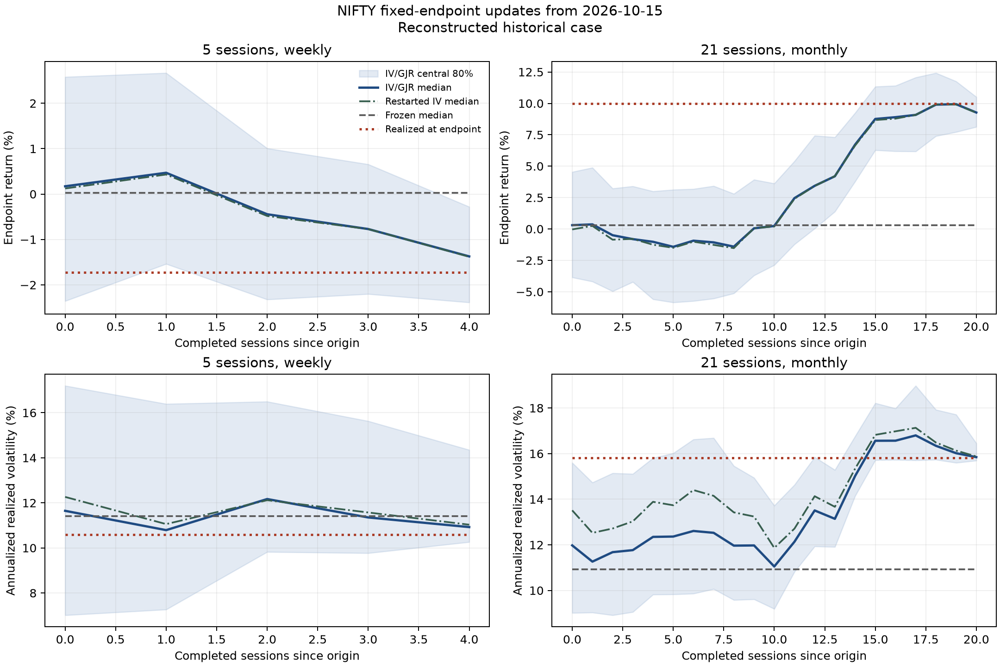

# V15 conditional path updating

Every updated law joins the exact observed prefix to a simulated remaining path. A path has O/H/L/C per session and preserves relative price continuity between its current anchor and all future closes. This makes endpoint, realized volatility, high, low, range, drawdown, rebound and touch probabilities jointly determined. Known highs and lows impose a floor on whole-window range throughout each sequence. Simulated columns quantify the remaining period separately. The original frozen dated law is accessed by hash and continues to supply the no-update baseline.

## Restart, condition and hybrid comparisons

| horizon | model | origins | range crps | range cov80 | range width80 | remaining range crps | vol crps | drawdown crps | joint energy |
| --- | --- | --- | --- | --- | --- | --- | --- | --- | --- |
| 5 | hybrid | 265 | 0.004167 | 0.821698 | 0.015286 | 0.003725 | 0.016071 | 0.003706 | 0.450300 |
| 5 | iv_restart | 265 | 0.004173 | 0.804717 | 0.015534 | 0.003824 | 0.016091 | 0.003705 | 0.448150 |
| 5 | vol_state | 265 | 0.004183 | 0.814151 | 0.015463 | 0.003726 | 0.016065 | 0.003690 | 0.448505 |
| 5 | particle | 265 | 0.004229 | 0.808491 | 0.014404 | 0.003913 | 0.016524 | 0.003763 | 0.455166 |
| 5 | analogue | 265 | 0.004353 | 0.810377 | 0.016018 | 0.003981 | 0.017238 | 0.003823 | 0.464707 |
| 5 | gjr_restart | 265 | 0.004465 | 0.798113 | 0.014520 | 0.003973 | 0.017126 | 0.003704 | 0.458911 |
| 5 | historical | 265 | 0.005012 | 0.807547 | 0.018383 | 0.005081 | 0.020689 | 0.003909 | 0.491348 |
| 5 | frozen | 265 | 0.005850 | 0.788679 | 0.021226 | 0.003961 | 0.026593 | 0.005997 | 0.681894 |
| 21 | vol_state | 217 | 0.009947 | 0.784332 | 0.030703 | 0.010116 | 0.013568 | 0.008249 | 0.497222 |
| 21 | iv_restart | 217 | 0.010019 | 0.748387 | 0.031521 | 0.010191 | 0.013843 | 0.008455 | 0.498345 |
| 21 | hybrid | 217 | 0.010026 | 0.786866 | 0.029933 | 0.010287 | 0.014010 | 0.008257 | 0.501069 |
| 21 | gjr_restart | 217 | 0.010160 | 0.764747 | 0.028601 | 0.010557 | 0.014400 | 0.008240 | 0.502234 |
| 21 | particle | 217 | 0.010542 | 0.747696 | 0.027223 | 0.011523 | 0.016277 | 0.008403 | 0.516526 |
| 21 | analogue | 217 | 0.010948 | 0.790553 | 0.038960 | 0.011373 | 0.015445 | 0.009251 | 0.543204 |
| 21 | historical | 217 | 0.011808 | 0.716820 | 0.036176 | 0.013373 | 0.020441 | 0.009099 | 0.560344 |
| 21 | frozen | 217 | 0.015422 | 0.764977 | 0.044758 | 0.011940 | 0.028802 | 0.014301 | 0.767308 |

## Particle and analogue concentration

| horizon | checkpoints | particle min | particle median | analogue min | analogue median | analogue count max | hybrid prior median |
| --- | --- | --- | --- | --- | --- | --- | --- |
| 5 | 1,325 | 21.529793 | 1286.224458 | 13.780853 | 144.823240 | 210 | 0.363777 |
| 21 | 4,557 | 17.539421 | 1282.264261 | 5.043933 | 150.673195 | 210 | 0.362964 |

The particle likelihood weights paths by standardized observed close-prefix distance and realized prefix variance. Effective sample size is 1 / Σw² before any tempering, relative to 2,048 original particles. The low-ESS fallback adds uniform support below 24. A hybrid chooses a fixed ESS-bound share of conditional original paths and fills the remainder with restarted IV/GJR paths. Analogue fitting uses up to 210 already-resolved original windows, matches prefix behavior and starting risk, scales the remaining analogous path by current IV and gives the matched empirical distribution mixed uniform support. Empirical blocks use matched remaining-horizon length. IV diffusion, GJR refiltering and the blended risk state restart from current market levels. The energy score compares normalized endpoint, range, risk and drawdown jointly using shared path draws and a paired approximation.

[Encoded joint forecast law manifest](joint-update-archive.json) [Concentration receipts](joint-update-receipts.json) [Whole and remaining path scores](sequential-scores.csv.gz) [Historical fixed-endpoint chart](historical-fixed-endpoint-updates.png)

