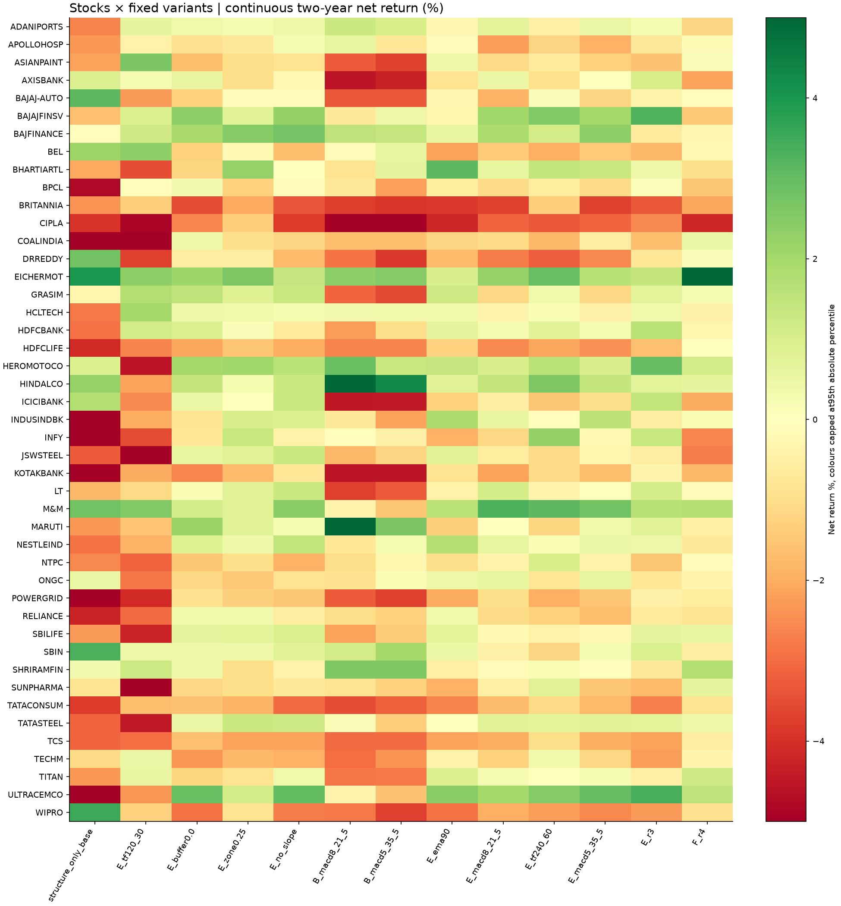
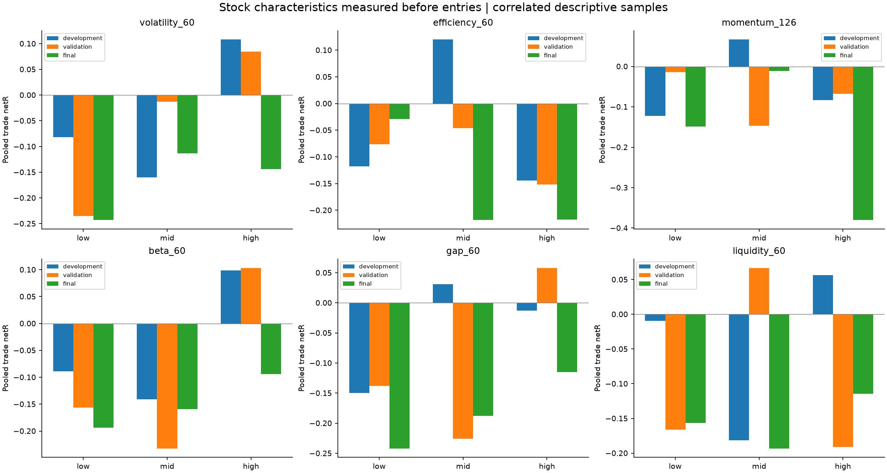

# Individual-stock swing strategy transfer test

Tested **13 fixed variants** on **45 comparable stocks** from a registered starting universe of 50 stocks. Window: 11 November 2024–9 November 2026; January 2023 onward warmup. Two timing controls are additional. No parameter was optimized per stock.

## What the results mean

**No stock/variant pair passed the joint evidence screen.** 230 of 585 pairs had positive two-year net returns, yet all 13 variants had negative mean returns across the 45 eligible stocks. Historical fit was stock-specific rather than a broadly transferable edge.

Eicher Motors had positive net returns on all 13 variants; Hindalco and Hero MotoCorp on 12 each, and M&M on 11. These are discovery observations from the same period. Hindalco’s leading histogram variant weakened from +5.56% over the full period to +0.34% in the reserved final segment and −0.32% under severe final costs. Maruti’s leading histogram variant returned +5.04% overall but −0.91% in the final segment. The high profit factor for Eicher’s 4 R alignment rule comes from only 8 trades and does not supply a dependable win-rate estimate.

The two characteristic hypotheses chosen in development did not transfer: medium directional efficiency went from +0.12 R per trade in development to −0.22 R in final; high volatility went from +0.11 R to −0.14 R. No volatility, momentum, beta or gap bucket had positive final expectancy. Autos and metals/materials had small positive final pooled estimates (+0.064 R and +0.068 R), with intervals spanning zero; telecom’s positive estimate comes from Bharti Airtel alone. This does not justify selecting a sector or stock type for investment.

Across stocks, the rank correlation between median strategy return and buy-and-hold return was 0.53. That is evidence of some association with the stock’s overall path, not evidence of incremental alpha. Buy-and-hold exposure differs substantially from swing exposure.

Full-period winners below identify historical strategy fit. They are selected after seeing this period and are not investment recommendations. The stronger test is whether stocks chosen using development data and stock characteristics known before entry continued to work in later periods. This remains a swing-trading study; business valuation, earnings durability and suitability for long-term investment were not tested.

## Highest historical stock/variant returns

|Stock|Fixed variant|Two-year trades|Two-year net%|MTM DD%|PF|Reserved final net%|
|---|---|---|---|---|---|---|
|HINDALCO|B_macd8_21_5|34|5.56|2.35|1.84|0.34|
|EICHERMOT|F_r4|8|5.13|0.74|19.04|0.62|
|MARUTI|B_macd8_21_5|26|5.04|1.82|2.02|-0.91|
|HINDALCO|B_macd5_35_5|32|4.27|2.35|1.66|0.34|
|EICHERMOT|structure_only_base|40|3.97|2.66|1.37|0.97|
|WIPRO|structure_only_base|33|3.54|2.39|1.38|1.05|
|ULTRACEMCO|E_r3|8|3.38|0.74|4.30|0.72|
|SBIN|structure_only_base|37|3.33|3.79|1.37|1.50|
|M&M|E_macd8_21_5|11|3.31|1.65|2.97|0.40|
|BAJAJFINSV|E_r3|11|3.25|1.64|2.61|1.01|
|M&M|E_tf240_60|13|3.12|1.59|2.46|0.51|
|BHARTIARTL|E_ema90|11|3.11|1.44|2.60|0.40|
|BAJAJ-AUTO|structure_only_base|34|3.11|2.97|1.33|2.67|
|ULTRACEMCO|E_no_slope|9|3.01|1.02|3.94|0.95|
|ULTRACEMCO|E_macd5_35_5|14|3.01|1.35|2.21|0.88|

[All stock/variant rankings](pair-leaderboard.csv), [stock summaries](stock-summary.csv), [registered universe dispositions](registered-pair-dispositions.csv).

## Which variants transferred broadly

Every stock sleeve starts with ₹10 lakh, risks at most 0.5% including fees, and holds at most one cash long position. Cross-stock means below are averages across separately funded sleeves. They do not simulate using one ₹10 lakh account to fund all stocks simultaneously. Positive stock breadth matters: one spectacular stock is weaker evidence than consistent results across many stocks.

|Variant|Stocks|Positive stocks%|Total trades|Mean two-year%|Median two-year%|Mean final%|Mean severe final%|
|---|---|---|---|---|---|---|---|
|E_zone0.25|45|48.89|266|-0.09|-0.02|-0.10|-0.17|
|E_no_slope|45|46.67|426|-0.13|-0.11|-0.14|-0.26|
|E_r3|45|46.67|361|-0.15|-0.36|-0.19|-0.25|
|E_tf240_60|45|42.22|445|-0.18|-0.40|-0.12|-0.23|
|E_buffer0.0|45|53.33|355|-0.20|0.31|-0.14|-0.25|
|F_r4|45|33.33|302|-0.33|-0.31|-0.03|-0.08|
|E_ema90|45|42.22|410|-0.34|-0.26|-0.21|-0.26|
|E_macd5_35_5|45|40.00|441|-0.36|-0.28|-0.23|-0.31|
|E_macd8_21_5|45|40.00|415|-0.39|-0.43|-0.20|-0.28|
|B_macd8_21_5|45|24.44|1211|-1.19|-1.03|-0.33|-0.55|
|B_macd5_35_5|45|31.11|1242|-1.36|-1.38|-0.44|-0.65|
|E_tf120_30|45|33.33|773|-1.51|-1.87|-0.56|-0.72|
|structure_only_base|45|28.89|1618|-1.74|-2.30|-0.62|-0.96|

## Stocks with broader historical fit

R anked by median return across all 13 fixed variants, avoiding selection solely by each stock’s best historical rule. The best-rule column is explicitly post-hoc. Buy-and-hold invests nearly 100% of capital, so its return is not exposure-matched to the risk-sized swing rules. Both include modeled cash dividend entitlement.

|Stock|Sector|Median variant%|Positive variants/13|Best historical variant|Best net%|Buy & hold%|
|---|---|---|---|---|---|---|
|EICHERMOT|autos|2.37|13|F_r4|5.13|62.75|
|ULTRACEMCO|metals_materials|2.02|9|E_r3|3.38|13.92|
|M&M|autos|1.68|11|E_macd8_21_5|3.31|12.74|
|HINDALCO|metals_materials|1.41|12|B_macd8_21_5|5.56|49.41|
|BAJFINANCE|financial_services|1.39|10|E_no_slope|2.75|56.28|
|HEROMOTOCO|autos|1.37|12|E_r3|3.00|20.56|
|BAJAJFINSV|financial_services|0.91|9|E_r3|3.25|6.19|
|TATASTEEL|metals_materials|0.48|9|E_zone0.25|1.25|30.07|
|SBIN|banks|0.45|10|structure_only_base|3.33|26.75|
|BHARTIARTL|telecom|0.44|7|E_ema90|3.11|34.91|
|NESTLEIND|consumer_staples|0.40|9|E_ema90|1.68|15.79|
|GRASIM|metals_materials|0.37|8|E_tf120_30|1.75|25.77|
|ADANIPORTS|industrials_infrastructure|0.37|9|B_macd8_21_5|1.25|43.99|
|HCLTECH|IT|0.31|9|E_tf120_30|2.03|-17.83|
|MARUTI|autos|0.22|8|B_macd8_21_5|5.04|16.18|

## Development-selected stock transfer

For each fixed rule, select up to 5 stocks with at least 8 development trades and positive development net R; rank by development expectancy only. The selector was specified before stock results were calculated. The same selected stocks are evaluated in validation and final; empty selection remains cash. No replacement by later winners is allowed. These samples are small, and this 13-variant transfer study inherits selection from prior ETF research on overlapping dates.

|id|part|stocks_selected|n_trades|mean_return_pct|selected_stocks|
|---|---|---|---|---|---|
|structure_only_base|validation|5|48|-1.35|M&M,EICHERMOT,SBILIFE,GRASIM,BAJFINANCE|
|structure_only_base|final|5|43|-0.18|M&M,EICHERMOT,SBILIFE,GRASIM,BAJFINANCE|
|structure_only_base|final_severe|5|41|-0.27|M&M,EICHERMOT,SBILIFE,GRASIM,BAJFINANCE|
|E_tf120_30|validation|5|26|-0.84|HDFCBANK,M&M,EICHERMOT,TATACONSUM,BAJFINANCE|
|E_tf120_30|final|5|10|-0.07|HDFCBANK,M&M,EICHERMOT,TATACONSUM,BAJFINANCE|
|E_tf120_30|final_severe|5|10|-0.12|HDFCBANK,M&M,EICHERMOT,TATACONSUM,BAJFINANCE|
|E_buffer0.0|validation|0|0|0.00||
|E_buffer0.0|final|0|0|0.00||
|E_buffer0.0|final_severe|0|0|0.00||
|E_zone0.25|validation|0|0|0.00||
|E_zone0.25|final|0|0|0.00||
|E_zone0.25|final_severe|0|0|0.00||
|E_no_slope|validation|1|3|-0.58|NESTLEIND|
|E_no_slope|final|1|3|1.05|NESTLEIND|
|E_no_slope|final_severe|1|3|0.95|NESTLEIND|
|B_macd8_21_5|validation|5|32|0.40|MARUTI,HEROMOTOCO,BAJFINANCE,HINDALCO,BPCL|
|B_macd8_21_5|final|5|25|-0.37|MARUTI,HEROMOTOCO,BAJFINANCE,HINDALCO,BPCL|
|B_macd8_21_5|final_severe|5|24|-0.58|MARUTI,HEROMOTOCO,BAJFINANCE,HINDALCO,BPCL|
|B_macd5_35_5|validation|5|40|-0.11|MARUTI,BAJFINANCE,HINDALCO,BPCL,SBIN|
|B_macd5_35_5|final|5|30|-0.97|MARUTI,BAJFINANCE,HINDALCO,BPCL,SBIN|
|B_macd5_35_5|final_severe|5|29|-1.17|MARUTI,BAJFINANCE,HINDALCO,BPCL,SBIN|
|E_ema90|validation|3|9|-0.13|M&M,NESTLEIND,ULTRACEMCO|
|E_ema90|final|3|5|0.65|M&M,NESTLEIND,ULTRACEMCO|
|E_ema90|final_severe|3|5|0.59|M&M,NESTLEIND,ULTRACEMCO|
|E_macd8_21_5|validation|1|1|-0.50|BHARTIARTL|
|E_macd8_21_5|final|1|4|0.85|BHARTIARTL|
|E_macd8_21_5|final_severe|1|4|0.73|BHARTIARTL|
|E_tf240_60|validation|1|1|-0.50|BHARTIARTL|
|E_tf240_60|final|1|5|1.79|BHARTIARTL|
|E_tf240_60|final_severe|1|4|0.94|BHARTIARTL|
|E_macd5_35_5|validation|1|1|-0.50|BHARTIARTL|
|E_macd5_35_5|final|1|4|0.85|BHARTIARTL|
|E_macd5_35_5|final_severe|1|4|0.73|BHARTIARTL|
|E_r3|validation|0|0|0.00||
|E_r3|final|0|0|0.00||
|E_r3|final_severe|0|0|0.00||
|F_r4|validation|0|0|0.00||
|F_r4|final|0|0|0.00||
|F_r4|final_severe|0|0|0.00||

## What kinds of stocks fit

Daily features are volatility over 60 sessions, directional efficiency over 60 sessions,126-session price momentum,60-session beta against NIFTY, average absolute overnight gap over 60 sessions, and a provider price×volume turnover proxy. Values enter trade records only after the daily candle is complete. Low/mid/high cutoffs are development-only terciles from unique stock/signal events. Sector is a fixed broad business classification, not a historical market-cap label. This large-cap universe cannot establish whether small-cap stocks work better.

The liquidity proxy is exploratory because historical volume adjustment was not independently certified. Split-neutral prices preserve scale-invariant trading signals, but cross-stock liquidity comparisons require verified contemporary volume and traded value. No live liquidity filter is inferred. Sector and feature-bin summaries pool correlated rule trades and repeat some market events; block intervals resample common 10-session exit calendars and are conditional descriptive intervals, not independent confirmations.

Two development-chosen characteristic hypotheses (minimum 30 trades and 10 stocks; liquidity excluded):

|feature|bucket|stocks|n_trades|expectancy_r|
|---|---|---|---|---|
|efficiency_60|mid|45|1421|0.12|
|volatility_60|high|39|1375|0.11|

R eserved final stock-type evidence (all bins are disclosed, rather than selecting only favorable ones):

|feature|bucket|stocks|n_trades|expectancy_r|ci_low|ci_high|
|---|---|---|---|---|---|---|
|volatility_60|high|43|967|-0.14|-0.45|0.16|
|volatility_60|low|30|393|-0.24|-0.66|0.35|
|volatility_60|mid|39|533|-0.11|-0.50|0.22|
|efficiency_60|high|45|492|-0.22|-0.52|0.13|
|efficiency_60|low|45|624|-0.03|-0.38|0.29|
|efficiency_60|mid|45|777|-0.22|-0.53|0.12|
|momentum_126|high|26|399|-0.38|-0.60|-0.11|
|momentum_126|low|39|917|-0.15|-0.51|0.22|
|momentum_126|mid|36|577|-0.01|-0.33|0.28|
|beta_60|high|27|533|-0.09|-0.47|0.29|
|beta_60|low|34|803|-0.19|-0.49|0.12|
|beta_60|mid|36|557|-0.16|-0.54|0.19|
|gap_60|high|45|1068|-0.12|-0.44|0.20|
|gap_60|low|27|311|-0.24|-0.88|0.41|
|gap_60|mid|37|514|-0.19|-0.51|0.16|
|liquidity_60|high|21|656|-0.11|-0.47|0.29|
|liquidity_60|low|16|522|-0.16|-0.48|0.16|
|liquidity_60|mid|26|715|-0.19|-0.53|0.12|
|sector|IT|5|161|-0.38|-0.95|0.27|
|sector|autos|5|231|0.06|-0.41|0.50|
|sector|banks|6|307|-0.12|-0.44|0.26|
|sector|consumer_discretionary|2|73|-0.30|-0.67|0.15|
|sector|consumer_staples|3|112|-0.01|-0.45|0.48|
|sector|energy_utilities|6|219|-0.61|-0.88|-0.35|
|sector|financial_services|5|179|-0.21|-0.67|0.20|
|sector|healthcare|4|214|-0.21|-0.52|0.17|
|sector|industrials_infrastructure|3|116|-0.08|-0.55|0.51|
|sector|metals_materials|5|226|0.07|-0.43|0.51|
|sector|telecom|1|55|0.38|-0.39|1.05|

[All type/sector results](stock-type-results.csv), [frozen cutoffs](characteristic-thresholds.json), [causal trade features](trades-with-characteristics.csv).

## Evidence gates and controls

0 of 585 tested stock/variant pairs passed the joint historical screen: development>=8 trades and positive net R, validation>=5 and positive net R, final>=10 and positive 95% lower block bound, validation search-wide max-t adjusted p<=0.05, and positive severe final return. Deployment is not certified even when a historical row passes: a genuinely new forward period and executable quote/impact validation remain necessary.

Approximate one-sided max-t jointly resamples 10-session validation calendars across stock/variant combinations and timing controls; it tests net daily returns versus cash, not excess return over buy-and-hold. The characteristic bucket search is additional exploratory analysis and is not fully corrected by the stock/variant max-t. Earlier use of the underlying market period prevents calling this an independent untouched holdout.

|id|stocks|n_trades|mean_return_pct|
|---|---|---|---|
|ema_only_base|45|719|-0.01|
|macd_only_base|45|2479|-2.36|

## Data, costs and corporate-action treatment

Universe: the NIFTY 50 constituents at the first research session,11 November 2024; later index exits remain in the registered universe. The dated fund constituent document provides start ISINs; today’s Upstox master resolves instrument-key changes and company renames only. Data are 5-minute Upstox candles, complete 75-bar regular sessions for indicators, with short special-session raw candles restored for next-tradable-open execution and protective orders. Invalid warmup sessions are removed and audited; missing ordinary sessions within the evaluated period quarantine the stock.

Historical NSE corporate-action data were retrieved for 2023–9 November 2026. Provider price continuity around each known split/bonus determines whether pre-event prices are already adjusted. Actual historical share-unit prices are reconstructed, while homogeneous split-neutral series drive indicators; stop/ATR values are converted back to the available share basis. A held position’s integer quantity and protective levels change on the ex-date. This avoids artificial split losses. Cash dividend economic entitlement is included for positions carried into the ex-date; payment-date availability and investor income tax/withholding are not modeled. The original ETF/index engine is unchanged; a separately tested stock engine implements entitlements.

Price-basis reconstruction is inferred from known exchange action ratios and observed provider continuity; every historical price has not been independently reconciled to an exchange bhavcopy. Dividend treatment assumes candle OHLC has not been adjusted for cash distributions. The pair leaderboard separately includes dividend entitlement and the net price component with that entitlement removed from the same realized trade ledger. That attribution is not a full rerun with different dividend-related capital sizing. Historical volume adjustment, dividend payment timing and independent raw-price certification remain material data limits.

Unresolved demergers, rights issues and fractional bonus entitlements are quarantined from comparable whole-period ranking rather than assigned fabricated proceeds. Large unexplained gaps are also flagged for review. The exclusion ledger is retained; conclusions apply to the eligible subset, not automatically all 50 starting members or the entire stock market.

- ADANIENT: [{"date": "2025-11-17", "kind": "unresolved_capital_action", "factor": 1.0, "dividend": 0.0, "subject": "Rights 3:25 @ Premium Rs 1799/-", "source": "NSE corporate actions historical API"}]; missing research dates=[]
- HINDUNILVR: [{"date": "2025-12-05", "kind": "unresolved_capital_action", "factor": 1.0, "dividend": 0.0, "subject": "Demerger", "source": "NSE corporate actions historical API"}]; missing research dates=['2025-12-05']
- ITC: [{"date": "2025-01-06", "kind": "unresolved_capital_action", "factor": 1.0, "dividend": 0.0, "subject": "Demerger", "source": "NSE corporate actions historical API"}]; missing research dates=['2025-01-06']
- TATAMOTORS: [{"date": "2025-10-14", "kind": "unresolved_capital_action", "factor": 1.0, "dividend": 0.0, "subject": "Demerger", "source": "NSE corporate actions historical API"}]; missing research dates=['2025-10-14']
- TRENT: [{"date": "2026-06-04", "kind": "split_bonus", "factor": 1.5, "dividend": 0.0, "subject": "Bonus 1:2", "source": "NSE corporate actions historical API"}]; missing research dates=[]

Equity delivery fees include ₹20 brokerage per order,0.1% STT on both buy and sell,0.015% buy stamp duty, date-aware exchange/IPFT/SEBI fees,18% GST and applicable overnight DP fees. Baseline slippage 2 bps per side; severe stress doubles fees and uses 5 bps per side. Same-day exits conservatively use the declared delivery fee model. No observed historical bid/ask depth, volume participation cap or certified market-impact curve is available. Next-open entries, adverse gap stops, stop-first ambiguous candles and fee-inclusive cash-risk sizing follow the prior engine. No shorts, derivatives, leverage or averaging down.

Sources: [dated constituent list](nifty50-2024-11-11.pdf), [NSE historical corporate actions](https://www.nseindia.com/companies-listing/corporate-filings-actions), [September2024Nifty reconstitution](https://www.niftyindices.com/Press_Release/ind_prs23082024.pdf), [Upstox candles](https://upstox.com/developer/api-documentation/v3/get-historical-candle-data/), [broker cost schedule](https://upstox.com/brokerage-charges/). R aw source responses, hashes, constituent mappings, action records and every stock audit are retained.

## Figures





## R eproduce

```powershell
.\.venv\Scripts\python.exe scripts\fetch_stock_swing.py
.\.venv\Scripts\python.exe scripts\run_stock_swing.py
.\.venv\Scripts\python.exe -m unittest discover -s tests -p "test_stock_swing.py"
```

[Protocol](protocol.json), [data audit](stock-data-audit.json), [verification](verification.json), [simple controls](simple-controls.csv).
