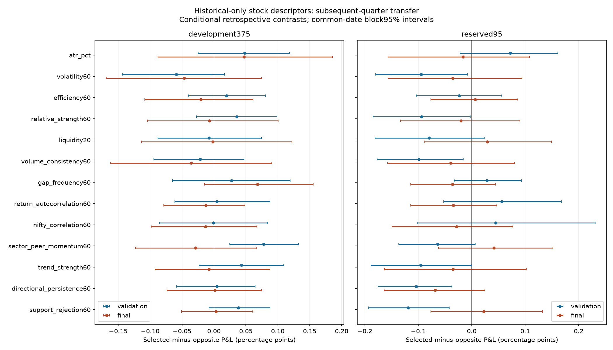
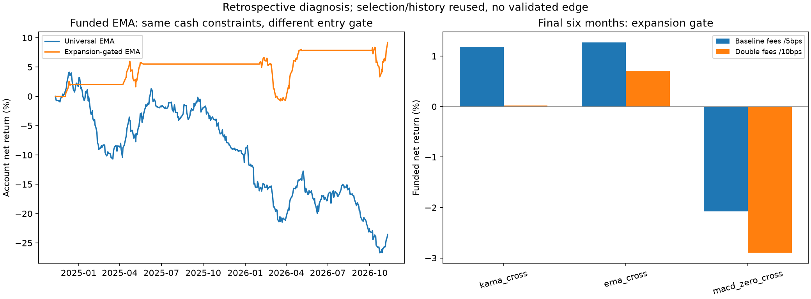

# Swing research diagnosis and underlying-edge investigation

This phase diagnoses the frozen research rather than adding an indicator grid. Previous code, ledgers, data and reports remain preserved. Corrected replays and new diagnostic controls live only in this directory. Data ends 9 November 2026; the report is assembled after that frozen endpoint.

**Verdict:** two implementation defects were demonstrated, but correcting them does not rescue the original 48 finalists. The strongest new research hypothesis is a fixed market-volatility-expansion gate for EMA crossover plus relative strength. Its funded retrospective results improve materially, including under higher costs, but its uncertainty, event concentration and reused selection history prevent a validated-edge claim. No stock-characteristic selector is validated and no live deployment is supported.

## 1. Audit: verified defects, correct mechanics and unresolved assumptions

**Verified fact — dividend semantics.** The original parser kept only the first rupee dividend amount in multi-component announcements. It credited TCS January 2025 with Rs10 instead of Rs76, TCS January 2026 with Rs11 instead of Rs57, Pfizer July 2025 with Rs35 instead of Rs165, and 3M India July 2026 with Rs160 instead of Rs506. We identified 26 affected research-period events across 20 eligible companies. The correction is an enumerated action patch, not an unsafe generic sum of all rupee numbers.

**Verified fact — same-day statutory taxes.** Actual same-session exits were charged delivery STT and stamp duty. Audit-only execution now refunds the delivery/non-delivery difference when the exit actually occurs that day. Planned sizing/targets retain overnight fees because the eventual exit date is unknown at entry. Flat brokerage remains unchanged; broker caps and contract-note rounding remain outside this correction.

**Verified fact — corrected execution.** All 48 frozen rules were rerun on final and full-period dates, 96 executions, with corrected dividends and same-day taxes. Exactly 2/48 remain positive in the final period and 0/48 over two years. Median corrected final return is -0.0480%; median two-year return is -0.1919%. KAMA final changes from +0.006677% to +0.007001%. These are independent-account averages including idle cash. Neither patched defect explains the broad failed result.

**Verified fact — tested indicator mechanics.** Independent scalar EMA, ATR, RSI, ADX and MACD calculations on six real stocks match within 2e-10. Independent strict-pivot confirmation matches. All 48 family representatives pass the tested real-data prefix invariance cut, including weekly and adaptive families. Next-open decisions, stop-first ambiguity, worse gap stops and conservative targets are implemented as declared. This is scoped evidence, not proof against every possible historical data revision.

**Verified timing restriction.** A completed Friday weekly value is released to Monday’s feature and used for Tuesday’s entry. It could have supported a Monday-open decision if made Friday. A controlled fixture demonstrates this one-session conservative delay. Its economic impact has not been measured, so it is not asserted to explain weekly-family losses.

**Bounded design concern.** Requiring 50% positive stocks including inactive sleeves can reject selective rules. Only 2 of 166 profitable development configurations were mathematically unable to reach that threshold because too few stocks traded. This concern does not explain most failures. Report active-stock breadth alongside coverage in the next design.

**Unresolved.** Adjustment/volume units are inferred rather than independently certified; 30 future-incomplete/action-ambiguous identities are quarantined; ex-date dividend credit precedes actual payment; settlement cash reuse, price bands, auctions, queue priority and real spreads/depth are unmodeled. These remain limits, not invented demonstrated bugs.

[Full implementation evidence, exact source locations, primary issuer/NSE/broker references and tests](audit-findings.md). [Dividend patch list](audit-dividend-corrections.csv), [corrected replay](audit-corrected-replay.csv), [fixed-path attribution](audit-fixed-path-corrections.csv). The previous arithmetic audit reconciled a defective input/model consistently; it did not establish semantic correctness.

## 2. Root causes: entries, exits, costs and whipsaws

**Statistical observation.** Below are continuous corrected two-year trade paths, grouped by entry period, not separately restarted accounts. Gross R adds back explicit transaction fees while retaining slippage/path effects. R divides trade P&L by planned initial cash risk. Counts aggregate correlated overlapping models, not independent trials.

| stage | n_trades | gross_r | fee_r | net_r |
| --- | --- | --- | --- | --- |
| development | 70949 | -0.0475 | 0.0488 | -0.0962 |
| final | 40423 | -0.0454 | 0.0494 | -0.0948 |
| validation | 31900 | 0.0012 | 0.0493 | -0.0481 |

Development and final entries/exits lose before explicit fees; validation is approximately flat before fees and negative afterward. Recorded fees consume about 0.049R per trade. Thus fees are material, but neither fees nor the two corrected bugs alone explain failure. Same-entry forward price returns and pre-exit excursions also fail to support a universal timing advantage. These are diagnostics, not realizable alternative exits.

**Controlled exit/filter tests.** Three already-researched references were replayed with one change at a time: 1ATR/3ATR stops, 3R target, no fixed target with a 10-session stop/time exit, 20-session hold, no extra entry filter, and zero fees/slippage. No control was chosen as a new winner. The table gives final-period mean-account net returns; exact development/validation results remain retained.

| variant | ema_cross | hybrid_ribbon_pullback | kama_cross |
| --- | --- | --- | --- |
| base | 0.0051 | -0.0028 | 0.0070 |
| hold_20 | -0.0051 | 0.0132 | -0.0094 |
| stop_1atr | -0.0143 | -0.1031 | -0.0018 |
| stop_3atr | -0.0035 | 0.0061 | 0.0004 |
| target_3r | 0.0053 | 0.0056 | 0.0062 |
| time_only_10 | 0.0039 | 0.0059 | 0.0060 |
| without_filter | -0.0105 | -0.0730 | -0.0067 |
| zero_friction | 0.0265 | 0.0466 | 0.0337 |

Wider stops do not rescue KAMA or EMA crossover. The hybrid benefits in the final segment from wider stops/longer holding, but corresponding effects do not establish stable validation improvement. Tightening to 1ATR is especially harmful for the hybrid. Removing the reference filters worsens these final results. Zero-friction scenarios improve all three; they are counterfactuals and can change sizing/paths. There is no evidence that simply loosening every stop or removing every filter fixes the problem.

Paired 10-session block intervals and BH adjustment across 21 alternatives per stage are in [exit-control-uncertainty.csv](exit-control-uncertainty.csv). They describe daily-return contrasts conditional on already selected rules. [Exit design](exit-design.json), [all exit controls](exit-controls.csv), [breakdowns](breakdown-all-dimensions.csv), [trade excursions](breakdown-family-cost-excursions.csv). Year/month, sector/stock, trend/volatility, entry/exit and holding buckets are retained. All tests are long-only; no short-side conclusion is possible.

## 3. Benchmarks and the economic null

**Verified data / statistical returns.** Official total-return levels were acquired for NIFTY50, NIFTY500, Bank, IT and Pharma. TRI includes index-methodology dividend reinvestment. These fully invested published indices do not include ETF costs and are not exposure-matched alpha controls for cash-heavy accounts. Stock buyhold is a frozen equal-starting-capital cohort with fees, capacity limits and corrected dividends, not a reconstituting cap-weighted index.

| benchmark | stage | net_return_pct | drawdown_pct | sharpe | exposure_pct |
| --- | --- | --- | --- | --- | --- |
| Nifty 50 TRI | final | 4.4916 | 10.2093 | 0.7437 | 100.0000 |
| Nifty 500 TRI | final | 2.6517 | 9.8748 | 0.4764 | 100.0000 |
| Nifty Bank TRI | final | 8.7200 | 7.6171 | 1.1858 | 100.0000 |
| Nifty IT TRI | final | 11.5330 | 17.1829 | 0.9098 | 100.0000 |
| Nifty Pharma TRI | final | 20.2745 | 6.8306 | 2.7865 | 100.0000 |
| 470-stock buyhold sleeves | final | -1.7281 | 11.4534 | -0.1808 | 96.0409 |
| simple_trend_ema200 | final | -0.3409 | 0.5173 | -1.5302 | 46.1049 |
| simple_momentum60 | final | -0.3760 | 0.5602 | -1.4279 | 52.5163 |
| 20 random seeds, arithmetic mean | final | -0.0842 | 0.1852 | -1.1954 | 13.2716 |
| Nifty 50 TRI | two_year | 6.0848 | 15.0823 | 0.2901 | 100.0000 |
| Nifty 500 TRI | two_year | 6.0572 | 14.7276 | 0.2802 | 100.0000 |
| Nifty Bank TRI | two_year | 17.5522 | 18.3189 | 0.6035 | 100.0000 |
| Nifty IT TRI | two_year | -19.5579 | 42.0016 | -0.3377 | 100.0000 |
| Nifty Pharma TRI | two_year | 29.8648 | 15.6970 | 0.9333 | 100.0000 |
| 470-stock buyhold sleeves | two_year | 2.2188 | 20.8016 | 0.1504 | 96.8695 |
| simple_trend_ema200 | two_year | -1.4174 | 1.6662 | -1.5262 | 45.2040 |
| simple_momentum60 | two_year | -1.4258 | 1.5890 | -1.4339 | 47.1623 |
| 20 random seeds, arithmetic mean | two_year | -0.3463 | 0.4681 | -1.1006 | 13.4851 |

Exposure-column units differ by model: published TRI is100% allocated; stock buyhold reports average invested NAV; sleeve signal/random controls report the fraction of observed stock-days holding a position. These measures must not be compared as equal capital utilization. Turnover, CAGR, Sortino and Calmar remain in the linked complete benchmark tables.

The simple EMA200 and positive-60-session-momentum controls use the same 2ATR/2R/10-session wrapper as the original research. They test simple entry conditions; their losses do not refute conventional long-horizon trend following. Twenty random seeds use per-stock development entry probabilities averaged across the 48 frozen rules. No seed is selected. This matches generic raw signal frequency, not every finalist’s executed frequency/exposure. Seed dispersion is conditional randomization variation on one history, not independent-market uncertainty.

All 20 corrected random controls lose in final and full-period tests. The corrected frozen-family mean final return (-0.0816%) is close to the random mean (-0.0842%) at broadly similar aggregate stock-day exposure. This supplies a useful economic null, not a formal individual-rule alpha rejection. Pharma TRI returned about +29.9% over two years, versus IT about -19.6%; the earlier stock winners may partly reflect sector opportunity. That causal attribution is a hypothesis requiring sector-matched controls.

[Benchmark report](benchmark-report.md), [benchmark design](benchmark-design.md), [full corrected controls](benchmark-controls-corrected.csv), [official TRI](benchmark-tri-comparison.csv), [source fingerprints](benchmark-source-fingerprints.json), [buyhold correction](benchmark-buyhold-correction.csv). Benchmark provenance and acquisition failures/successes are documented in [historical feasibility](history-feasibility.md).

## 4. Can historical stock characteristics predict later rule performance?

**Experiment.** Thirteen fixed descriptors were measured strictly before eight quarterly selection dates: ATR/price, realized volatility, trend efficiency, NIFTY relative strength, traded value, volume consistency, gap frequency, return autocorrelation, NIFTY correlation, sector-peer momentum, normalized trend strength, directional persistence and prior-support rejection. Terciles use contemporaneously available information. Feature direction is fitted only on the 375 development companies before the validation cutoff; the 95-company group is excluded from fitting. Outcomes use corrected executions and include zero-trade stock-quarter cells.

**Statistical observation.** No positive selected-bin advantage survives the 13-feature BH correction in validation or final in either stock pool. Sector-peer momentum has the best development-company validation contrast (+0.0776 percentage points), but q=0.0823, reverses on reserved-company validation, and reverses on development-company final. The most statistically clear reserved-validation contrasts are failures of the training-selected direction, not successful predictors.

| feature | orientation | stage | pool | delta | lo | hi | bh_q |
| --- | --- | --- | --- | --- | --- | --- | --- |
| support_rejection60 | low | validation | reserved95 | -0.1187 | -0.1926 | -0.0421 | 0.0368 |
| directional_persistence60 | low | validation | reserved95 | -0.1034 | -0.1752 | -0.0373 | 0.0368 |
| volume_consistency60 | high | validation | reserved95 | -0.0987 | -0.1767 | -0.0157 | 0.0780 |
| sector_peer_momentum60 | high | validation | development375 | 0.0776 | 0.0245 | 0.1329 | 0.0823 |
| trend_strength60 | high | validation | reserved95 | -0.0957 | -0.1881 | -0.0012 | 0.0989 |
| volatility60 | low | validation | reserved95 | -0.0942 | -0.1794 | -0.0084 | 0.0989 |
| relative_strength60 | high | validation | reserved95 | -0.0939 | -0.1847 | -0.0029 | 0.0989 |
| sector_peer_momentum60 | high | validation | reserved95 | -0.0637 | -0.1362 | 0.0066 | 0.1535 |
| liquidity20 | high | validation | reserved95 | -0.0799 | -0.1805 | 0.0236 | 0.1805 |
| atr_pct | high | validation | reserved95 | 0.0722 | -0.0219 | 0.1613 | 0.1805 |
| return_autocorrelation60 | high | validation | reserved95 | 0.0561 | -0.0525 | 0.1676 | 0.4237 |
| gap_frequency60 | high | validation | reserved95 | 0.0283 | -0.0330 | 0.0931 | 0.4706 |

Delta is the selected-minus-opposite cumulative quarterly attributed P&L contrast per original capital across frozen rules; it is not a compounded funded-portfolio return. Only eight quarters, correlated rule paths, retrospective finalist selection, historical sector labels and future completeness selection limit inference. Causal feature timestamps do not undo those limitations. True sector-index relative strength was not added post hoc to this frozen experiment; selected sector TRI now makes a separately designed test possible.

[Detailed characteristic/regime report](features-report.md), [all validation contrasts](characteristics-forward-validation.csv), [stock-quarter cells including inactivity](characteristics-stock-quarter-cells.csv).

## 5. Market regimes: a promising hypothesis with weak independent evidence

Trend states use signed NIFTY60-session return normalized by vol60*sqrt60: absolute value<0.5 sideways, >=1 strong bull, 0.5..1 weak bull, <=-1 strong bear, remainder weak bear. High/low volatility compares vol20 with its prior252-session median. Expansion is vol20/vol60>1.2; contraction<0.8. All values are completed signal-day observations.

**Statistical observation.** Development-selected expansion subsets show positive conditional net R for several broad families in validation and final, including reserved companies. However final expansion covers only 22 signal sessions across two months; 60–89% of many subsets’ trades occur in one month. All reported expansion mean-R calendar-block 95% intervals span zero. Generic trend strength or high/low-volatility labels did not establish a universally profitable gate.

**Controlled, retrospective follow-up.** The expansion observation triggered exactly one entry gate on frozen KAMA-cross/RS, EMA-cross/RS and MACD-zero-cross/RS references. The validation/final subset results had already been inspected; this replay is execution falsification, not fresh confirmation. Entries are genuinely suppressed before execution, allowing different later entries, quantities and capital competition. No threshold grid is searched.

| family | stage | total_return_pct | stress_return_pct | max_drawdown_pct | exposure_pct | n_trades |
| --- | --- | --- | --- | --- | --- | --- |
| kama_cross | development | 0.0173 | -0.8395 | 5.1464 | 6.4589 | 27 |
| kama_cross | validation | 0.3545 | -1.1936 | 8.3111 | 23.0971 | 52 |
| kama_cross | final | 1.1872 | 0.0235 | 3.2878 | 10.4526 | 28 |
| kama_cross | two_year | 1.5886 | -1.9814 | 9.7180 | 11.5889 | 107 |
| ema_cross | development | 5.5176 | 4.8401 | 4.1062 | 7.8382 | 34 |
| ema_cross | validation | 2.2512 | 1.1180 | 6.9072 | 22.2251 | 53 |
| ema_cross | final | 1.2736 | 0.7078 | 4.6644 | 9.6871 | 27 |
| ema_cross | two_year | 9.2165 | 6.9228 | 6.9311 | 11.8172 | 114 |
| macd_zero_cross | development | 5.8166 | 4.5234 | 1.7126 | 6.5832 | 27 |
| macd_zero_cross | validation | 1.1686 | -0.1150 | 7.7254 | 25.8353 | 61 |
| macd_zero_cross | final | -2.0743 | -2.8977 | 5.4069 | 12.0139 | 32 |
| macd_zero_cross | two_year | 4.7473 | 1.4772 | 7.7188 | 12.6958 | 120 |

**Hypothesis worth prioritizing.** EMA20/50 plus stock60-session relative strength, gated to expansion, has a funded full-period return +9.2165%, max close drawdown6.9311%, and mean capital utilization11.8172%. Double fees/10bps returns +6.9228%. Its final-period return is +1.2736%, stress +0.7078%, on only27 funded trades and10 reserved-company trades. The full-period block interval is approximately [-10.02%,+32.95%]; final approximately [-7.63%,+10.92%]. It is not statistically established or demonstrably superior on exposure-matched risk. Broad selection history, a few volatility episodes and a new gate chosen after diagnosis leave substantial overfitting risk.

The KAMA gate improves validation but sacrifices some final universal profit and fails full-period cost stress. MACD gate remains negative in the final funded segment. Thus expansion is not a blanket indicator-family cure. The next comparison must randomize entries *within the same gate*, stock ranking and funded allocation, and compare exposure-matched index/sector controls before assigning the gain to EMA entries.

[Gate protocol](regime-replay-design.json), [all company-pool and funded replays](regime-replay-results.csv), [cost stress](regime-stress-results.csv), [conditional intervals](regime-portfolio-uncertainty.csv), [calendar coverage](regime-calendar-coverage.json), [broad-family regimes and concentration](regime-development-gates.csv).

## 6. Five-to-ten-year expansion: feasible prices, incomplete investable universes

**Verified fact.** Official TRI downloads contain 2,690 daily observations per selected index from January2016 through November2026. Read-only daily-price probes for2016–2019 succeed for NIFTY and Reliance (986 rows each), Infosys and TCS (983 each). Missing observations, timestamp differences and adjustment quality still require audits. This demonstrates instrument availability, not all-stock/delisted coverage.

**Verified limitation.** The official inclusion/exclusion workbook has37 sheets, but the retained NIFTY500 event history ends September2020 and NIFTY50 July2020. It is not a current complete membership ledger. No ten-year strategy performance using the2024-selected stocks is presented as historically investable.

**Exact data plan.** Obtain one dated2016 starting membership snapshot, reconstruct changes through2026 from verified announcements/snapshots and historical ISIN mappings, and retain every exit/delist/unresolved identity. Verify corporate-action components and liquidation consideration before performance. Reconcile raw prices, units, volume, dividends and cash on action dates. Obtain historical sectors. Only then expand strategy evaluation. A vendor history for surviving instruments does not resolve missing identities.

Proposed chronological transfer design:2016–2020 development,2021–2022 validation,2023–2024 retrospective transfer segment. Freeze the protocol before reading strategy outcomes. Familiar historical events and design informed by2024–2026 mean even this is not pristine ignorance. Reserve genuinely future data after a new dated protocol for performance confirmation. November2024–November2026 remains contaminated.

[Acquisition evidence, primary URLs and unresolved data requirements](history-feasibility.md), [actual probes](history-price-probes.json), [membership coverage](history-membership-events-coverage.csv).

## 7. Actual funded portfolios versus independent-account averages

**Verified implementation.** One Rs1m account reserves principal and fees in cash, permits at most10 positions, caps each at20% and each sector at30% at admission, ranks simultaneous candidates by known60-session relative strength, and applies original liquidity/participation constraints. Allocation controls are equal10% equity, volatility-adjusted sizing, or0.5% stop-risk with20% notional cap. Risk policies add prior60-session correlation>0.8 rejection and a15% observed-close-drawdown entry halt as separate ablations. Existing exits, economic dividend accrual and conservative daily execution remain. No cash interest is credited. Limits can drift after price moves; drawdown suspension cannot guarantee a maximum realized drawdown or prevent gaps.

**Statistical observation.** Capital utilization materially changes headline returns and selection, but does not rescue the universal references. Corrected risk+correlation results follow:

| family | stage | total_return_pct | max_drawdown_pct | exposure_pct | n_trades | turnover_multiple |
| --- | --- | --- | --- | --- | --- | --- |
| kama_cross | development | -15.2818 | 18.4696 | 58.6905 | 257 | 34.1979 |
| kama_cross | validation | -5.4203 | 12.6557 | 59.4247 | 120 | 18.2657 |
| kama_cross | final | 5.3423 | 9.6271 | 62.7327 | 143 | 23.0383 |
| kama_cross | two_year | -15.4545 | 24.5548 | 60.9113 | 518 | 67.8631 |
| ema_cross | development | -6.5146 | 14.2191 | 55.0565 | 237 | 34.6011 |
| ema_cross | validation | -6.6915 | 16.6880 | 48.5087 | 122 | 16.8685 |
| ema_cross | final | -9.5646 | 13.3346 | 60.4399 | 138 | 19.2931 |
| ema_cross | two_year | -23.5579 | 29.5899 | 55.7156 | 495 | 66.3733 |
| hybrid_ribbon_pullback | development | -22.0807 | 22.9300 | 35.1711 | 149 | 19.9207 |
| hybrid_ribbon_pullback | validation | -2.4858 | 7.4477 | 23.1752 | 56 | 8.0106 |
| hybrid_ribbon_pullback | final | -2.4043 | 6.6075 | 39.3008 | 92 | 12.6276 |
| hybrid_ribbon_pullback | two_year | -26.4273 | 28.1689 | 33.3761 | 293 | 35.0502 |

KAMA universal final +5.3423% is followed by neither a profitable validation (-5.4203%) nor a profitable full path (-15.4545%). The final block interval spans roughly -10.74% to+23.20%. Higher costs turn its final period negative. The pooled universe ranking/cash competition changes which stocks trade; the portfolio is a distinct strategy, not a scaled sleeve return.

Equal-weight and volatility allocations, correlation and drawdown ablations are all retained in [portfolio-corrected-results.csv](portfolio-corrected-results.csv). Unchanged outcomes when a constraint does not bind are reported, not interpreted as evidence of a benefit. [Design](../../research/swing_diagnosis/PORTFOLIO_DESIGN.md), [cash/position reconciliation](portfolio-corrected-verification.json), [conditional uncertainty](portfolio-uncertainty.csv). Settlement buying power and actual execution remain unverified.

## 8. What could constitute an underlying edge?

**Verified facts:** the two semantic defects, tested causal/numeric implementation, original funded-account distinction and measured benchmark histories. **Statistical observations:** most selected rules have weak/negative gross economics; costs amplify losses; no stock descriptor transfers convincingly; a small expansion-gated EMA reference improves retrospectively. **Hypotheses:** expansion may increase tradable directional opportunity relative to ordinary periods; sector opportunity may explain some stock winners; overly delayed weekly decisions may suppress specific setups. **Unresolved:** whether those effects survive independent episodes, sector/exposure-matched random controls, historical membership reconstruction, true execution and future observations.

A plausible mechanism is conditional price movement being large/persistent enough to overcome the fixed stop/fees, rather than a universally predictive MACD/EMA crossing. This is an economic explanation to falsify, not a demonstrated causal mechanism. Selecting the observed best stocks or searching more indicator periods now would add hindsight.

## 9. Exact next controlled experiments and expected value

| Priority | Fixed experiment | Main comparison and value | Predeclared decision rule |
| --- | --- | --- | --- |
| P0 | Semantic data/fees gate | Verify every multi-component action against issuer totals, non-delivery vs delivery contract-note examples, unit continuity and pay-date cash. Prevent internally consistent but economically wrong inputs. | No performance conclusion until action and cash fixtures reconcile; unresolved cases remain quarantined and disclosed. |
| P1 | Conditional entry null | Hold EMA20/50, RS60>NIFTY60, vol20/vol60>1.2, existing stops/exits and funded constraints fixed. Run20 frozen random seeds within exactly the same eligible expansion sessions, stock pool and ranking/capital constraints; add index/sector exposure-matched controls. | Joint market-date block interval for net advantage above0 after family-wise adjustment, no dependence on one episode; otherwise reject indicator-specific edge. |
| P1 | Independent episode transfer | Reconstruct dated historical membership, then test the unchanged gate across earlier untouched-by-this-code chronological segments and reserved companies; maintain a prospective calendar. | Positive net advantage across independent episodes and reserved stocks, positive higher-cost result, drawdown/exposure acceptable under a prospectively chosen mandate. Old2024–2026 does not count as fresh confirmation. |
| P2 | Sector opportunity control | Use verified Bank/IT/Pharma TRI mappings, relative-strength definition and lagged sector exposure; compare sector-neutral/within-sector eligibility with the same unmodified entry rule. | Benefit must remain after sector returns/costs, with joint corrected inference; do not pick winning sectors from this test. |
| P2 | Timing/exit attribution | Compare Friday-close weekly decision for Monday entry against declared delayed Tuesday entry; paired identical eligible events. For one mechanism only, compare predefined10/20-session management with competing-entry effects retained. | Stable paired improvement across time/stock groups and costs; reject isolated final-period gains. |
| P3 | Forward execution observation | Freeze one surviving configuration, capital/settlement rules, horizon, monitoring and failure criteria before new data; record quotes/fills without live deployment. | Enough independent regime episodes and precision for positive lower net-advantage bound; no promotion on a fixed trade count alone. |

Thresholds for a funded deployment mandate (risk tolerance, horizon, maximum acceptable loss and minimum useful return) have not been supplied. The evidence above does not imply their values. Those operational criteria must be fixed before any future deployment decision, rather than chosen to fit these historical curves.

## 10. Prioritized roadmap and reproducibility

First lock the two corrected semantics and an auditable action/fee validation gate. Next test whether the expansion hypothesis beats matched random entries and simple exposure using one fixed reference. In parallel acquire a historically valid starting cohort and missing membership/actions, rather than backdating current survivors. Only a surviving episode-transfer result warrants prospective observation. Stock-characteristic optimization and larger indicator grids have lower priority until these tests resolve the source of conditional performance.

Reproduce the audits, controls and analysis using the scripts listed in [research README](../../research/swing_diagnosis/README.md). Frozen experiment designs, all failed variants/seeds, original and corrected diagnostic versions, daily NAVs and trade journals are retained. The original discovery directory is read-only input. No broker orders, paper workers or live deployment were started.

[Machine-readable phase registry and source preservation checks](verification.json). Reported test count:58 existing discovery tests,6 funded/feature diagnostic tests and5 audit regressions, all passed. Numerical unit checks do not certify investment performance.
