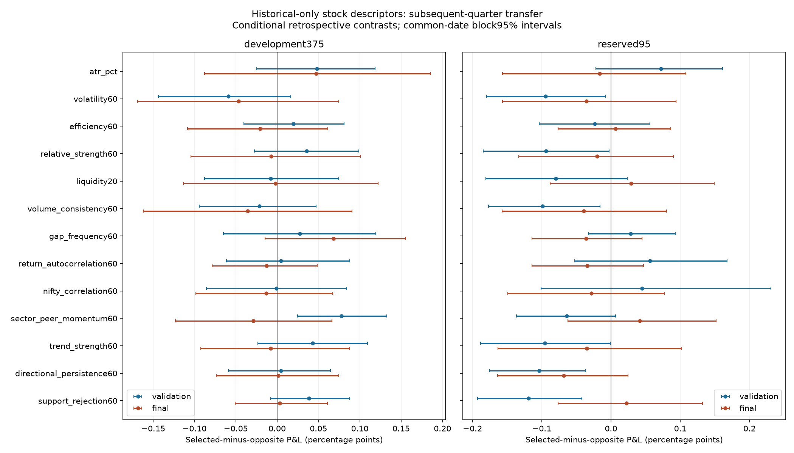
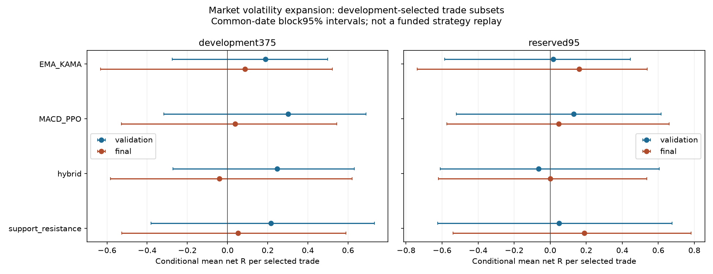

# Failure, causal stock characteristics and market regimes

**Basis:** Corrected48 exact two-year execution replay: multi-component dividends and same-daystatutory fees corrected; no rule changes.

**Verified fact:** 143,272 two-year trades from48 frozen finalists. They are separate stock sleeves and overlapping correlated rules, not one funded portfolio. Stage attribution here is by entry quarter within the continuous two-year path; it differs from resetting cash at each reported stage.

## What failed: gross entries, exits and costs

| stage | trades | gross_r | fee_r | net_r | forward5_pct | forward10_pct | forward20_pct |
| --- | --- | --- | --- | --- | --- | --- | --- |
| development | 70949 | -0.0475 | 0.0488 | -0.0962 | -0.1221 | -0.0538 | -0.1311 |
| final | 40423 | -0.0454 | 0.0494 | -0.0948 | -0.2149 | -0.4307 | -0.4323 |
| validation | 31900 | 0.0012 | 0.0493 | -0.0481 | 0.0396 | 0.3840 | 0.7361 |

R is net profit divided by modeled initial cash risk. Gross R removes recorded transaction fees but retains slippage and the original path. Forward close columns are price-only percentage returns from each actual entry fill to the 5th/10th/20th session close; they exclude dividends, fees and alternative-path cash constraints. They diagnose entry timing and are not executable alternative strategies.

**Statistical observation:** development and final trade sets lose before fees as well as after fees; the validation gross margin is approximately flat and costs turn it negative. Cost is material, but it is not a sufficient explanation of the entire failure.

| stage | stop_trades | mean_net_r | forward20_pct | pre_exit_mfe_over_1R_pct | share_all_trades_pct |
| --- | --- | --- | --- | --- | --- |
| development | 25119 | -1.0277 | -6.0588 | 3.7263 | 35.4043 |
| final | 13989 | -1.0028 | -5.8004 | 3.0953 | 34.6065 |
| validation | 11987 | -1.0095 | -5.0830 | 4.2212 | 37.5768 |

The stop rows describe exits, not causation. Pre-exit excursions include complete held bars only and exclude exit-day extremes to avoid unknowable ordering. A later recovery after a stop does not prove that widening/removing that stop improves net portfolio performance. The existing coarse execution ablations and a matched entry-level replay are the appropriate controlled tests.

[Full breakdowns](breakdown-all-dimensions.csv) cover year/month, stock, sector, entry family, exit policy/reason, holding period, market trend/volatility/expansion. All executions are long only; there is no long-versus-short comparison.

## Causal stock-characteristic experiment

Thirteen frozen descriptors were sampled strictly before each of eight quarter boundaries. Their cross-sectional terciles used information available then. Each stock-quarter includes inactive rules/zero-trade cells. High-versus-low orientation was fitted only on original375 development companies in the first four quarters, and only trades with exits observable before the fit boundary could determine orientation. The95 reserved companies were excluded from fitting.

The outcome is average net P&L per original1m capital across all48 frozen stock-rule accounts, attributed to the next entry quarter. Contrasts sum quarter-level per-stock averages; they are percentage points of initial capital, not a new compounded portfolio return. Ten-session common-market-date block bootstrap retains same-date stock/rule dependence; BH corrects13 descriptor tests within each stage/pool.

**Statistical observation:** no positive selected-bin advantage survives BH q<=.05 in validation or final in either company pool. Some selected signs significantly fail in the reserved validation group. No stock selector is validated.

| feature | orientation | stage | pool | delta | lo | hi | bh_q |
| --- | --- | --- | --- | --- | --- | --- | --- |
| atr_pct | high | final | development375 | 0.0471 | -0.0876 | 0.1859 | 0.9730 |
| atr_pct | high | final | reserved95 | -0.0166 | -0.1564 | 0.1081 | 0.8660 |
| atr_pct | high | validation | development375 | 0.0479 | -0.0247 | 0.1186 | 0.5302 |
| atr_pct | high | validation | reserved95 | 0.0722 | -0.0219 | 0.1613 | 0.1805 |
| volatility60 | low | final | development375 | -0.0466 | -0.1688 | 0.0745 | 0.9730 |
| volatility60 | low | final | reserved95 | -0.0354 | -0.1567 | 0.0939 | 0.8546 |
| volatility60 | low | validation | development375 | -0.0589 | -0.1434 | 0.0167 | 0.5302 |
| volatility60 | low | validation | reserved95 | -0.0942 | -0.1794 | -0.0084 | 0.0989 |
| efficiency60 | low | final | development375 | -0.0206 | -0.1082 | 0.0613 | 0.9730 |
| efficiency60 | low | final | reserved95 | 0.0067 | -0.0766 | 0.0861 | 0.8660 |
| efficiency60 | low | validation | development375 | 0.0199 | -0.0400 | 0.0810 | 0.8207 |
| efficiency60 | low | validation | reserved95 | -0.0237 | -0.1035 | 0.0560 | 0.6001 |
| relative_strength60 | high | final | development375 | -0.0074 | -0.1044 | 0.1007 | 0.9730 |
| relative_strength60 | high | final | reserved95 | -0.0199 | -0.1330 | 0.0900 | 0.8546 |
| relative_strength60 | high | validation | development375 | 0.0356 | -0.0276 | 0.0987 | 0.5906 |
| relative_strength60 | high | validation | reserved95 | -0.0939 | -0.1847 | -0.0029 | 0.0989 |
| liquidity20 | high | final | development375 | -0.0018 | -0.1135 | 0.1221 | 0.9730 |
| liquidity20 | high | final | reserved95 | 0.0292 | -0.0880 | 0.1489 | 0.8546 |
| liquidity20 | high | validation | development375 | -0.0079 | -0.0879 | 0.0745 | 0.9678 |
| liquidity20 | high | validation | reserved95 | -0.0799 | -0.1805 | 0.0236 | 0.1805 |
| volume_consistency60 | high | final | development375 | -0.0358 | -0.1616 | 0.0907 | 0.9730 |
| volume_consistency60 | high | final | reserved95 | -0.0395 | -0.1571 | 0.0804 | 0.8546 |
| volume_consistency60 | high | validation | development375 | -0.0215 | -0.0940 | 0.0469 | 0.8207 |
| volume_consistency60 | high | validation | reserved95 | -0.0987 | -0.1767 | -0.0157 | 0.0780 |
| gap_frequency60 | high | final | development375 | 0.0683 | -0.0148 | 0.1554 | 0.9730 |
| gap_frequency60 | high | final | reserved95 | -0.0361 | -0.1141 | 0.0446 | 0.8546 |
| gap_frequency60 | high | validation | development375 | 0.0273 | -0.0650 | 0.1194 | 0.8207 |
| gap_frequency60 | high | validation | reserved95 | 0.0283 | -0.0330 | 0.0931 | 0.4706 |
| return_autocorrelation60 | high | final | development375 | -0.0128 | -0.0786 | 0.0484 | 0.9730 |
| return_autocorrelation60 | high | final | reserved95 | -0.0346 | -0.1140 | 0.0469 | 0.8546 |
| return_autocorrelation60 | high | validation | development375 | 0.0048 | -0.0615 | 0.0876 | 0.9678 |
| return_autocorrelation60 | high | validation | reserved95 | 0.0561 | -0.0525 | 0.1676 | 0.4237 |
| nifty_correlation60 | high | final | development375 | -0.0131 | -0.0983 | 0.0670 | 0.9730 |
| nifty_correlation60 | high | final | reserved95 | -0.0282 | -0.1489 | 0.0771 | 0.8546 |
| nifty_correlation60 | high | validation | development375 | -0.0011 | -0.0856 | 0.0844 | 0.9840 |
| nifty_correlation60 | high | validation | reserved95 | 0.0447 | -0.1009 | 0.2308 | 0.6001 |
| sector_peer_momentum60 | high | final | development375 | -0.0286 | -0.1228 | 0.0662 | 0.9730 |
| sector_peer_momentum60 | high | final | reserved95 | 0.0415 | -0.0623 | 0.1517 | 0.8546 |
| sector_peer_momentum60 | high | validation | development375 | 0.0776 | 0.0245 | 0.1329 | 0.0823 |
| sector_peer_momentum60 | high | validation | reserved95 | -0.0637 | -0.1362 | 0.0066 | 0.1535 |
| trend_strength60 | high | final | development375 | -0.0077 | -0.0925 | 0.0878 | 0.9730 |
| trend_strength60 | high | final | reserved95 | -0.0347 | -0.1635 | 0.1019 | 0.8546 |
| trend_strength60 | high | validation | development375 | 0.0432 | -0.0231 | 0.1094 | 0.5302 |
| trend_strength60 | high | validation | reserved95 | -0.0957 | -0.1881 | -0.0012 | 0.0989 |
| directional_persistence60 | low | final | development375 | 0.0015 | -0.0735 | 0.0748 | 0.9730 |
| directional_persistence60 | low | final | reserved95 | -0.0683 | -0.1637 | 0.0248 | 0.8546 |
| directional_persistence60 | low | validation | development375 | 0.0045 | -0.0589 | 0.0644 | 0.9678 |
| directional_persistence60 | low | validation | reserved95 | -0.1034 | -0.1752 | -0.0373 | 0.0368 |
| support_rejection60 | low | final | development375 | 0.0032 | -0.0506 | 0.0609 | 0.9730 |
| support_rejection60 | low | final | reserved95 | 0.0226 | -0.0762 | 0.1320 | 0.8546 |
| support_rejection60 | low | validation | development375 | 0.0384 | -0.0079 | 0.0877 | 0.5302 |
| support_rejection60 | low | validation | reserved95 | -0.1187 | -0.1926 | -0.0421 | 0.0368 |

Feature definitions: ATR14/close;60-session volatility; absolute displacement/absolute travel efficiency;60-session return minus NIFTY; lagged20-session traded-value proxy; negative volume CV; frequency of >1% overnight gaps; return lag1 autocorrelation; NIFTY return correlation; leave-self-out same-sector peer return; normalized signed60-session trend; sign persistence; and frequency of rejections of the prior20-session low within0.5ATR. Historical sector labels, complete-data selection and volume-unit hypotheses are inherited limitations. Sector-peer momentum is not true sector-index relative strength.

## Regime-conditioned observations

Market trend uses signed NIFTY60-session return/(60-session daily-return volatility*sqrt60): absolute value<.5 is sideways; >=1 strong bull;0.5..1 weak bull; <=-1 strong bear; remainder weak bear. High volatility is20-session volatility above its prior252-session median. Expansion is vol20/vol60>1.2; contraction<.8. All labels use completed signal-day data.

Within each of four broad family groups, one regime per dimension was selected on development375 only, requiring100 training trades. It was then held fixed. The table below shows the development-selected expansion gate. Intervals use3000 common-calendar10-session blocks and are conditional on the selected frozen rule set; no claim is based on independent trade counts.

| broad_family | chosen_regime | stage | pool | n_selected | selected_signal_days | selected_months | largest_month_trade_fraction | selected_net_r | selected_r_lo | selected_r_hi | universal_net_r | delta_r_lo | delta_r_hi |
| --- | --- | --- | --- | --- | --- | --- | --- | --- | --- | --- | --- | --- | --- |
| EMA_KAMA | expansion | final | development375 | 292 | 22 | 2 | 0.7158 | 0.0871 | -0.6320 | 0.5222 | -0.0280 | -0.5948 | 0.5546 |
| EMA_KAMA | expansion | final | reserved95 | 53 | 17 | 2 | 0.6038 | 0.1608 | -0.7376 | 0.5376 | -0.1622 | -0.5614 | 0.7188 |
| EMA_KAMA | expansion | validation | development375 | 1367 | 45 | 3 | 0.5501 | 0.1881 | -0.2758 | 0.4991 | -0.0362 | -0.0379 | 0.5281 |
| EMA_KAMA | expansion | validation | reserved95 | 305 | 41 | 3 | 0.4918 | 0.0161 | -0.5867 | 0.4458 | -0.2058 | -0.1282 | 0.5833 |
| MACD_PPO | expansion | final | development375 | 2775 | 22 | 2 | 0.7759 | 0.0386 | -0.5277 | 0.5445 | -0.1000 | -0.4034 | 0.6188 |
| MACD_PPO | expansion | final | reserved95 | 633 | 22 | 2 | 0.7536 | 0.0476 | -0.5733 | 0.6611 | -0.1518 | -0.3582 | 0.7920 |
| MACD_PPO | expansion | validation | development375 | 4638 | 45 | 3 | 0.3903 | 0.3024 | -0.3165 | 0.6903 | 0.0178 | -0.0819 | 0.5584 |
| MACD_PPO | expansion | validation | reserved95 | 1150 | 45 | 3 | 0.4261 | 0.1301 | -0.5213 | 0.6152 | -0.1198 | -0.1438 | 0.5886 |
| hybrid | expansion | final | development375 | 177 | 22 | 2 | 0.8757 | -0.0400 | -0.5828 | 0.6199 | -0.0356 | -0.5579 | 0.6361 |
| hybrid | expansion | final | reserved95 | 46 | 16 | 2 | 0.8043 | 0.0009 | -0.6200 | 0.5354 | -0.1492 | -0.4719 | 0.6491 |
| hybrid | expansion | validation | development375 | 527 | 42 | 3 | 0.4061 | 0.2480 | -0.2709 | 0.6307 | -0.0456 | -0.0587 | 0.6125 |
| hybrid | expansion | validation | reserved95 | 127 | 32 | 3 | 0.5197 | -0.0647 | -0.6111 | 0.6057 | -0.2753 | -0.1886 | 0.7561 |
| support_resistance | expansion | final | development375 | 1959 | 22 | 2 | 0.8744 | 0.0520 | -0.5273 | 0.5893 | -0.0919 | -0.4155 | 0.6394 |
| support_resistance | expansion | final | reserved95 | 376 | 21 | 2 | 0.8856 | 0.1891 | -0.5391 | 0.7820 | -0.1706 | -0.2942 | 0.9157 |
| support_resistance | expansion | validation | development375 | 3806 | 45 | 3 | 0.3862 | 0.2172 | -0.3808 | 0.7313 | -0.0507 | -0.1236 | 0.6214 |
| support_resistance | expansion | validation | reserved95 | 952 | 45 | 3 | 0.4118 | 0.0495 | -0.6238 | 0.6772 | -0.1811 | -0.2333 | 0.6397 |

**Hypothesis:** volatility expansion may identify a market state worth testing with a small frozen rule set. The subset results are not an executable regime strategy. Suppressing a trade can permit a later entry, alter cash/risk sizing and change held corporate-action entitlements. A fresh gated replay and a funded portfolio are required, and any such test here is a new retrospective experiment triggered by these observations.

## Limits and next controlled experiments

All calendar dates and48 finalists were already researched. Causal descriptors do not undo strategy-selection leakage or create an untouched holdout. There are only eight quarters, forward outcomes overlap, market cycles are limited, family signals are correlated, and13 features plus12 regime selections add search degrees of freedom. The bootstrap does not remove these limitations.

1. Replay the fixed market-volatility-expansion gate on prespecified representative rules, comparing skipped/added entries, cash utilization and date concentration; preserve the universal control.
2. Check whether conditional performance remains after official sector-TRI controls, avoiding credit for a sector rally. Selected Bank/IT/Pharma TRI were acquired separately; a true stock/sector-index relative-strength selector was not part of this frozen13-descriptor diagnostic.
3. Test entry quality against risk/exposure-matched random entries and then vary one stop/exit rule on exactly matched decisions.
4. Freeze any surviving stock/regime selector for genuinely new prospective data. Preserve calendar and company reservations; do not optimize again on the final months.

Reproduction: `python scripts/diagnosis_features.py --corrected`, then `python scripts/diagnosis_feature_report.py`. Original-path diagnostic outputs remain in `features_original/`. The design, orientations, stock-quarter cells, full breakdowns and confidence values remain machine-readable beside this report.
