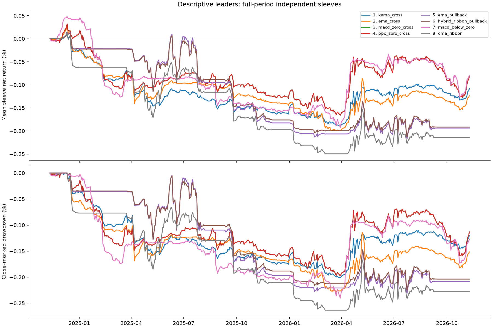
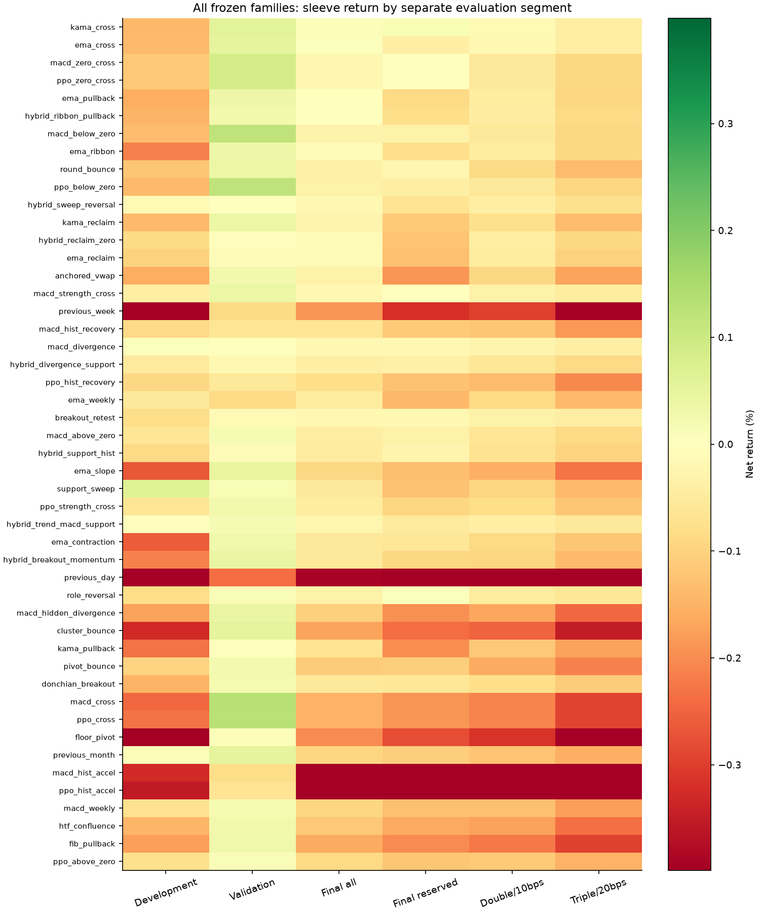
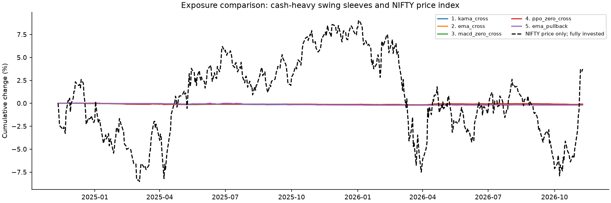
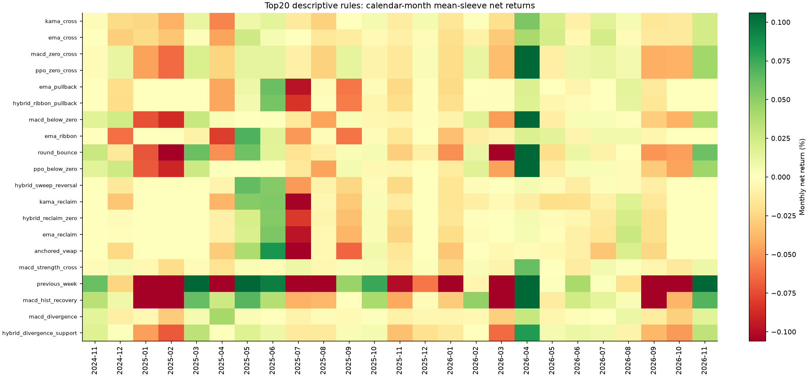
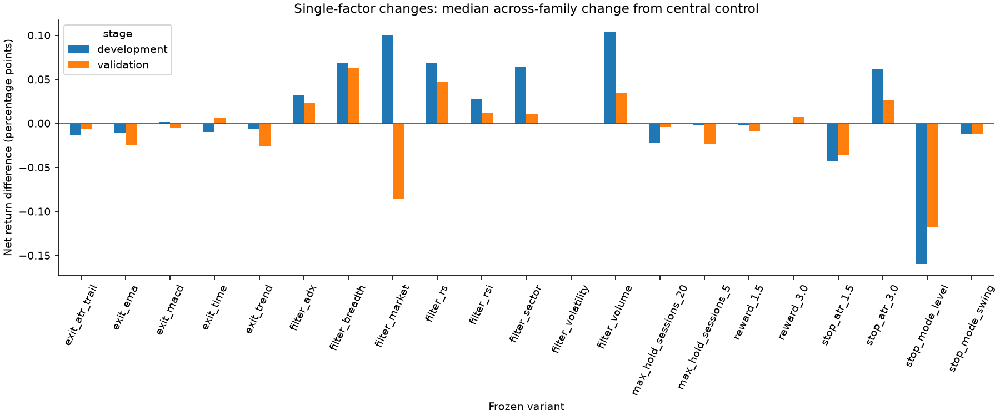

# Expanded daily swing-strategy discovery

None of the 48 frozen family finalists passes the full evidence screen. The top 20 are ranked diagnostics; this study does not supply 20 validated trading strategies.

Registered starting identities: **500**; executable complete-data stocks: **470**; development companies: **375**; reserved novel companies: **95**. Coarse configurations: **1174**; development-only refinements: **134**; logged execution runs: **6429**. All failed configurations and zero-trade outcomes are retained.

## Interpretation and verdict

The leading descriptive family is **kama_cross**, with final mean-sleeve net return **0.007%**, **347** pooled stock trades and mean net R **0.018**. Its reserved-company return is **0.014%**, and double-fee/10 bps return is **-0.015%**. Its status is **diagnostic; evidence screen failed**.

A family winner was frozen using development/validation only. Final outcomes rank those already-frozen finalists descriptively; they do not generate neighbors, change entries, pick new exits, or choose per-stock parameters. The two-year performance paths include selection periods and are in-sample context. This calendar overlaps earlier research, so the final dates cannot honestly be called untouched. Reserved companies test cross-sectional transfer within the same market history.

The two small positive final aggregate returns did not survive the double-cost scenario; all three rolling walk-forward selections lost money. The leading rule was exposed during only about 4.3% of observed stock-days, so its very small mean-sleeve return is not comparable to a fully invested index return.

The strongest development findings did not reproduce nearby:119 of 134 refined settings were profitable on development companies/dates, but 0 of 134 were profitable in validation. A broad positive training neighborhood therefore did not establish a durable effect. The coarse-grid development CSCV/PBO diagnostic was 0.70; this is a conditional search-instability statistic, not the probability that every technical strategy fails.

## Evaluation design

| segment | start | end_exclusive |
| --- | --- | --- |
| development | 2024-11-10 | 2025-11-10 |
| validation | 2025-11-10 | 2026-05-10 |
| final | 2026-05-10 | 2026-11-10 |

Each company has its own independent ₹1 m capital sleeve. Reported aggregate equity is the arithmetic mean of these separate sleeves; it is not a pooled deployable account, daily rebalanced portfolio, or allocation recommendation. Pooled trade counts/net R reflect correlated stock opportunities. Mean-sleeve returns use capital including idle cash. NIFTY context is a fully invested price index and excludes dividends and trading costs, so it is not exposure matched.

## Descriptive top 20

| Rank | Family | Status | Final trades | Final net% | Final netR | Sharpe | Portfolio DD% | Positive stocks% | Reserved net% | Double/10bps% | Triple/20bps% |
| --- | --- | --- | --- | --- | --- | --- | --- | --- | --- | --- | --- |
| 1 | kama_cross | diagnostic; evidence screen failed | 347 | 0.007 | 0.018 | 0.273 | 0.035 | 26.809 | 0.014 | -0.015 | -0.043 |
| 2 | ema_cross | diagnostic; evidence screen failed | 303 | 0.005 | 0.014 | 0.189 | 0.042 | 22.766 | -0.038 | -0.018 | -0.041 |
| 3 | macd_zero_cross | diagnostic; evidence screen failed | 507 | -0.021 | -0.040 | -0.529 | 0.090 | 30.851 | 0.002 | -0.054 | -0.091 |
| 4 | ppo_zero_cross | diagnostic; evidence screen failed | 507 | -0.021 | -0.040 | -0.529 | 0.090 | 30.851 | 0.002 | -0.054 | -0.091 |
| 5 | ema_pullback | diagnostic; evidence screen failed | 716 | -0.003 | -0.003 | -0.046 | 0.046 | 34.681 | -0.090 | -0.047 | -0.096 |
| 6 | hybrid_ribbon_pullback | diagnostic; evidence screen failed | 660 | -0.003 | -0.004 | -0.059 | 0.047 | 32.766 | -0.079 | -0.045 | -0.090 |
| 7 | macd_below_zero | diagnostic; evidence screen failed | 452 | -0.029 | -0.062 | -0.746 | 0.092 | 26.596 | -0.033 | -0.056 | -0.092 |
| 8 | ema_ribbon | diagnostic; evidence screen failed | 519 | -0.011 | -0.020 | -0.249 | 0.032 | 34.043 | -0.080 | -0.048 | -0.091 |
| 9 | round_bounce | diagnostic; evidence screen failed | 753 | -0.036 | -0.045 | -0.665 | 0.132 | 32.340 | -0.019 | -0.085 | -0.136 |
| 10 | ppo_below_zero | diagnostic; evidence screen failed | 455 | -0.032 | -0.069 | -0.815 | 0.096 | 26.809 | -0.039 | -0.058 | -0.095 |
| 11 | hybrid_sweep_reversal | diagnostic; evidence screen failed | 440 | -0.016 | -0.035 | -0.404 | 0.038 | 28.723 | -0.068 | -0.041 | -0.076 |
| 12 | kama_reclaim | diagnostic; evidence screen failed | 753 | -0.028 | -0.035 | -0.472 | 0.071 | 33.191 | -0.114 | -0.077 | -0.137 |
| 13 | hybrid_reclaim_zero | diagnostic; evidence screen failed | 614 | -0.010 | -0.015 | -0.211 | 0.045 | 30.213 | -0.122 | -0.043 | -0.092 |
| 14 | ema_reclaim | diagnostic; evidence screen failed | 695 | -0.011 | -0.015 | -0.221 | 0.053 | 31.277 | -0.128 | -0.048 | -0.103 |
| 15 | anchored_vwap | diagnostic; evidence screen failed | 1043 | -0.032 | -0.029 | -0.402 | 0.083 | 33.191 | -0.189 | -0.093 | -0.169 |
| 16 | macd_strength_cross | diagnostic; evidence screen failed | 205 | -0.018 | -0.084 | -1.323 | 0.030 | 16.596 | 0.002 | -0.032 | -0.048 |
| 17 | previous_week | diagnostic; evidence screen failed | 1997 | -0.189 | -0.090 | -0.835 | 0.567 | 42.128 | -0.320 | -0.297 | -0.424 |
| 18 | macd_hist_recovery | diagnostic; evidence screen failed | 972 | -0.065 | -0.065 | -0.831 | 0.204 | 40.851 | -0.114 | -0.120 | -0.186 |
| 19 | macd_divergence | diagnostic; evidence screen failed | 168 | -0.017 | -0.094 | -0.972 | 0.043 | 11.489 | -0.016 | -0.026 | -0.038 |
| 20 | hybrid_divergence_support | diagnostic; evidence screen failed | 386 | -0.039 | -0.094 | -1.102 | 0.111 | 24.894 | -0.036 | -0.061 | -0.090 |

The complete ranking of frozen family finalists, including failures, is in [all-finalists.csv](all-finalists.csv). Exact IDs, configurations, entry/filter/exit/stop/risk rules are in [top-20-rules.md](top-20-rules.md) and [top-20-exact-rules.json](top-20-exact-rules.json).

Zero-trade final families: **0**. Screen passes sort ahead of diagnostics. The remaining order uses 45% final,25% reserved,20% double-cost and 10% validation bounded scores:40% clipped Sharpe,30% clipped net R,20% positive-stock breadth and 10% clipped median stock return. This ranking is an outcome summary, not evidence that its top-ranked rule has escaped selection bias.

Evidence-screen requirements: frozen development/validation eligibility; at least 50 final and 20 reserved trades; positive return and expectancy in both pools; at least 50% positive final-stock breadth; worst-sleeve drawdown no more than 25%; positive double-fee/10 bps return and expectancy; positive lower 95% 10-session-block bounds for final return and pooled net R; validation search-adjusted p<=.05. See [report-evidence-screen.json](report-evidence-screen.json). A failure on any dimension leaves the candidate labeled diagnostic.

## Category leaders

| category | id | family | status | final_return_pct | final_sharpe | final_drawdown_pct | reserved_return_pct |
| --- | --- | --- | --- | --- | --- | --- | --- |
| MACD family | macd_zero_cross_7cb993665d76 | macd_zero_cross | diagnostic; evidence screen failed | -0.021 | -0.529 | 0.090 | 0.002 |
| PPO family | ppo_zero_cross_dffda8cb8df2 | ppo_zero_cross | diagnostic; evidence screen failed | -0.021 | -0.529 | 0.090 | 0.002 |
| EMA/adaptive | kama_cross_098a05a5d438 | kama_cross | diagnostic; evidence screen failed | 0.007 | 0.273 | 0.035 | 0.014 |
| support/resistance | round_bounce_315f7e58bebf | round_bounce | diagnostic; evidence screen failed | -0.036 | -0.665 | 0.132 | -0.019 |
| hybrid | hybrid_ribbon_pullback_345d115be690 | hybrid_ribbon_pullback | diagnostic; evidence screen failed | -0.003 | -0.059 | 0.047 | -0.079 |
| risk-adjusted | kama_cross_098a05a5d438 | kama_cross | diagnostic; evidence screen failed | 0.007 | 0.273 | 0.035 | 0.014 |
| drawdown | breakout_retest_c71104bc32b8 | breakout_retest | diagnostic; evidence screen failed | -0.018 | -1.246 | 0.027 | -0.016 |
| consistency | macd_hist_recovery_e758e11f9a78 | macd_hist_recovery | diagnostic; evidence screen failed | -0.065 | -0.831 | 0.204 | -0.114 |
| MACD only, frozen subset | macd_strength_cross_25d860e37c1e | macd_strength_cross | diagnostic; evidence screen failed | -0.018 | -1.323 | 0.030 | 0.002 |
| EMA only, frozen subset | ema_weekly_3acfa35b0d85 | ema_weekly | diagnostic; evidence screen failed | -0.047 | -0.643 | 0.154 | -0.141 |
| S&R only, frozen subset | round_bounce_315f7e58bebf | round_bounce | diagnostic; evidence screen failed | -0.036 | -0.665 | 0.132 | -0.019 |

Category leaders obey the same screen-first ordering within the already-frozen family representatives. Broad family rows may include an explicit extra filter. The separate MACD-only, EMA-only and S&R-only rows require no extra filter and compatible exits; their scope is the eligible pure subset of frozen representatives, not a new search of final outcomes across every coarse rule. Risk-adjusted leaders then use final Sharpe; drawdown leaders use the smallest final portfolio drawdown; consistency uses the smaller of final/reserved positive-stock breadth. An inactive or rejected diagnostic can win a descriptive category and remains labeled as such.

## Full paths, drawdowns, costs and family transfer

Daily decisions execute at the next open with 5 bps adverse slippage per fill at baseline. Stops are tested before targets on ambiguous OHLC candles; adverse gaps can exceed initial risk. Fee schedules change by fill date. Targets are calibrated to modeled net R including costs; a same-day exit may avoid the overnight DP fee. Double/triple fee tests use 10/20 bps adverse slippage and rerun sizing/execution, rather than subtracting a constant from original profit.

## Calendar consistency

| family | months | positive_months | median_month_pct | worst_month_pct | best_month_pct |
| --- | --- | --- | --- | --- | --- |
| anchored_vwap | 25 | 4 | -0.003 | -0.136 | 0.086 |
| ema_cross | 25 | 8 | -0.004 | -0.046 | 0.041 |
| ema_pullback | 25 | 7 | -0.000 | -0.098 | 0.062 |
| ema_reclaim | 25 | 5 | -0.001 | -0.096 | 0.056 |
| ema_ribbon | 25 | 6 | -0.002 | -0.080 | 0.070 |
| hybrid_divergence_support | 25 | 14 | 0.001 | -0.070 | 0.083 |
| hybrid_reclaim_zero | 25 | 5 | -0.001 | -0.082 | 0.054 |
| hybrid_ribbon_pullback | 25 | 5 | -0.001 | -0.084 | 0.057 |
| hybrid_sweep_reversal | 25 | 6 | -0.002 | -0.049 | 0.064 |
| kama_cross | 25 | 11 | -0.003 | -0.056 | 0.056 |
| kama_reclaim | 25 | 4 | -0.005 | -0.105 | 0.054 |
| macd_below_zero | 25 | 11 | -0.001 | -0.086 | 0.146 |
| macd_divergence | 25 | 9 | -0.004 | -0.029 | 0.042 |
| macd_hist_recovery | 25 | 14 | 0.004 | -0.215 | 0.152 |
| macd_strength_cross | 25 | 11 | -0.002 | -0.025 | 0.062 |
| macd_zero_cross | 25 | 12 | -0.002 | -0.064 | 0.106 |
| ppo_below_zero | 25 | 12 | -0.000 | -0.089 | 0.145 |
| ppo_zero_cross | 25 | 12 | -0.002 | -0.064 | 0.106 |
| previous_week | 25 | 11 | -0.019 | -0.382 | 0.452 |
| round_bounce | 25 | 10 | -0.009 | -0.123 | 0.185 |

Calendar-year net returns below come from the full-period frozen-rule paths.2024 and 2026 are partial years; months at dataset boundaries can also be partial. These are not independent replications.

| family | 2024 | 2025 | 2026 |
| --- | --- | --- | --- |
| anchored_vwap | -0.024 | -0.122 | -0.090 |
| ema_cross | -0.028 | -0.112 | 0.017 |
| ema_pullback | -0.021 | -0.161 | -0.011 |
| ema_reclaim | -0.001 | -0.095 | -0.038 |
| ema_ribbon | -0.063 | -0.134 | -0.018 |
| hybrid_divergence_support | 0.019 | -0.128 | -0.033 |
| hybrid_reclaim_zero | -0.003 | -0.076 | -0.032 |
| hybrid_ribbon_pullback | -0.022 | -0.154 | -0.016 |
| hybrid_sweep_reversal | -0.015 | 0.005 | -0.038 |
| kama_cross | -0.026 | -0.128 | 0.046 |
| kama_reclaim | -0.032 | -0.082 | -0.090 |
| macd_below_zero | 0.040 | -0.195 | 0.074 |
| macd_divergence | 0.004 | -0.011 | -0.030 |
| macd_hist_recovery | 0.043 | -0.145 | -0.123 |
| macd_strength_cross | 0.002 | -0.045 | 0.017 |
| macd_zero_cross | 0.010 | -0.131 | 0.040 |
| ppo_below_zero | 0.041 | -0.195 | 0.067 |
| ppo_zero_cross | 0.010 | -0.131 | 0.040 |
| previous_week | 0.037 | -0.524 | -0.271 |
| round_bounce | 0.013 | -0.167 | -0.023 |

## Stocks, regimes and trade behavior

Stock table ranks median final return across every frozen family, including flat/losing outcomes. It does not pick a winning rule per company. These company rankings use final outcomes and are descriptive, not an implementable pre-test stock selector.

| symbol | sector | frozen_rules | median_rule_net_pct | positive_rules_pct | median_rule_trades | worst_rule_drawdown_pct |
| --- | --- | --- | --- | --- | --- | --- |
| ANANDRATHI | Capital Markets | 48 | 0.730 | 64.583 | 3.000 | 1.018 |
| SHYAMMETL | Industrial Products | 48 | 0.698 | 66.667 | 3.000 | 1.205 |
| DIVISLAB | Pharmaceuticals & Biotechnology | 48 | 0.685 | 79.167 | 2.000 | 1.024 |
| WELSPUNLIV | Textiles & Apparels | 48 | 0.609 | 72.917 | 2.500 | 1.332 |
| REDINGTON | Commercial Services & Supplies | 48 | 0.596 | 66.667 | 2.000 | 0.954 |
| GLAND | Pharmaceuticals & Biotechnology | 48 | 0.505 | 64.583 | 2.000 | 1.051 |
| IFCI | Finance | 48 | 0.495 | 64.583 | 1.500 | 1.152 |
| BOSCHLTD | Auto Components | 48 | 0.487 | 68.750 | 1.000 | 0.957 |
| CGCL | Finance | 48 | 0.482 | 70.833 | 1.000 | 1.258 |
| ZOMATO | Retailing | 48 | 0.478 | 77.083 | 2.000 | 1.168 |
| CHENNPETRO | Petroleum Products | 48 | 0.463 | 68.750 | 2.000 | 1.699 |
| APARINDS | Electrical Equipment | 48 | 0.452 | 70.833 | 2.000 | 1.712 |
| PAYTM | Financial Technology (Fintech) | 48 | 0.438 | 64.583 | 2.000 | 1.249 |
| LAURUSLABS | Pharmaceuticals & Biotechnology | 48 | 0.363 | 60.417 | 2.000 | 1.271 |
| COFORGE | IT - Software | 48 | 0.346 | 66.667 | 2.000 | 1.913 |

Full per-stock/per-rule results are in [stock-analysis.csv](stock-analysis.csv). [stock-consistency.csv](stock-consistency.csv) retains all eligible companies. [regime-analysis.csv](regime-analysis.csv) uses NIFTY close/EMA 50/EMA 200 known on the signal day: all above/aligned is market_up, all below/aligned is market_down, and the rest is mixed. Regime summaries are conditional breakdowns of the same trades, not extra tests of new parameters.

| value | n_trades | expectancy_r | win_rate_pct | net_pnl | avg_hold_hours |
| --- | --- | --- | --- | --- | --- |
| market_down | 270 | 0.014 | 45.926 | 17,470.813 | 261.073 |
| market_mixed | 77 | 0.033 | 50.649 | 13,912.351 | 196.506 |

Trade-tail quantiles, worst/best net R, holding-time percentiles, dividends, gap-stop counts and fee totals are in [trade-analysis.csv](trade-analysis.csv). Exit reasons, signal regimes, entry weekdays, holding buckets and exit years are in [trade-breakdowns.csv](trade-breakdowns.csv). Journal net P&L reconciles each sleeve’s realized end NAV; pooled cash fees/net P&L are sums over separate stock sleeves and should not be compared directly with a single ₹1 m portfolio.

## Uncertainty and search controls

| family | return_ci95_pct | netR_ci95 | validation_adjusted_p | development_DSR |
| --- | --- | --- | --- | --- |
| kama_cross | [-0.05531495725535157, 0.07313398709668685] | [-0.19239781287436156, 0.18710386099838114] | 0.855 | 0.000 |
| ema_cross | [-0.056590695706225935, 0.07301645646647824] | [-0.2552314859991648, 0.19865907371891564] | 0.870 | 0.000 |
| macd_zero_cross | [-0.1434177002044998, 0.10865265584335598] | [-0.3168335426259978, 0.19154146644877354] | 0.786 | 0.000 |
| ppo_zero_cross | [-0.1434177002044998, 0.10865265584335598] | [-0.3168335426259978, 0.19154146644877354] | 0.786 | 0.000 |
| ema_pullback | [-0.08910727624738518, 0.08589741255661261] | [-0.08727122123419453, 0.07121307421362505] | 0.817 | 0.000 |
| hybrid_ribbon_pullback | [-0.08635774208003683, 0.08407464756188868] | [-0.09176910936388957, 0.07671011607204091] | 0.862 | 0.000 |
| macd_below_zero | [-0.14679900381481148, 0.0956000708576077] | [-0.3416548899233687, 0.19711057898517625] | 0.543 | 0.000 |
| ema_ribbon | [-0.06984354378403362, 0.055298970204681906] | [-0.12878550035714142, 0.0546911184076045] | 0.914 | 0.000 |
| round_bounce | [-0.19125146374844665, 0.13521719757111972] | [-0.24751189022043082, 0.16238639124003093] | 0.958 | 0.000 |
| ppo_below_zero | [-0.15681589927699524, 0.09776052956027578] | [-0.35806054675418547, 0.20506870586063225] | 0.556 | 0.000 |
| hybrid_sweep_reversal | [-0.09441871171830651, 0.06488992190638698] | [-0.19069793042866265, 0.10864528190768795] | 0.968 | 0.002 |
| kama_reclaim | [-0.11941458755468676, 0.06098792840481044] | [-0.1563478748713078, 0.07522414755977787] | 0.862 | 0.000 |
| hybrid_reclaim_zero | [-0.0961803932198857, 0.08282963027139822] | [-0.16959539298979392, 0.09776307761327228] | 0.991 | 0.000 |
| ema_reclaim | [-0.10698157287020726, 0.0903301152883207] | [-0.15304649654632554, 0.09408234493735067] | 0.993 | 0.000 |
| anchored_vwap | [-0.17683222510750551, 0.1054267381736552] | [-0.13904036895993152, 0.06432548610767035] | 0.921 | 0.000 |
| macd_strength_cross | [-0.05574030756258869, 0.019075160216632248] | [-0.3666233183979688, 0.0737754326783715] | 0.839 | 0.000 |
| previous_week | [-0.8589264782752765, 0.53740449066988] | [-0.4067636221906819, 0.25082125688767726] | 0.991 | 0.000 |
| macd_hist_recovery | [-0.329460569365472, 0.1909905989142258] | [-0.2801393081190997, 0.1846240227170257] | 0.993 | 0.000 |
| macd_divergence | [-0.07165373401680553, 0.034826450131297274] | [-0.3703102153872239, 0.21466374337401944] | 0.980 | 0.004 |
| hybrid_divergence_support | [-0.16352259517904338, 0.08112375931435213] | [-0.3589597071231182, 0.1946255735848415] | 0.993 | 0.000 |

Development CSCV/PBO: **0.700**; distinct outcome paths **1144**, original rules **1174**. The diagnostic scope and deduplication are recorded in [pbo-development.json](pbo-development.json). Symmetric CSCV splits are not chronological out-of-sample tests. Development-selected refinement is excluded from a coarse-only CSCV analysis when specified by the runner.

The ledger includes 1308 attempted coarse/refined tuples. DSR reports an IID/nonnormal-return approximation with an assumed independent trial count; dependence and historical reuse limit that interpretation. Validation max-t shares 10-session calendar bootstrap blocks across rules to preserve market/cross-rule dependence. Final block intervals are conditional on frozen choices; they do not remove earlier research reuse. Bootstrap positive fractions are resampling frequencies, not probabilities that a strategy is truly profitable. All-zero return/trade series remain explicit null/undefined outcomes rather than disappearing.

[Final return/netR intervals](final-uncertainty.json), [validation search control](validation-search-control.json), [final frozen-family search diagnostic](final-search-control-diagnostic.json), and [development DSR](dsr-development.json) retain the machine-readable values. Final search diagnostics are descriptive and do not feed back into trading rules.

## Ablations and development-neighbor stability

Each coarse single-factor variant is compared with its own family’s central unfiltered entry/control on the same development or validation companies/calendar. [ablation-analysis.csv](ablation-analysis.csv) includes the base values, changed values and deltas for filters, stops, exits, targets and hold limits. Development-only neighbors are evaluated against their actual parent and are excluded from the central-control ablation chart. No final-stage fine-grid search is performed.

| parent | stage | neighbors | positive_neighbors | median_return_pct | minimum_return_pct | maximum_return_pct | median_expectancy_r |
| --- | --- | --- | --- | --- | --- | --- | --- |
| macd_divergence_08e814414865 | development | 14 | 13 | 0.174 | -0.182 | 0.193 | 0.088 |
| macd_divergence_08e814414865 | validation | 14 | 0 | -0.250 | -0.274 | -0.145 | -0.254 |
| macd_divergence_1ca6a87e5297 | development | 14 | 12 | 0.059 | -0.160 | 0.072 | 0.037 |
| macd_divergence_1ca6a87e5297 | validation | 14 | 0 | -0.100 | -0.123 | -0.049 | -0.122 |
| macd_divergence_f37572c6ce72 | development | 14 | 13 | 0.086 | -0.272 | 0.104 | 0.050 |
| macd_divergence_f37572c6ce72 | validation | 14 | 0 | -0.216 | -0.229 | -0.132 | -0.231 |
| macd_hist_recovery_9f609543a653 | development | 12 | 12 | 0.096 | 0.051 | 0.108 | 0.040 |
| macd_hist_recovery_9f609543a653 | validation | 12 | 0 | -0.259 | -0.307 | -0.228 | -0.291 |
| macd_hist_recovery_d354fdcf11a7 | development | 12 | 10 | 0.039 | -0.038 | 0.062 | 0.010 |
| macd_hist_recovery_d354fdcf11a7 | validation | 12 | 0 | -0.422 | -0.505 | -0.387 | -0.213 |
| macd_hist_recovery_e2dd4890162a | development | 12 | 10 | 0.071 | -0.162 | 0.093 | 0.011 |
| macd_hist_recovery_e2dd4890162a | validation | 12 | 0 | -0.542 | -0.704 | -0.480 | -0.150 |
| ppo_hist_recovery_89701b13bcfa | development | 12 | 10 | 0.063 | -0.177 | 0.096 | 0.009 |
| ppo_hist_recovery_89701b13bcfa | validation | 12 | 0 | -0.560 | -0.739 | -0.488 | -0.148 |
| ppo_hist_recovery_9ad53ea43e7b | development | 12 | 10 | 0.034 | -0.052 | 0.049 | 0.009 |
| ppo_hist_recovery_9ad53ea43e7b | validation | 12 | 0 | -0.435 | -0.527 | -0.399 | -0.215 |
| ppo_hist_recovery_d3fadc33c1dc | development | 12 | 12 | 0.100 | 0.053 | 0.117 | 0.040 |
| ppo_hist_recovery_d3fadc33c1dc | validation | 12 | 0 | -0.264 | -0.315 | -0.235 | -0.290 |
| support_sweep_59b84c0f4975 | development | 10 | 9 | 0.066 | -0.047 | 0.096 | 0.029 |
| support_sweep_59b84c0f4975 | validation | 10 | 0 | -0.169 | -0.223 | -0.113 | -0.140 |
| support_sweep_8aab6367478f | development | 10 | 8 | 0.039 | -0.055 | 0.052 | 0.014 |
| support_sweep_8aab6367478f | validation | 10 | 0 | -0.140 | -0.158 | -0.104 | -0.099 |

[neighbor-stability.csv](neighbor-stability.csv) contains every attempted neighbor and axis. Positive-neighbor fractions and the min/median/max outcomes show whether an isolated best setting has surrounding support. A useful neighborhood was selected on development data only; validation still tests that selected neighborhood conditionally.

## Walk-forward checks

| train_start | test_start | test_end | id | n_trades | total_return_pct | expectancy_r |
| --- | --- | --- | --- | --- | --- | --- |
| 2024-11-10 | 2025-08-10 | 2025-11-10 | hybrid_divergence_support_c42d86df3bc6 | 77 | -0.016 | -0.194 |
| 2025-02-10 | 2025-11-10 | 2026-02-10 | macd_divergence_08e814414865 | 446 | -0.168 | -0.357 |
| 2025-05-10 | 2026-02-10 | 2026-05-10 | macd_hist_recovery_e758e11f9a78 | 466 | -0.072 | -0.147 |

The rolling 9-month train/3-month test policy searches only the original frozen coarse rules in each training fold. Later main-study fine neighborhoods cannot enter earlier fold training. A fold with no eligible rule remains cash. Folds stop before the final calendar segment.

## Complete attempts and failures

| stage | pool | runs | zero_trade_runs | positive_return_runs | median_net_pct |
| --- | --- | --- | --- | --- | --- |
| development | development_stocks | 1308 | 0 | 166 | -0.151 |
| final | all_eligible_stocks | 48 | 0 | 2 | -0.048 |
| final | development_stocks | 48 | 0 | 8 | -0.041 |
| final | reserved_stocks | 48 | 0 | 5 | -0.107 |
| final_double10 | all_eligible_stocks | 48 | 0 | 0 | -0.086 |
| final_severe20 | all_eligible_stocks | 48 | 0 | 0 | -0.136 |
| two_year | all_eligible_stocks | 48 | 0 | 0 | -0.193 |
| validation | development_stocks | 1308 | 0 | 217 | -0.066 |
| walktest_2025-08-10 | all_eligible_stocks | 1 | 0 | 0 | -0.016 |
| walktest_2025-11-10 | all_eligible_stocks | 1 | 0 | 0 | -0.168 |
| walktest_2026-02-10 | all_eligible_stocks | 1 | 0 | 0 | -0.072 |
| walktrain_2025-08-10 | development_stocks | 1174 | 0 | 60 | -0.143 |
| walktrain_2025-11-10 | development_stocks | 1174 | 0 | 222 | -0.077 |
| walktrain_2026-02-10 | development_stocks | 1174 | 0 | 2 | -0.150 |

Logged zero-trade executions: **0**; nonpositive-return executions: **5747**; nonpositive/undefined-expectancy executions: **5747**; drawdown-veto executions: **0**. Counts overlap and include different dates/pools/cost scenarios; they are not distinct strategy counts.

Every exact attempted tuple is in [all-tried-configurations.json](all-tried-configurations.json), every execution summary in [all-runs.csv](all-runs.csv), and every retained failure classification in [failure-ledger.csv](failure-ledger.csv). The SQLite ledger preserves stock rows and portfolio calendars. Failed families are not replaced using final winners.

## Universe exclusions and limitations

| reason | stocks |
| --- | --- |
| daily_data_unavailable | 4 |
| fewer_than_200_research_observations | 4 |
| missing_research_calendar_session_conservative_execution_quarantine | 4 |
| no_executable_terminal_price_in_last_five_sessions | 4 |
| split_bonus | 7 |
| unexplained_overnight_gap_above_30pct | 9 |
| unresolved_capital_action | 19 |

[universe-exclusions.md](universe-exclusions.md) lists excluded identities and reasons; counts can overlap. The dated source is an official October 2024 NIFTY 500 fund portfolio published before the November 2024 start. It is a holdings proxy, not a certified historical index constituent master. Membership is frozen as a cohort; later additions are not silently inserted. Current instruments resolve identity only.

Missing research-period candles, ambiguous/unmodeled capital actions and discontinuities are quarantined before performance analysis. Requiring complete executable data can favor surviving/data-complete companies even though every starting name stays in the disposition ledger. Results therefore do not establish outcomes for all 500 historical members. Prices before the universe date are indicator warmup, never performance attributed to a contemporaneously selected 2020 universe.

Actual share units are reconstructed from split/bonus continuity and known actions; dividends accrue only to carried shares. Fractional entitlements and unmodeled mergers/rights/demergers are excluded. Historical volume adjustment is unverified. The fixed inverse-adjustment hypothesis uses prior 20 median provider volume/current unit factor for current-share capacity and prior 20 median(neutral price*provider volume) for traded-value proxy. Neither volume hypothesis nor 5/10/20 bps slippage certifies historical spread, depth, queue priority or market impact.

Daily OHLC cannot establish intraday ordering; stop-first is a conservative convention. Close-marked drawdowns can miss intraday peaks/troughs. Reported holding hours use daily-bar timestamps, so they are calendar-time approximations rather than measured intraday fill durations. Exposure is the fraction of observed stock-days with a position. The NIFTY provider calendar includes observed special sessions and is not independently certified against every exchange circular. No volume-at-price, true volume-profile nodes, option returns, broker fills, earnings valuation or long-term investment suitability is inferred.

The search is broad but bounded. Entry grids and development-only neighborhoods vary indicator periods and structural settings; filters use frozen reference thresholds rather than an optimized threshold grid. The eight ablations cover volume expansion, ADX, RSI, ATR/price, market trend, stock relative strength against NIFTY, breadth and sector-peer momentum. Sector peers are a cohort-based proxy, not historical sector-index relative strength. True delivery volume and volume-at-price were unavailable. Historical NIFTY Next 50/100/200 subgroup membership was not separately certified, so no subgroup-specific coverage claim is made. The two-year evaluation does not establish repeatability across longer market cycles.

## Implementation recommendations

Further investigation: KAMA-cross plus NIFTY-relative-strength and EMA-cross plus NIFTY-relative-strength are useful diagnostic references because they lead the frozen ranking. Their tiny returns and cost failures do not justify a profitability claim. Investigate observed execution costs and an explicitly funded portfolio model before expanding their parameters.

Paper and forward testing: no candidate qualifies as a validated edge. If a fixed rule is observed prospectively to validate the data and execution pipeline, preregister its exact configuration, cash allocation, costs, evaluation horizon and failure criteria before collecting new observations. That operational exercise must remain distinct from a profitable-strategy claim. Live deployment: none is supported by this study.

Stock selection: company and sector tables describe where these frozen rules happened to work. They do not demonstrate which stocks will perform next. No reusable stock-type selector was frozen and independently validated here, so the observed winners cannot support an investment allocation rule.

## Primary references and research artifacts

Indicator definitions and hypothesis motivation came from [Fidelity MACD](https://www.fidelity.com/learning-center/trading-investing/technical-analysis/technical-indicator-guide/macd), [StockCharts PPO](https://chartschool.stockcharts.com/table-of-contents/technical-indicators-and-overlays/technical-indicators/percentage-price-oscillator-ppo), [StockCharts adaptive overlays](https://chartschool.stockcharts.com/table-of-contents/technical-indicators-and-overlays/technical-overlays), and [Schwab CAM](https://toslc.thinkorswim.com/center/reference/Tech-Indicators/studies-library/C-D/CAM-Indicator). These definitions do not establish an Indian-equity edge.

[New York Fed order-placement research](https://www.newyorkfed.org/research/staff_reports/sr125.html) motivates separate breakout, reversal and round-price hypotheses in currency markets; transferring that motivation to equities is an unproven hypothesis. [Sullivan, Timmermann and White](https://ideas.repec.org/p/fmg/fmgdps/dp303.html) and [Bailey and López de Prado](https://www.davidhbailey.com/dhbpapers/deflated-sharpe.pdf) motivate search corrections, not automatic validation.

The frozen research sources are [DISCOVERY_FREEZE.md](C:/Users/ME/Desktop/trading-desk/research/swing_discovery/DISCOVERY_FREEZE.md) and [RESEARCH_DESIGN.md](C:/Users/ME/Desktop/trading-desk/research/swing_discovery/RESEARCH_DESIGN.md). [Protocol](protocol.json), [data audit](data-audit.json), [frozen finalists](frozen-finalists.json), [run summary/source hashes](run-summary.json), and [raw fingerprints](raw-fingerprints.json) provide provenance.

## Finer-resolution checks

The preselected finer-resolution subset and its limitations are recorded in [intraday-resolution-check.json](intraday-resolution-check.json). These checks do not retune the daily finalists.

## Executable-assumption buy-and-hold control

This control buys once at the first qualifying open using the same cash, fees,5 bps fill slippage, minimum turnover proxy and 1% lagged-volume cap. Unspent cash stays idle; quantities adjust for modeled splits and receive dividend economic entitlements. It is a separate benchmark, not a reconstituted index or an exposure-matched alpha test.

| stage | total_return_pct | cagr_pct | max_drawdown_pct | sharpe | n_trades |
| --- | --- | --- | --- | --- | --- |
| development | 0.944 | 0.953 | 20.806 | 0.141 | 470 |
| validation | 1.199 | 2.449 | 15.075 | 0.226 | 469 |
| final | -1.739 | -3.441 | 11.455 | -0.182 | 467 |
| two_year | 2.179 | 1.086 | 20.806 | 0.149 | 470 |

[All benchmark pools](buy-hold-benchmarks.csv), [per-stock benchmark results](buy-hold-stock-results.csv).

## Independent verification

[Ledger, journal and chronology verification](verification.json) reconciles the completed experiment. Statistical diagnostics remain conditional on the documented assumptions.

## Additional causal regime breakdowns

[Additional regime analysis](additional-regime-analysis.csv) separates signal-day market volatility, normalized 60-session trend strength, and a known reversal-shock proxy. High volatility means 20-session realized volatility above its prior 252-session median. Strong trend means absolute 60-session market return divided by (20-session volatility * sqrt(60)) is at least 1. Reversal shock means a completed-day move larger than 2 prior daily-volatility units opposite the preceding 20-session direction. These are descriptive breakdowns of frozen trades, not new filters or independent experiments.
