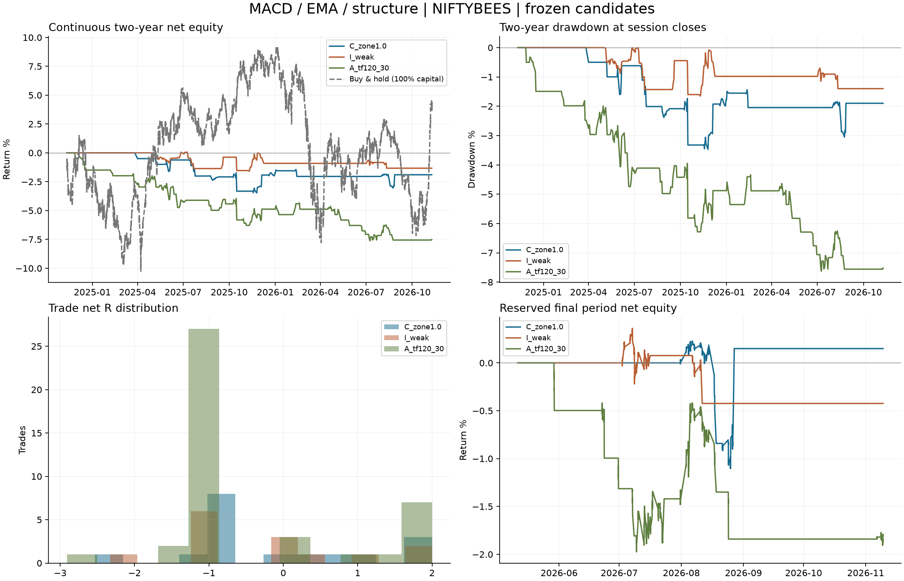
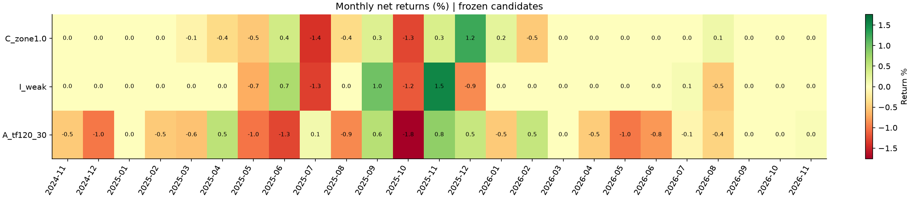
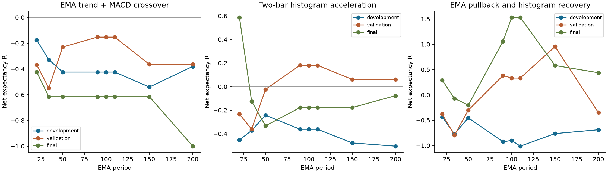
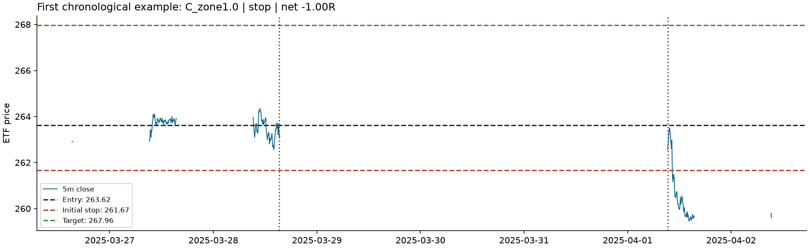

# Two-year systematic swing strategy research

**No strategy tested has sufficient evidence of a durable positive edge.**

Research as of 10 November 2026, Asia/Kolkata. Requested interval 10 November 2024–9 November 2026 inclusive; first actual regular session 11 November 2024. Tested 207 predeclared configurations on 3 instruments. 0 family finalists met the minimum positive development/validation screen. The final period is reserved for this run but was already examined by earlier research in this workspace; there is no genuinely untouched historical holdout.

This is an executed research experiment. Positive backtests below are observations, not a deployment recommendation. Complete losing configurations and exact trade ledgers are included.

The three frozen diagnostic configurations all lost money over the continuous two-year primary ETF replay after the declared costs. The original baseline generated no executable trades; walk-forward selection stayed in cash twice and selected a rule that produced no forward trades in the third fold. This supplies no usable forward-trading evidence.

|Frozen diagnostic|Two-year trades|Net R/trade|Two-year return%|PF|MTM DD%|
|---|---|---|---|---|---|
|C_zone1.0|17.00|-0.23|-1.90|0.67|3.51|
|I_weak|14.00|-0.20|-1.33|0.68|1.94|
|A_tf120_30|42.00|-0.39|-7.52|0.51|7.68|

## Data and instruments

Upstox 5-minute OHLCV; regular-session indicators use 09:15–15:30 IST. Each instrument has 493 complete sessions/36,975 regular 5-minute bars in the requested window and separate 2023-onward warmup. NIFTY is a nontradable index with hypothetical long/short P&L. NIFTYBEES and BANKBEES are actual cash ETFs tested independently long-only, with integer units and no leverage. These related equity markets do not provide independent asset-class replication.

No invalid OHLC or conflicting overlapping prices were detected. Identical overlapping cache rows were deduplicated. Short/special sessions are omitted from indicator calculations, but their valid raw candles replay next-tradable entries and protective orders so overnight risk is not skipped. Ordinary stray out-of-session records are excluded. Whole-day calendar coverage was compared with retained same-provider daily observations, not independently certified against every official exchange holiday.

Raw provider adjustment status is not certified. Corporate-action endpoint responses for the ETF ISINs were empty; that does not prove no action occurred. No dividends or capital-gains income taxes are modeled. These are price-return studies, not certified total returns. No futures rollover/margin simulation or option-premium reconstruction was attempted.

Data provenance: [manifest](data-manifest.json), [supplemental audit](supplemental-audit.json). [Upstox candle documentation](https://upstox.com/developer/api-documentation/v3/get-historical-candle-data/) specifies candle-start timestamps and request limits.

## Execution and accounting

A 09:15–13:15 four-hour candle becomes available at 13:15. Its completed 13:15–15:30 tail is a separate 135-minute candle under the default policy. Two-hour candles have a completed 15-minute final tail. Full-only and close-anchored variants quantify this boundary choice. Higher-timeframe observations merge backward at their actual availability time; strict pivots wait for all right-hand candles. Warmup prices never generate evaluated trades.

Signals fill at the next observed 5-minute open at or after availability, including a subsequent special session. Segment boundaries start flat and liquidate at the final observed close, preventing cross-split trade leakage. Gap stops fill at the adverse open; if both barriers are touched in the same 5-minute bar, stop wins. Resting targets receive no favorable gap improvement. Initial risk is 0.5% of current equity including estimated stopped-exit fees; notional plus entry fees cannot exceed cash. One position per independently tested instrument/configuration; no combined three-instrument portfolio is implied.

ETF costs: ₹20 brokerage per order; buy stamp duty 0.015%; ETF STT 0 on purchases/0.001% on delivery sales; date-dependent NSE transaction charges 0.00297% before 1 March 2026 and 0.00307% thereafter; SEBI fee 0.0001%; applicable IPFT and 18% GST; conservative ₹20+GST overnight DP sales. Slippage 2 basis points per side. Costs use fractional estimates without statutory rounding. Same-day trades conservatively retain the declared delivery fee model. No historical quotes/order-book depth are available, so spread/market impact remain modeled rather than observed. [Broker schedule](https://upstox.com/brokerage-charges/), [NSE STT circular](https://nsearchives.nseindia.com/content/circulars/FATAX73524.pdf).

NIFTY costs are an illustrative 5 basis points per side plus 2 basis-point slippage, not actual derivative fees. Fixed targets solve the net cash reward after estimated fees from the actual slipped entry. Conservative overnight exit-fee estimates can make same-day target net R slightly larger. Partial exits take half the integer quantity at 1 gross price-risk R, with the rest at configured R; original stop remains. ATR/EMA trails replace fixed targets. Time-only exit retains the stop; MACD and structural-target exits retain their special target/exit condition. All modes have a 10 observed-session maximum unless configuration states otherwise.

Drawdown is five-minute-close marked equity; unobserved intrabar equity extremes can be worse. Sharpe/Sortino use session-close returns, zero risk-free rate, 252 annualization. Holding hours include nights/weekends; exposure is observed market-bar time, not elapsed wall-clock exposure. NetR divides net P&L by initial planned cash risk, which gaps may exceed.

## Frozen selection and reserved final results

Development: 10 November 2024–9 November 2025. Validation: 10 November 2025–9 May 2026. Final: 10 May–9 November 2026. Each split starts with ₹1,000,000. Candidate choice requires at least 12 development/6 validation trades and positive expectancy in both; within each family choose highest validation expectancy. If no candidate qualifies, retain the most-traded validation candidate as an explicitly rejected diagnostic. Family choices and top 3 were saved before the final batch. All 207 variant final rows are then disclosed once, without changing choices.

The table follows frozen validation selection order, not highest final profit. A positive final estimate with few trades is not sufficient. Max-t control jointly resamples 10-session centered validation returns across all configurations, preserving their dependence; it is an approximate search-wide diagnostic. Final block intervals are conditional on the frozen choice and do not erase historical reuse.

|Frozen family finalist|Final trades|Final netR/trade|Final return%|PF|MTM DD%|Validation adjusted p|
|---|---|---|---|---|---|---|
|C_zone1.0|4.00|0.08|0.15|1.15|1.33|0.94|
|I_weak|2.00|-0.42|-0.42|0.15|0.78|0.99|
|A_tf120_30|10.00|-0.41|-1.80|0.44|1.97|0.99|
|F_tf120_30|6.00|-0.32|-0.96|0.52|1.08|1.00|
|E_tf120_30|6.00|0.36|1.20|1.90|1.11|1.00|
|B_exit_macd|11.00|-0.09|-0.69|0.72|2.16|1.00|
|G_early_base|1.00|-1.00|-0.50|0.00|0.77|1.00|
|H_ema34|3.00|-0.33|-0.50|0.20|0.83|1.00|
|structure_only_base|7.00|-0.01|-0.05|0.97|2.33|1.00|
|G_ema20|2.00|-0.42|-0.42|0.15|0.78|1.00|
|ema_only_base|5.00|0.20|0.49|1.33|1.38|1.00|
|D_ema20|4.00|0.05|0.10|1.91|0.69|1.00|
|macd_only_base|13.00|0.35|2.25|1.63|2.30|1.00|
|J_ema34|2.00|0.29|0.29|—|0.63|1.00|
|zero_cross_base|2.00|-0.20|-0.20|0.60|0.65|1.00|
|D0_base|3.00|0.15|0.22|2.70|0.65|1.00|
|baseline_base|0.00|—|0.00|—|0.00|1.00|

[Full leaderboard](leaderboard.csv); [all split metrics](all-period-metrics.csv); [exact configurations](protocol.json); [frozen choices](frozen-selection.json).

Complete continuous two-year grid (descriptive only; positive rows are not new candidate selections):

|Instrument|Configurations|At least 1 trade|Positive net return|Largest trade count|
|---|---|---|---|---|
|BANKBEES|207.00|196.00|55.00|54.00|
|NIFTY|207.00|199.00|54.00|81.00|
|NIFTYBEES|207.00|192.00|23.00|60.00|

[Continuous all-variant metrics](continuous-all-variants.csv), [all 10,897 trade records](all-variant-trades.csv), [all year/regime/side/exit breakdowns](all-variant-subgroups.csv), [all monthly returns](monthly-all-variants.csv), [extension verification](extension-summary.json). Identical realized outcomes occur across some parameter variants, including flat rules; the 207 configurations are not 207 independent pieces of evidence.

## Original baseline

|part|n_trades|expectancy_r|total_return_pct|profit_factor|max_drawdown_pct|
|---|---|---|---|---|---|
|development|0.00|—|0.00|—|0.00|
|validation|0.00|—|0.00|—|0.00|
|final|0.00|—|0.00|—|0.00|

A restrictive baseline may generate too few trades to support inference. Relaxing its structural/zone requirements is a different tested hypothesis, not evidence that the original conjunction works.

## Top three research candidates

These are the top frozen development/validation candidates, including rejected diagnostics if necessary. They are suitable for inspecting the evidence; none is certified for live deployment.

### 1. `C_zone1.0` — Confirmed-pivot support/resistance rejection

HTF=240 minutes; LTF=120 minutes; session policy=partial. MACD=[12, 26, 9].

EMA=100; slope=(EMA[t]−EMA[t−5])/(5*ATR 14[t]). Zone tolerance=1.0*HTF_ATR; stop buffer=0.2*HTF_ATR.

Long trend: last completed HTF close>EMA and normalized slope>0.

LTF low<=confirmed HTF pivot low+zone*ATR, close>=pivot low, green body, lower wick>=0.5*body, histogram rising; enter only on a false-to-true event.

Stop: last confirmed HTF pivot low−0.2*HTF_ATR.

A strict pivot has 2 lower highs/higher lows on both sides and is released only after all right-hand candles close. Stop distance must be 0.5–5 HTF_ATR at decision and executable next open.

Exit=fixed; target reward=2.0 R. Fixed target is solved from the actual slipped entry and estimated exit fees so target net profit equals reward*initial_cash_risk. All variants retain the protective stop and maximum 10 observed-session hold.

Risk<=0.5% of current marked flat equity, including estimated entry/stopped-exit fees; integer quantity and notional+entry fees<=cash; one position; no leverage. ETF long-only. NIFTY short rules reverse inequalities and price direction, purely theoretical.

|part|n_trades|expectancy_r|total_return_pct|profit_factor|max_drawdown_pct|
|---|---|---|---|---|---|
|development|9.00|-0.77|-3.32|0.23|3.32|
|validation|4.00|0.66|1.32|3.60|0.64|
|final|4.00|0.08|0.15|1.15|1.33|

Reserved final 95% session-block interval: [-0.5618535430693472, 1.999999999999996]net R/trade.

Cross-instrument reserved final evidence:

|instrument|n_trades|expectancy_r|total_return_pct|profit_factor|max_drawdown_pct|
|---|---|---|---|---|---|
|NIFTY|8.00|-0.25|-1.01|0.66|2.57|
|NIFTYBEES|4.00|0.08|0.15|1.15|1.33|
|BANKBEES|4.00|-0.42|-0.85|0.43|1.50|

Cost/slippage stress:

|stress|n_trades|expectancy_r|total_return_pct|profit_factor|max_drawdown_pct|
|---|---|---|---|---|---|
|double_fees|4.00|0.07|0.13|1.13|1.33|
|severe|5.00|-1.00|-2.47|0.00|2.47|

Observed entry-regime performance over the continuous two-year replay:

|group|n_trades|expectancy_r|net_profit|
|---|---|---|---|
|range|3.00|0.59|8511.79|
|weak_bull|14.00|-0.41|-27497.52|

Executable reconstruction (full parameters are in protocol.json):

```python
from research.swing.signals import make_signals
from research.swing.engine import simulate
config = {'htf': 240, 'ltf': 120, 'ema': 100, 'slope': 5, 'slope_filter': True, 'slope_threshold': 0, 'macd': [12, 26, 9], 'pivot': 2, 'zone': 1.0, 'buffer': 0.2, 'reward': 2.0, 'exit': 'fixed', 'stop_mode': 'swing', 'policy': 'partial', 'max_hold_sessions': 10, 'risk_fraction': 0.005, 'initial_capital': 1000000, 'structure_filter': False, 'id': 'C_zone1.0', 'family': 'C'}
signals = make_signals(regular_bars, config)
result = simulate(execution_bars, signals, {**config, 'cost_model': 'etf_delivery'},
                  '2024-11-10', '2026-11-10', allow_short=False)
```

### 2. `I_weak` — Trend-strength-filtered crossover

HTF=240 minutes; LTF=120 minutes; session policy=partial. MACD=[12, 26, 9].

EMA=100; slope=(EMA[t]−EMA[t−5])/(5*ATR 14[t]). Zone tolerance=0.5*HTF_ATR; stop buffer=0.2*HTF_ATR.

Long trend: last completed HTF close>EMA and normalized slope>0.

LTF bullish histogram crossover and abs(normalized HTF slope)>=0.10 (weak variant:>=0.02 and<0.10).

Stop: last confirmed HTF pivot low−0.2*HTF_ATR.

A strict pivot has 2 lower highs/higher lows on both sides and is released only after all right-hand candles close. Stop distance must be 0.5–5 HTF_ATR at decision and executable next open.

Exit=fixed; target reward=2.0 R. Fixed target is solved from the actual slipped entry and estimated exit fees so target net profit equals reward*initial_cash_risk. All variants retain the protective stop and maximum 10 observed-session hold.

Risk<=0.5% of current marked flat equity, including estimated entry/stopped-exit fees; integer quantity and notional+entry fees<=cash; one position; no leverage. ETF long-only. NIFTY short rules reverse inequalities and price direction, purely theoretical.

|part|n_trades|expectancy_r|total_return_pct|profit_factor|max_drawdown_pct|
|---|---|---|---|---|---|
|development|9.00|-0.36|-1.53|0.51|1.71|
|validation|3.00|0.42|0.63|2.25|1.06|
|final|2.00|-0.42|-0.42|0.15|0.78|

Reserved final 95% session-block interval: [-1.0, 0.15286031681630302]net R/trade.

Cross-instrument reserved final evidence:

|instrument|n_trades|expectancy_r|total_return_pct|profit_factor|max_drawdown_pct|
|---|---|---|---|---|---|
|NIFTY|4.00|0.17|0.30|1.28|1.25|
|NIFTYBEES|2.00|-0.42|-0.42|0.15|0.78|
|BANKBEES|3.00|-0.96|-1.43|0.00|1.47|

Cost/slippage stress:

|stress|n_trades|expectancy_r|total_return_pct|profit_factor|max_drawdown_pct|
|---|---|---|---|---|---|
|double_fees|2.00|-0.44|-0.44|0.12|0.78|
|severe|2.00|-0.45|-0.45|0.10|0.78|

Observed entry-regime performance over the continuous two-year replay:

|group|n_trades|expectancy_r|net_profit|
|---|---|---|---|
|weak_bull|14.00|-0.20|-13314.69|

Executable reconstruction (full parameters are in protocol.json):

```python
from research.swing.signals import make_signals
from research.swing.engine import simulate
config = {'htf': 240, 'ltf': 120, 'ema': 100, 'slope': 5, 'slope_filter': True, 'slope_threshold': 0, 'macd': [12, 26, 9], 'pivot': 2, 'zone': 0.5, 'buffer': 0.2, 'reward': 2.0, 'exit': 'fixed', 'stop_mode': 'swing', 'policy': 'partial', 'max_hold_sessions': 10, 'risk_fraction': 0.005, 'initial_capital': 1000000, 'structure_filter': False, 'id': 'I_weak', 'family': 'I', 'regime_filter': 'weak'}
signals = make_signals(regular_bars, config)
result = simulate(execution_bars, signals, {**config, 'cost_model': 'etf_delivery'},
                  '2024-11-10', '2026-11-10', allow_short=False)
```

### 3. `A_tf120_30` — EMA trend + MACD crossover

HTF=120 minutes; LTF=30 minutes; session policy=partial. MACD=[12, 26, 9].

EMA=100; slope=(EMA[t]−EMA[t−5])/(5*ATR 14[t]). Zone tolerance=0.5*HTF_ATR; stop buffer=0.2*HTF_ATR.

Long trend: last completed HTF close>EMA and normalized slope>0.

LTF MACD histogram crosses from<=0 to>0.

Stop: last confirmed HTF pivot low−0.2*HTF_ATR.

A strict pivot has 2 lower highs/higher lows on both sides and is released only after all right-hand candles close. Stop distance must be 0.5–5 HTF_ATR at decision and executable next open.

Exit=fixed; target reward=2.0 R. Fixed target is solved from the actual slipped entry and estimated exit fees so target net profit equals reward*initial_cash_risk. All variants retain the protective stop and maximum 10 observed-session hold.

Risk<=0.5% of current marked flat equity, including estimated entry/stopped-exit fees; integer quantity and notional+entry fees<=cash; one position; no leverage. ETF long-only. NIFTY short rules reverse inequalities and price direction, purely theoretical.

|part|n_trades|expectancy_r|total_return_pct|profit_factor|max_drawdown_pct|
|---|---|---|---|---|---|
|development|23.00|-0.58|-6.28|0.36|6.28|
|validation|9.00|0.27|1.21|1.60|1.47|
|final|10.00|-0.41|-1.80|0.44|1.97|

Reserved final 95% session-block interval: [-0.997284760262819, 0.46984008946840117]net R/trade.

Cross-instrument reserved final evidence:

|instrument|n_trades|expectancy_r|total_return_pct|profit_factor|max_drawdown_pct|
|---|---|---|---|---|---|
|NIFTY|18.00|-0.43|-3.36|0.46|4.79|
|NIFTYBEES|10.00|-0.41|-1.80|0.44|1.97|
|BANKBEES|7.00|0.03|0.09|1.05|2.15|

Cost/slippage stress:

|stress|n_trades|expectancy_r|total_return_pct|profit_factor|max_drawdown_pct|
|---|---|---|---|---|---|
|double_fees|10.00|-0.42|-1.89|0.42|2.00|
|severe|10.00|-0.43|-2.05|0.39|2.14|

Observed entry-regime performance over the continuous two-year replay:

|group|n_trades|expectancy_r|net_profit|
|---|---|---|---|
|range|16.00|-0.28|-20310.94|
|strong_bull|3.00|-0.64|-9156.89|
|weak_bull|23.00|-0.44|-45722.86|

Executable reconstruction (full parameters are in protocol.json):

```python
from research.swing.signals import make_signals
from research.swing.engine import simulate
config = {'htf': 120, 'ltf': 30, 'ema': 100, 'slope': 5, 'slope_filter': True, 'slope_threshold': 0, 'macd': [12, 26, 9], 'pivot': 2, 'zone': 0.5, 'buffer': 0.2, 'reward': 2.0, 'exit': 'fixed', 'stop_mode': 'swing', 'policy': 'partial', 'max_hold_sessions': 10, 'risk_fraction': 0.005, 'initial_capital': 1000000, 'structure_filter': False, 'id': 'A_tf120_30', 'family': 'A'}
signals = make_signals(regular_bars, config)
result = simulate(execution_bars, signals, {**config, 'cost_model': 'etf_delivery'},
                  '2024-11-10', '2026-11-10', allow_short=False)
```

## Walk-forward optimization

Three rolling 9-month training windows choose the highest positive training expectancy among configurations with at least 12 trades; the following 3 months are replayed without reselection. All folds end before the reserved final interval. Training uses the same fixed catalog. Split portfolios reset to ₹1,000,000; returns can be compounded descriptively but do not reflect a traded continuous portfolio.

|test_start|test_end|id|n_trades|total_return_pct|
|---|---|---|---|---|
|2025-08-10|2025-11-10|cash_no_eligible_training_strategy|0.00|0.00|
|2025-11-10|2026-02-10|cash_no_eligible_training_strategy|0.00|0.00|
|2026-02-10|2026-05-10|A_exit_macd|0.00|0.00|

## What changes helped or failed

Controlled one-component comparisons below use the same engine and costs. Validation/final differences that reverse direction show instability; they are not retained as improvements after observing the final period. Filter comparisons change the admitted trade sample, so mean differences are descriptive rather than matched-trade causal estimates.

|Hypothesis|Treatment n|Control n|TreatmentR|ControlR|DifferenceR|
|---|---|---|---|---|---|
|Slope adds value|6.00|8.00|-0.15|-0.36|0.21|
|Histogram vs crossover|6.00|6.00|0.18|-0.15|0.33|
|HTF momentum alignment|2.00|6.00|-0.36|-0.15|-0.21|
|Zero-line filter|2.00|6.00|-0.36|-0.15|-0.21|
|Earlier zero-side crossover|4.00|2.00|-0.05|-0.36|0.32|
|Retest vs breakout close|1.00|1.00|-1.10|-1.10|0.00|
|ATR vs swing stop|6.00|6.00|-0.36|-0.15|-0.20|
|Structure filter|3.00|6.00|-0.62|-0.15|-0.47|
|Trailing vs fixed exit|7.00|6.00|-0.56|-0.15|-0.41|
|Longer candle tail excluded|5.00|6.00|-0.26|-0.15|-0.11|
|Candle end anchored|6.00|6.00|-0.33|-0.15|-0.17|
|Nearby resistance room|0.00|6.00|—|-0.15|—|

[All controlled differences including final](controlled-comparisons.csv), [EMA sensitivity](ema-sensitivity.csv), [year/regime/exit subgroups](candidate-subgroups.csv), [winner concentration](candidate-concentration.csv).

The slope filter improved validation expectancy by 0.21 R relative to the matched no-slope specification, then worsened final expectancy by 0.65 R; that contribution was unstable. Histogram acceleration was less negative than crossover timing in the final segment (−0.18 R versus −0.62 R), with only 9 and 3 trades respectively; being less negative does not establish an edge. Higher-timeframe momentum alignment cut the final crossover sample from 3 trades to 1 and returned −1 R. The support-bounce diagnostic had positive reserved final return of 0.15% on only 4 trades, with 95% expectancy interval −0.56 to 2.00 R; doubling fees plus 5 basis-point slippage changed the complete fill/position path and produced −2.47%.

EMA 90/100/110 neighborhoods did not rescue the development losses of the testedA/B/E specifications. The best diagnostic support-bounce rule lost 0.41 R per weak-bull trade across 14 observations; its apparent range-regime profit came from only 3 trades. Two gap-stop exits averaged−1.88 R and accounted for ₹18,433 of loss before other winners/losses. The weak-trend diagnostic included one−2.33 R gap loss. These are observed failure mechanisms and sparse subgroup descriptions, not regime filters selected after the fact.

|Frozen family diagnostic|Observed failure evidence|
|---|---|
|C_zone1.0|sparse development/validation sample (9/4); negative development expectancy (-0.77R); only4final trades; no search-adjusted validation support|
|I_weak|sparse development/validation sample (9/3); negative development expectancy (-0.36R); negative final expectancy (-0.42R); only2final trades; no search-adjusted validation support|
|A_tf120_30|negative development expectancy (-0.58R); negative final expectancy (-0.41R); only10final trades; no search-adjusted validation support|
|F_tf120_30|sparse development/validation sample (10/4); negative development expectancy (-0.26R); negative final expectancy (-0.32R); only6final trades; no search-adjusted validation support|
|E_tf120_30|sparse development/validation sample (9/8); only6final trades; no search-adjusted validation support|
|B_exit_macd|negative development expectancy (-0.29R); negative final expectancy (-0.09R); only11final trades; no search-adjusted validation support|
|G_early_base|sparse development/validation sample (4/4); negative development expectancy (-0.50R); negative validation expectancy (-0.05R); negative final expectancy (-1.00R); only1final trades; no search-adjusted validation support|
|H_ema34|sparse development/validation sample (8/3); negative development expectancy (-0.19R); negative validation expectancy (-0.18R); negative final expectancy (-0.33R); only3final trades; no search-adjusted validation support|
|structure_only_base|negative validation expectancy (-0.22R); negative final expectancy (-0.01R); only7final trades; no search-adjusted validation support|
|G_ema20|sparse development/validation sample (9/3); negative development expectancy (-0.18R); negative validation expectancy (-0.24R); negative final expectancy (-0.42R); only2final trades; no search-adjusted validation support|
|ema_only_base|sparse development/validation sample (6/3); negative development expectancy (-0.07R); negative validation expectancy (-0.33R); only5final trades; no search-adjusted validation support|
|D_ema20|sparse development/validation sample (8/2); negative development expectancy (-0.33R); negative validation expectancy (-0.53R); only4final trades; no search-adjusted validation support|
|macd_only_base|negative development expectancy (-0.02R); negative validation expectancy (-0.63R); only13final trades; no search-adjusted validation support|
|J_ema34|sparse development/validation sample (9/5); negative development expectancy (-0.49R); negative validation expectancy (-0.76R); only2final trades; no search-adjusted validation support|
|zero_cross_base|sparse development/validation sample (3/5); negative development expectancy (-0.18R); negative validation expectancy (-0.99R); negative final expectancy (-0.20R); only2final trades; no search-adjusted validation support|
|D0_base|sparse development/validation sample (7/1); negative development expectancy (-0.21R); negative validation expectancy (-1.10R); only3final trades; no search-adjusted validation support|
|baseline_base|sparse development/validation sample (0/0); only0final trades; no search-adjusted validation support|

Failure checks: baseline trade scarcity, late confirmation throughFversusA, range whipsaws through regime groups, early-reversal misses through early-zero versus same-side-zero, false breakouts throughD/D 0, stop sensitivity through ATR/buffer/pivot variants, target selectivity through 1–4 Rvariants, and friction through doubled-fee/5 basis-point stress. Uncertainty is evaluated on observed samples; a sparse or inconsistent row is rejected rather than patched with additional indicators. MACD divergence and repeated-zone clustering were not implemented; no claim is made about their value.

## Simpler controls

EMA-only, MACD-only and structure-only timing are included in the grid with ATR stops, so their entry logic is simpler but position sizing/exits remain comparable. Twenty seeded randomized-timing controls use the same reference signal count per segment, causal decision close/ATR, and the same capital/stop/exit model. They match attempted frequency, not exactly realized market exposure; rejected/overlapping trades can differ. These are descriptive controls, not 20 independent proofs. Buy-and-hold below invests nearly 100% of capital, whereas risk-sized swing strategies may use less; returns are therefore not exposure-matched.

|instrument|total_return_pct|max_drawdown_pct|sharpe|
|---|---|---|---|
|NIFTY|3.78|15.69|0.21|
|NIFTYBEES|4.37|15.48|0.24|
|BANKBEES|16.45|18.66|0.59|

## Playbook and research verdict

[Explicit validation gates](validation-gates.csv) show every family diagnostic failing the historical evidence requirements before the separate fresh-data condition is considered. [Independent verification](verification.json) reconciles all 1,863 split-metric rows and 102 selected trade/equity journals; 45 synthetic/data/validation tests also pass. The continuous extension independently reconciles 621 scenarios and 10,897 trades.

**No live trading playbook is justified by this experiment.** The precise candidate specifications above are research rules. A usable next step is to freeze one rule, collect fresh forward quotes and fills, and evaluate a predeclared sufficient sample without further tuning. Required evidence includes a positive lower expectancy bound, search-adjusted validation support, adequate final trade count, cost robustness, and independent forward replication. The existing historical period cannot satisfy the fresh-data condition.

The strongest positive rows, any failures, and uncertainty are all retained; the conclusion is insufficient evidence of durability, not a claim that profitable swing trading is impossible. Futures/option execution, real spread/impact, independently certified corporate actions, and additional independent markets remain outside this evidence.

## Figures









## Reproduce

```powershell
.\.venv\Scripts\python.exe -m unittest discover -s tests -p "test_swing*.py"
.\.venv\Scripts\python.exe -m unittest research.swing.test_data
.\.venv\Scripts\python.exe scripts\run_swing_research.py --offline
.\.venv\Scripts\python.exe scripts\verify_swing_research.py
```

All acquisition is read-only. No broker orders are submitted. Source modules: data.py, signals.py, engine.py, validation.py, reporting.py. Protocol, source hashes, seeds, raw-response fingerprints, complete metrics and selected trade/equity journals are persisted under artifacts/swing_research/.
